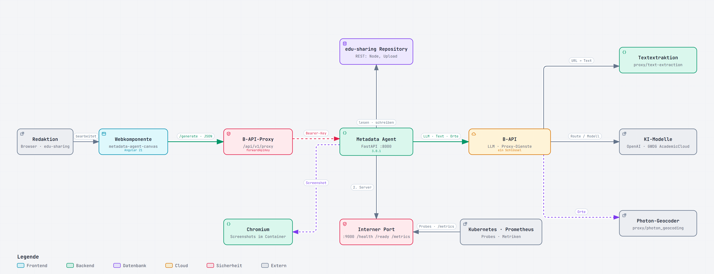

# Metadata Agent API

[English](README.md) · **Deutsch**

Die Metadata Agent API erschließt Bildungsinhalte mit einem Sprachmodell
(LLM). Aus einem Text, einer Webseite oder einem Repository-Node erzeugt sie
strukturierte Metadaten nach dem [WLO/OEH-Schema](https://wirlernenonline.de)
und kann das Ergebnis in ein WLO-edu-sharing-Repository schreiben. Der Dienst
ist eine FastAPI-Anwendung für Python 3.13 (Version 4.0.1). Er liefert auch
die Webkomponente `<metadata-agent-canvas>` aus, die die Metadaten anzeigt und
bearbeitbar macht.

## Inhalt

- [Was der Dienst tut](#was-der-dienst-tut)
- [Schnellstart](#schnellstart)
- [LLM-Provider wählen](#llm-provider-wählen)
- [Architektur](#architektur)
- [Endpunkte](#endpunkte)
- [Konfiguration](#konfiguration)
- [Webkomponente](#webkomponente)
- [Deployment](#deployment)
- [Dokumente](#dokumente)
- [Lizenz](#lizenz)

## Was der Dienst tut

```
Text / URL / Node-ID
        │
        ▼
   /generate ──────► Metadaten als flaches JSON (Umschlag und Felder auf einer Ebene)
        │
        ├──► /validate          Pflichtfelder und Wertebereiche prüfen
        ├──► /export/markdown   menschenlesbare Fassung
        └──► /upload ─────────► Node im WLO-Repository
                                  ├─ Metadaten (gefiltert auf Repository-Felder)
                                  ├─ Extended Data (Inhaltstyp, LRT, Voll-JSON)
                                  ├─ Sammlungen (optional, collection_id)
                                  └─ Prüf-Workflow (200_tocheck)
```

- **Eingabe:** ein Text, eine URL (abgerufen über eine Textextraktion), ein
  Repository-Node (`node_id`) oder ein Node mit dem Crawler als Rückfall
  (`node_url`).
- **Erschließung:** Der Agent erkennt den Inhaltstyp (zum Beispiel
  `event.json`), erschließt die Felder in parallelen LLM-Aufrufen,
  normalisiert Datumsangaben, Wahrheitswerte und Vokabularwerte und geocodiert
  Adressen. Die Schemata liegen in zwei Kontexten vor, `default` und `mds_oeh`
  (Versionen 1.8.0, 1.8.1 und 2.0.0).
- **Repository:** Node anlegen, Metadaten schreiben, den Node in Sammlungen
  aufnehmen, den Prüf-Workflow setzen, den Node zurücklesen und vergleichen.
- **Screenshots:** immer lokal mit Chromium (Playwright) aufgenommen. Ein
  externer Screenshot-Dienst wird nicht aufgerufen.
- **Zugriffsschutz:** Der Dienst prüft selbst keine Zugangsdaten. Er gehört
  hinter einen Proxy, der den Zugriff beschränkt. In edu-sharing ist das der
  B-API-Proxy.

Gut zu wissen vor dem ersten Lauf:

1. **Der Durchsatz hängt am Provider.** Der Standard `b-api-openai` erlaubt
   20 gleichzeitige LLM-Aufrufe, `b-api-academiccloud` 2 gleichzeitig und 2
   pro Sekunde. Siehe [LLM-Provider wählen](#llm-provider-wählen).
2. **Ein Lauf kann Minuten dauern.** Mit dem Standardmodell dauerte die
   Erschließung einer Webseite 12–22 s (gemessen am 16.10.2026); ein Text mit
   4.400 Zeichen dauert etwa 5 s (gemessen am 15.11.2026). Das Zeitlimit für
   `/generate` liegt bei 300 s. Ein Proxy vor dem Dienst braucht ein Timeout
   von etwa 310 s oder mehr.
3. **Ein Fehlschlag ist nie ein `200`.** Kommt kein einziges Feld zustande,
   antwortet `/generate` mit `502` (`503`, wenn das Gateway drosselt) und einem
   Fehlercode. Teilergebnisse kommen als `200` mit
   `processing.status: "partial"`.
4. **Das Repository verwirft unbekannte Properties stillschweigend.**
   [WLO-REPO-FELDER.md](WLO-REPO-FELDER.md) nennt die Felder, die geschrieben
   werden, und die, die verworfen werden.

## Schnellstart

Nötig sind ein **B-API-Schlüssel** (Standard-Provider) oder ein
**OpenAI-API-Schlüssel**, dazu entweder Docker mit Compose 2.24 oder neuer
oder Python 3.13 mit [uv](https://docs.astral.sh/uv/). Einzelheiten und
Fehlersuche: [INSTALL.de.md](INSTALL.de.md).

### Docker

```bash
cp .env.template .env       # danach B_API_KEY eintragen
docker compose up -d
```

Die Compose-Datei baut das Image, veröffentlicht Port 8000 nur auf
`127.0.0.1`, startet den Container schreibgeschützt und setzt
`stop_grace_period: 320s`, damit ein laufendes `/generate` bei einem Neustart
nicht abbricht. Dasselbe ohne Compose:

```bash
docker build -t metadata-agent-api .
docker run -d -p 127.0.0.1:8000:8000 --read-only --tmpfs /tmp --tmpfs /home/appuser \
  --stop-timeout 320 --env-file .env metadata-agent-api
```

### Lokal mit uv

```bash
uv sync                                 # Abhängigkeiten und Entwicklungswerkzeuge
uv run playwright install chromium      # nur für Screenshots nötig
cp .env.template .env                   # danach B_API_KEY eintragen
uv run uvicorn src.main:app --reload --port 8000
```

### Prüfen, ob der Dienst läuft

```bash
curl http://localhost:8000/health
# → {"status":"healthy","version":"4.0.1"}

curl -X POST http://localhost:8000/generate \
  -H "Content-Type: application/json" \
  -d '{"text": "Workshop KI in der Bildung am 15. März 2026 in Berlin"}'
```

Die interaktive API-Dokumentation (Swagger UI) steht unter
`http://localhost:8000/docs`. Der Agent liefert sie selbst aus; nichts wird
von einem CDN geladen. Ohne `WLO_GUEST_USERNAME` und `WLO_GUEST_PASSWORD`
erschließt der Dienst weiterhin, aber `/ready` und die Repository-Endpunkte
(`/upload`, `/nodes`, `/node`, `/workflow`, `/upload/verify`) antworten mit
`503`.

### Tests, Lint, Typen

```bash
uv run pytest -q -rs --cov              # Suite mit der Coverage-Untergrenze aus pyproject.toml
uv run ruff check && uv run ruff format --check
uv run mypy                             # ganz src/
```

Die Suite läuft offline und liest keine `.env`. Mit `REQUIRE_BROWSER=1` und
`REQUIRE_HELM=1` schlagen Tests fehl, statt sich zu überspringen, wenn
Chromium, das Widget-Bundle oder `helm` fehlt. `RUN_NETWORK_TESTS=1` führt
zusätzlich die mit `slow` markierten Tests gegen echte Dienste aus. Startet
Chromium unter Windows nicht (`EPERM … playwright-artifacts`), `TEMP` und
`TMP` in PowerShell auf ein Verzeichnis im Arbeitsbereich setzen.

## LLM-Provider wählen

`METADATA_AGENT_LLM_PROVIDER` legt fest, wie der Agent das Modell erreicht.
Drei Provider gehen über die B-API, einer spricht direkt mit einem
OpenAI-kompatiblen Endpunkt. `<B-API>` steht für
`METADATA_AGENT_B_API_BASE_URL`.

| Provider | Endpunkt | Standardmodell | Schlüssel | gleichzeitig | pro Sekunde |
|---|---|---|---|---:|---:|
| `b-api-openai` (Standard) | `<B-API>/api/v1/llm/openai` | `gpt-6-luna` | B-API-Schlüssel | 20 | keine Grenze |
| `b-api-academiccloud` | `<B-API>/api/v1/llm/academiccloud` | `deepseek-v4-flash` | B-API-Schlüssel | 2 | 2 |
| `b-api-router` | `<B-API>/api/v1/llm/router` | `openai/gpt-6-luna` | B-API-Schlüssel | 20 | keine Grenze |
| `openai` | `METADATA_AGENT_OPENAI_API_BASE`: jeder OpenAI-kompatible Endpunkt, der ein Bearer-Token annimmt (Standard `https://api.openai.com/v1`) | `gpt-4o-mini` | `OPENAI_API_KEY` | 20 | keine Grenze |

Die beiden letzten Spalten sind die voreingestellten Durchsatzgrenzen. Der
Agent hält sie für den ganzen Prozess ein, nicht je Anfrage, und deckelt
`METADATA_AGENT_DEFAULT_MAX_WORKERS` (Standard 20) darauf. Das Startlog nennt
die geltenden Grenzen.

- **Grenzen.** `METADATA_AGENT_LLM_MAX_CONCURRENT_REQUESTS` und
  `METADATA_AGENT_LLM_MAX_REQUESTS_PER_SECOND` (`0` = keine Ratengrenze)
  überschreiben die Standardwerte. Ein gesetzter Wert gilt für jeden Provider.
- **AcademicCloud.** Das Gateway weist einen dritten parallelen Request mit
  `429` und ohne `retry-after` ab. Der B-API-Schlüssel hat außerdem ein
  Kontingent von etwa 10 Aufrufen pro Minute (gemessen am 15.10.2026); eine
  Erschließung macht etwa 50 Aufrufe. Beide Grenzen gelten für den Schlüssel,
  der Agent drosselt aber je Prozess. Mehrere Instanzen müssen sie sich teilen
  (Helm-Chart: `sharedLlmLimit`).
- **Router.** Routen werden in der B-API angelegt, nicht in der Umgebung.
  `METADATA_AGENT_B_API_ROUTER_MODEL` nennt eine Route oder `provider/modell`;
  Letzteres geht ohne Route. Eine Route darf nur Modelle einer
  Parameterfamilie enthalten. Bei einem Routennamen
  `METADATA_AGENT_LLM_REQUEST_STYLE` auf `reasoning` (GPT-5, GPT-6, o-Modelle)
  oder `classic` (alle anderen) setzen; mit `auto` wird für einen Routennamen
  `classic` gesendet.
- **Je Anfrage.** `llm_provider` und `llm_model` im Body von `/generate`,
  `/detect-content-type` und `/extract-field` überschreiben die Konfiguration
  für diesen einen Aufruf. Die Durchsatzgrenzen gelten trotzdem.
  `METADATA_AGENT_ALLOWED_LLM_MODELS` begrenzt die Modelle, die eine Anfrage
  nennen darf (sonst `422`).

### Welcher Schlüssel die LLM-Aufrufe trägt

Für die drei B-API-Provider entscheidet `METADATA_AGENT_B_API_AUTH_MODE`,
welchen Schlüssel der Agent an die B-API schickt. Mit `openai` nutzt der Agent
immer `OPENAI_API_KEY`.

| Modus | Anfrage kommt mit `Authorization: Bearer …` | Anfrage kommt ohne |
|---|---|---|
| `auto` (Standard) | Der Header wird unverändert weitergereicht | `B_API_KEY` |
| `forward` | Der Header wird unverändert weitergereicht | `502` mit `LLM_AUTH_MISSING` |
| `static` | Der Header wird ignoriert | `B_API_KEY` |

Ein weitergereichter Schlüssel gilt nur für diese eine Anfrage. Er wird weder
gespeichert noch geloggt. `processing.auth_source` in der Antwort nennt die
Herkunft (`forwarded` oder `static`).

### Hinter dem B-API-Proxy oder eigenständig

| | Hinter dem B-API-Proxy | Eigenständig |
|---|---|---|
| Aufrufer | edu-sharing und die Webkomponente, über den B-API-Proxy-Eintrag `metadata-agent-canvas` (`/api/v1/proxy/metadata-agent-canvas/…`) | Jeder Client, der Port 8000 erreicht |
| Schlüssel der LLM-Aufrufe | Der Schlüssel des Aufrufers (Nutzer- oder Gast-Schlüssel). Der Proxy reicht ihn weiter, wenn am Eintrag `forwardApiKey` gesetzt ist, und die B-API bucht Nutzung und Limits auf ihn | `B_API_KEY`, oder `OPENAI_API_KEY` mit dem Provider `openai` |
| Auth-Modus | `auto`, oder `forward`, um nur mit weitergereichten Schlüsseln zu arbeiten (kein `B_API_KEY` nötig) | `auto` oder `static` |
| Zugriff | Der Dienst darf nur über die B-API erreichbar sein. Die NetworkPolicy des Helm-Charts setzt das durch | Eine Zugriffsbeschränkung davorsetzen. Im Modus `auto` löst jeder, der den Port erreicht, Erschließungen auf `B_API_KEY` aus |

### Textextraktion und Geocoder

Die Textextraktion (für URL-Eingaben) und den Geocoder gibt es einmal je
Umgebung. `METADATA_AGENT_B_API_SERVICES` legt fest, wie der Agent sie
erreicht:

| Wert | Textextraktion | Geocoder |
|---|---|---|
| `auto` (Standard) | Wie `proxy`, wenn der Provider ein B-API-Provider ist und seine LLM-Aufrufe an `METADATA_AGENT_B_API_BASE_URL` gehen, sonst wie `direct` | Dieselbe Regel |
| `proxy` | `<B-API>/api/v1/proxy/text-extraction` | `<B-API>/api/v1/proxy/photon_geocoding/api` |
| `direct` | Die OpenEduHub-Textextraktion, die zur Repository-Adresse passt (Staging oder Produktion) | `https://photon.komoot.io/api` |

- Aufrufe über die B-API tragen denselben Schlüssel wie die LLM-Aufrufe. Jeder
  verwendete Schlüssel braucht neben den LLM-Endpunkten die Rechte für die
  Proxy-Dienste `text-extraction` und `photon_geocoding`. Direkte Aufrufe
  tragen keinen Schlüssel.
- Fehlt das Recht, endet das Erschließen aus einer URL mit `502`
  `TEXT_EXTRACTION_AUTH_REFUSED`. Orte bleiben ohne Koordinaten, und
  `processing.warnings` nennt den Grund.
- `METADATA_AGENT_TEXT_EXTRACTION_API_URL` nennt eine eigene Textextraktion
  und überschreibt die Wahl. Sie ist zu setzen, wenn `direct` gilt und das
  Repository kein OpenEduHub-Host ist; sonst antwortet das Erschließen aus
  einer URL mit `503` `TEXT_EXTRACTION_NOT_CONFIGURED`.

Alle Variablen, Routing-Beispiele und Fehlercodes:
[ENV-PARAMETER.de.md](ENV-PARAMETER.de.md). Eine Kurzanleitung zu Routing und
Authentifizierung: [docs/b-api-kurzinfo.md](docs/b-api-kurzinfo.md).

## Architektur



Die Map zeigt den Betrieb über die B-API. Die Fassung mit direkten Aufrufen,
die Diagramme zum Anfrageablauf und die interaktiven Ansichten beschreibt
[docs/architektur/README.md](docs/architektur/README.md).

Im Agenten durchläuft eine Anfrage vier Stufen: die Eingangsquelle (Text, URL,
Node), die parallelen LLM-Feldaufrufe innerhalb des Durchsatzbudgets, die
Normalisierung (Feldtypen, Vokabulare, Geocoding, Ausgabestruktur) und die
Antwort. Die Module, mit Pfaden relativ zu `src/`:

| Modul | Aufgabe |
|---|---|
| `main.py` | Baut die App auf: Middleware, Lifespan, Router in fester Reihenfolge, statische Dateien |
| `config.py` | Einstellungen aus der Umgebung, Provider-Grenzen, Warnungen beim Start |
| `infra.py`, `metrics.py` | `/health`, `/ready`, der interne Port; Prometheus-Metriken |
| `api/routers/` | Ein Router je Bereich: `generate`, `extract`, `detect`, `validation`, `upload`, `save_node`, `nodes`, `verify`, `screenshot`, `schemata`, `widget`, `operations`, `docs`; `generate_docs.py` enthält Beschreibung und Request-Beispiele von `/generate` für `/docs` |
| `api/deps.py`, `api/input_resolver.py`, `api/request_body.py`, `api/generate_request.py`, `api/schema_resolution.py` | Gemeinsame Abhängigkeiten der Router; der Text, mit dem eine Anfrage arbeitet (Text, URL, Node); Lesen und Ablehnen von Request-Bodys; Lesen einer `/generate`-Anfrage und die Texte ihres Laufs; Kontext, Version und Schema einer Anfrage |
| `api/responses.py`, `api/openapi.py`, `api/params.py`, `api/disconnect.py` | Fehlerantworten (`detail` und `error`), das OpenAPI-Dokument, Pfadparameter, Abbruch der Arbeit, wenn der Client die Verbindung trennt |
| `models/common.py`, `models/extraction.py`, `models/validation.py`, `models/schema_info.py`, `models/screenshot.py`, `models/repository.py` | Request- und Response-Modelle, ein Modul je Familie: gemeinsame Validatoren, Grenzen und der Fehlerumschlag; `/generate`, `/detect-content-type` und `/extract-field`; `/validate` und `/export/markdown`; `/info/schemata`; `/screenshot`; die Schreibzugriffe aufs Repository |
| `models/schemas.py`, `models/repository_rules.py` | Die Fassade, die jedes Modell weiterreicht (`from ..models.schemas import X`); Repository-IDs und Workflow-Status |
| `services/metadata_service.py`, `services/metadata_generation.py` | Ein Erschließungslauf: Inhaltstyp, Feldauswahl, LLM-Aufrufe, Normalisierung, Geocoding, Zusammenführen mit vorhandenen Werten, Status |
| `services/metadata_validation.py`, `services/metadata_export.py` | Validierung gegen das Schema; Markdown-Export |
| `services/llm_service.py`, `services/llm_prompts.py`, `services/llm_content_type.py` | Parallele Feld-Erschließung; Prompts; Erkennung des Inhaltstyps |
| `services/llm_transport.py`, `services/llm_gate.py`, `services/llm_auth.py`, `services/llm_errors.py` | Ein LLM-Aufruf über HTTP; Durchsatzbudget je Gateway; welcher Schlüssel einen Aufruf trägt; typisierte Fehler mit Code und HTTP-Status |
| `services/llm_values.py`, `services/llm_dates_numbers.py`, `services/vocabulary_matching.py`, `services/field_normalizer.py`, `services/output_normalizer.py` | Modellantworten auf Feldtypen bringen; einen Wert den Konzepten eines Vokabulars zuordnen; nach Feldtyp normalisieren; die Ausgabe für die Webkomponente formen |
| `services/object_shapes.py` | Welche Felder Objekte halten und ob die Werte eines Datensatzes diese Form haben (geprüft vor dem Schreiben) |
| `services/input_source_service.py`, `services/geocoding_service.py`, `services/screenshot_service.py` | Text aus einer URL oder einem Repository-Node; Adressen zu Koordinaten (Photon); Screenshots mit lokalem Chromium |
| `services/repository_service.py`, `services/repository_write.py`, `services/repository_nodes.py`, `services/repository_metadata.py`, `services/repository_preview_upload.py`, `services/repository_curation.py`, `services/repository_review.py` | Schreibweg nach edu-sharing: der Ablauf eines Schreibvorgangs (`write_node`) und was ein Schreibvorgang verlangt; Nodes anlegen und finden; Metadaten schreiben; das Vorschaubild ablegen; Sammlungen und Workflow; Zurücklesen |
| `services/repository_edit_window.py`, `services/repository_cut_off.py` | Wie lange nach dem Anlegen ein Node noch überschrieben werden darf; was aus dem Node wird, wenn ein Schreibvorgang abgeschnitten wird oder scheitert |
| `services/repository_values.py`, `services/repository_licenses.py`, `services/repository_diff.py`, `services/repository_preview.py`, `services/repository_result.py`, `services/repository_support.py` | Wert-Aufbereitung für die Repository-API, Lizenz-Erkennung, SOLL/IST-Vergleich, Dekodieren oder Abrufen eines Vorschaubilds, die Ergebnisse eines Schreibvorgangs und die Antwort daraus, gemeinsame Hilfen |
| `services/diagnostics.py`, `services/lifecycle.py` | Erreichbarkeitsprüfungen hinter `/debug/dependencies`; Schließen der HTTP-Clients beim Beenden |
| `utils/request_id.py`, `utils/logging_setup.py`, `utils/loggable.py` | Anfrage-ID und Tracing-Header; Logs als Text oder JSON; URLs sicher für Logzeilen |
| `utils/body_limit.py`, `utils/security_headers.py`, `utils/public_url.py` | Obergrenze für Request-Bodies (`413`); Sicherheits-Header; nur öffentliche Ziele für URLs aus Anfragen |
| `utils/schema_loader.py`, `utils/vocabulary.py`, `utils/dates_numbers.py`, `utils/scalar_values.py`, `utils/text_utils.py`, `utils/tls_context.py` | Schemata laden und cachen; geschlossene Vokabulare; Zahlen und Datumsangaben; Wahrheitswerte und URLs; Text-Hilfen; ein TLS-Kontext für die ausgehenden Clients |
| `schemata/`, `static/` | Schema-Kontexte mit Vokabularen; Dateien der Swagger UI und die gebaute Webkomponente |

## Endpunkte

Der öffentliche Port ist 8000. Das OpenAPI-Dokument führt 16 Operationen auf:
jede Zeile von `/generate` bis `/widget/i18n/{lang}.json`. Die Zeilen darunter
gehören nicht dazu.

| Methode | Pfad | Zweck |
|---|---|---|
| `POST` | `/generate` | Metadaten aus einem Text, einer URL oder einem Repository-Node erzeugen |
| `POST` | `/detect-content-type` | Den Inhaltstyp (das Schema) einer Eingabe erkennen |
| `POST` | `/extract-field` | Ein einzelnes Feld erschließen oder neu erzeugen |
| `POST` | `/validate` | Metadaten gegen das Schema prüfen: Pflichtfelder, Typen, Vokabulare |
| `POST` | `/export/markdown` | Metadaten in ein lesbares Markdown-Dokument umwandeln |
| `POST` | `/upload` | Metadaten als Node ins Repository schreiben, mit Sammlungen und Workflow |
| `POST` | `/node` | Einen Node ohne Metadaten anlegen und seine ID für ein späteres `/upload` zurückgeben |
| `POST` | `/nodes` | Einen Node speichern: anlegen oder einen vorhandenen über `node_id` aktualisieren |
| `POST` | `/workflow/{node_id}` | Den Prüf-Workflow eines Nodes Schritt für Schritt weiterführen |
| `POST` | `/upload/verify/{node_id}` | Einen Node zurücklesen und wahlweise mit den erwarteten Metadaten vergleichen |
| `POST` | `/screenshot` | Einen Screenshot einer öffentlichen Webseite aufnehmen |
| `GET` | `/info/schemata` | Schema-Kontexte und ihre Versionen auflisten |
| `GET` | `/info/schemas/{context}/{version}` | Die Schemata (Inhaltstypen) eines Kontexts und einer Version auflisten |
| `GET` | `/info/schema/{context}/{version}/{schema_file}` | Eine Schema-Definition zurückgeben |
| `GET` | `/widget/info` | Die Webkomponente beschreiben: Script-URLs (relativ zu diesem Endpunkt), Layouts, Attribute, Events, Snippets |
| `GET` | `/widget/i18n/{lang}.json` | Oberflächentexte der Webkomponente (`de`, `en`) |
| `GET` | `/widget/dist/…`, `/widget/examples/…` | Statische Dateien: Bundles der Webkomponente, Beispielseiten |
| `GET` | `/docs`, `/openapi.json` | Swagger UI (Dateien unter `/docs-assets/`) und das OpenAPI-Dokument |
| `GET` | `/health` | Liveness: Status und Version |
| `GET` | `/ready` | Readiness: `503`, solange die Konfiguration unvollständig ist |
| `GET` | `/debug/auth`, `/debug/dependencies` | Prüfungen beim Einrichten; `404` außer mit `METADATA_AGENT_DEBUG_ENDPOINTS=true` |
| `GET` | `/health`, `/ready`, `/metrics` auf dem internen Port | Mit Einzelheiten und Prometheus-Metriken; nur mit `METADATA_AGENT_INTERNAL_PORT` |

Jede Antwort trägt `X-Request-ID`. Fehler haben überall dieselbe Form:
`detail` und dazu `error` mit `code`, `message` und `request_id`. Der Agent
leitet keinen Pfad weiter: Ein abschließender Schrägstrich (`/generate/`)
antwortet mit `404`.

Requests, Antworten, Statuscodes und Beispiele je Endpunkt:
[docs/API.de.md](docs/API.de.md).

## Konfiguration

Der Agent liest seine Einstellungen aus der Umgebung oder aus einer `.env` im
Arbeitsverzeichnis. Secrets tragen ihren Namen unverändert; jede andere
Variable hat das Präfix `METADATA_AGENT_`. Eine leere Variable gilt als nicht
gesetzt. Diese Variablen braucht man zuerst:

| Variable | Standard | Zweck |
|---|---|---|
| `B_API_KEY` | leer | B-API-Schlüssel für LLM-Aufrufe, Textextraktion und Geocoder. Rückfall im Modus `auto`, im Modus `forward` nicht nötig |
| `OPENAI_API_KEY` | leer | Nur für den Provider `openai` |
| `WLO_GUEST_USERNAME`, `WLO_GUEST_PASSWORD` | leer | Repository-Konto für die Schreib-Endpunkte und Node-Eingaben |
| `METADATA_AGENT_LLM_PROVIDER` | `b-api-openai` | `b-api-openai`, `b-api-academiccloud`, `b-api-router` oder `openai` |
| `METADATA_AGENT_B_API_AUTH_MODE` | `auto` | `auto`, `forward` oder `static` |
| `METADATA_AGENT_B_API_BASE_URL` | `https://b-api.staging.openeduhub.net` | Adresse der B-API. Produktion: `https://b-api.prod.openeduhub.net` |
| `METADATA_AGENT_REPOSITORY_URL` | `https://repository.staging.openeduhub.net/edu-sharing/rest` | Adresse des Repositorys. Produktion: `https://redaktion.openeduhub.net/edu-sharing/rest` |
| `METADATA_AGENT_B_API_SERVICES` | `auto` | Wie Textextraktion und Geocoder erreicht werden: `auto`, `proxy` oder `direct` |
| `METADATA_AGENT_REQUIRE_REPOSITORY` | `true` | `false`: `/ready` verlangt das Repository-Konto nicht (Deployment, das nur erschließt) |
| `METADATA_AGENT_GENERATE_TIMEOUT` | `300` | Zeitlimit in Sekunden für ein ganzes `/generate` |
| `METADATA_AGENT_CORS_ORIGINS` | `*` | Erlaubte Origins, durch Komma getrennt |
| `METADATA_AGENT_LOG_FORMAT` | `text` | `json` schreibt ein Objekt je Zeile für einen Log-Sammler |
| `METADATA_AGENT_INTERNAL_PORT` | leer | Zweiter Port für `/health`, `/ready` und `/metrics`; braucht genau einen Worker je Container |
| `METADATA_AGENT_DEBUG_ENDPOINTS` | `false` | Schaltet `/debug/auth` und `/debug/dependencies` frei |

Die voreingestellten Adressen zeigen auf Staging. Beim Start loggt der Agent
die wirksamen Adressen und warnt, wenn Einstellungen nicht zusammenpassen,
etwa wenn die Adressen zu verschiedenen Umgebungen gehören. Die
Repository-Adresse kommt nur aus der Umgebung; der Request-Parameter
`repository` ist veraltet und wird ignoriert.

Jede Variable mit Standardwert und Beispielen je Betriebsart:
[ENV-PARAMETER.de.md](ENV-PARAMETER.de.md). Eine kommentierte Vorlage:
[`.env.template`](.env.template).

## Webkomponente

Der Agent liefert die gebaute Webkomponente `<metadata-agent-canvas>` (Angular
Elements) als statische Dateien aus. Andere Anwendungen können sie so ohne
eigenen Build einbinden.

| Pfad | Inhalt |
|---|---|
| `/widget/dist/` | `runtime.js`, `polyfills.js`, `main.js`, `styles.css` und die selbst gehosteten Schriften (`fonts/`) |
| `/widget/examples/` | Beispielseiten, zum Beispiel `boilerplate.html` (minimale Vorlage), `full.html`, `detail.html` |
| `/widget/i18n/{lang}.json` | Oberflächentexte in `de` und `en` |
| `/widget/info` | JSON mit Script-URLs, Layouts, Layout-Aliasen, Attributen, Events und fertigen Snippets. Die URLs sind relativ zur Adresse von `/widget/info` (`dist/main.js`, `examples/full.html`); in den Snippets steht `{AGENT_URL}` für die Adresse des Agents |

Eine minimale Einbindung:

```html
<!-- Schriften und Icons sind selbst gehostet und kommen mit styles.css -->
<link rel="stylesheet" href="https://AGENT-URL/widget/dist/styles.css">
<script src="https://AGENT-URL/widget/dist/runtime.js" defer></script>
<script src="https://AGENT-URL/widget/dist/polyfills.js" defer></script>
<script src="https://AGENT-URL/widget/dist/main.js" defer></script>

<metadata-agent-canvas layout="default"></metadata-agent-canvas>
```

- **API-Adresse.** Die Komponente ruft die Adresse auf, von der sie geladen
  wurde: alles vor `/widget/dist/` in der URL von `main.js`, einschließlich
  eines Proxy-Präfixes wie
  `/edu-sharing/rest/bapi/api/v1/proxy/metadata-agent-canvas`. Für eine andere
  Adresse das Attribut `api-url` setzen oder vor den Scripts
  `window.__ENV = { agentUrl: '…' }`.
- **HTTPS.** Eine über HTTPS ausgelieferte Seite kann nur einen Agenten
  aufrufen, der ebenfalls über HTTPS erreichbar ist. Sonst blockieren Browser
  die Requests (Mixed Content).
- **Versionen.** Die Webkomponente 3.x braucht den Agenten 3.x; beide gemeinsam aktualisieren.
- **Bundle aktualisieren.** Im Widget-Repository baut `npm run build:elements`
  die Komponente und kopiert Bundles, Schriften, Übersetzungen und Lizenztexte
  nach `src/static/widget/` eines Agent-Checkouts. Das Ziel mit
  `--target=<agent>/src/static/widget` oder `WIDGET_TARGET` angeben. Das Skript
  bricht ab, wenn der Agent im Ziel eine andere Hauptversion hat. Die
  Beispielseiten werden in diesem Repository gepflegt und nicht kopiert.

Layouts, Attribute, Events und Datenaustausch:
[WIDGET-REFERENZ.md](WIDGET-REFERENZ.md). Quellcode, Entwicklung und
Einbettung in edu-sharing: das README des
[Widget-Repositorys](https://scm.edu-sharing.com/edu-sharing/projects/wlo/metaservices/metadata-agent-webcomponent).

## Deployment

[DEPLOYMENT.de.md](DEPLOYMENT.de.md) beschreibt Docker und Kubernetes im
Einzelnen: Update-Hinweise für ein bestehendes Deployment, die Prüfliste für
die erste Installation und das Rollback. Vor einem Update die Update-Hinweise
dort lesen. Die Übergabe an den Betrieb (Ports, Header, Metriken, Alarmregeln,
Skalierung, Kosten) steht in [UEBERGABE.md](UEBERGABE.md).

### Docker-Image

Die CI veröffentlicht das Image `metadata-agent-api` in der internen Registry:
Tag `v<version>` für einen Release-Tag, `main` und `develop` für die Branches.

```bash
docker pull $DOCKER_REGISTRY/projects/wlo/meta-services/metadata-agent-api:v4.0.1
docker run -d --name metadata-agent-api -p 127.0.0.1:8000:8000 \
  --read-only --tmpfs /tmp --tmpfs /home/appuser --stop-timeout 320 \
  -e B_API_KEY=<key> \
  $DOCKER_REGISTRY/projects/wlo/meta-services/metadata-agent-api:v4.0.1
```

- Das Image enthält Chromium (die Headless-Shell) für Screenshots und die
  gebaute Webkomponente. Es läuft als Nutzer `appuser` ohne Root-Rechte mit
  einem Worker, gestartet über `tini`; skaliert wird über Replicas.
- Das Root-Dateisystem kann schreibgeschützt sein, wenn `/tmp` und
  `/home/appuser` beschreibbar sind. `--stop-timeout 320` lässt ein laufendes
  `/generate` (bis 300 s) zu Ende laufen; Dockers Standard von 10 s würde es
  abbrechen.
- Für andere Rechner den Port nur hinter einer Zugriffsbeschränkung
  veröffentlichen.

### Kubernetes

Der Helm-Chart in [`helm/metadata-agent/`](helm/metadata-agent/README.md) legt
das Deployment, zwei Services (`<name>` mit Port 8000 für die API,
`<name>-internal` mit Port 9000 für die internen Endpunkte), eine
NetworkPolicy, ein PodDisruptionBudget, einen ServiceMonitor und Alarmregeln
(`PrometheusRule`) an. Ingress und Secret sind optional.

```bash
kubectl create secret generic metadata-agent \
  --from-literal=B_API_KEY='<B_API_KEY>' \
  --from-literal=WLO_GUEST_USERNAME='<WLO_GUEST_USERNAME>' \
  --from-literal=WLO_GUEST_PASSWORD='<WLO_GUEST_PASSWORD>'
helm install metadata-agent helm/metadata-agent \
  --set image.repository=$DOCKER_REGISTRY/projects/wlo/meta-services/metadata-agent-api \
  --set secret.existingSecret=metadata-agent
```

- `image.repository` ist Pflicht. Die Werte des Charts zeigen auf die
  Produktion (B-API und Repository), anders als die Standardwerte des Dienstes.
  `image.digest` legt das Image fest; in einem IPv6-Cluster
  `listenHost: "::"` setzen.
- Hinter der B-API braucht der Dienst keinen Ingress: Der B-API-Proxy ruft den
  Service im Cluster auf.
- Namespaces und Ports der NetworkPolicy vor der Installation an den Cluster
  anpassen. Voreingestellt darf nur der Namespace `b-api` Port 8000 aufrufen.

### Andere Laufzeitumgebungen

Ohne Docker muss eine Laufzeitumgebung Requests bis 300 s erlauben, Chromium
für Screenshots bereitstellen und `src/static/widget/` mit der Anwendung
ausliefern.
Bauen mit `uv sync --locked --no-dev && uv run playwright install --with-deps chromium`,
starten mit `uv run uvicorn src.main:app --host 0.0.0.0 --port $PORT`.

## Dokumente

INSTALL, DEPLOYMENT, ENV-PARAMETER und die API-Referenz gibt es auch auf
Englisch (ohne `.de` im Dateinamen); alle anderen Dokumente nur auf Deutsch.

| Dokument | Inhalt |
|---|---|
| [INSTALL.de.md](INSTALL.de.md) | Installation im Einzelnen: lokal, Docker, Compose, Prüfen, Fehlersuche |
| [DEPLOYMENT.de.md](DEPLOYMENT.de.md) | Deployment mit Docker und Kubernetes, Updates, erste Installation, Rollback |
| [ENV-PARAMETER.de.md](ENV-PARAMETER.de.md) | Jede Umgebungsvariable mit Standardwert und Beispielen je Betriebsart |
| [docs/API.de.md](docs/API.de.md) | API-Referenz: Requests, Antworten, Statuscodes, Nutzungsbeispiele |
| [UEBERGABE.md](UEBERGABE.md) | Übergabe an den Betrieb: Ports, Header, Metriken, Alarmregeln, Skalierung, Kosten |
| [helm/metadata-agent/README.md](helm/metadata-agent/README.md) | Helm-Chart mit ServiceMonitor und Alarmregeln |
| [docs/steckbrief.md](docs/steckbrief.md) | Steckbrief für die Übergabe an den Betrieb im gemeinsamen Schema für Dienste: Stammdaten, Architektur, Deployment, Security, Monitoring, Ressourcen und Kosten, je mit Status; offene und kritische Punkte |
| [docs/team6-anforderungen.md](docs/team6-anforderungen.md) | Abdeckung der Dienstanforderungen des Betriebsteams, Stand 3.0.0 (historisch) |
| [docs/b-api-kurzinfo.md](docs/b-api-kurzinfo.md) | Kurzanleitung zu B-API-Routing und B-API-Authentifizierung |
| [docs/architektur/README.md](docs/architektur/README.md) | Architektur-Map und Anfrageablauf als HTML, PNG und SVG, mit Hinweisen zum Neuerzeugen |
| [WIDGET-REFERENZ.md](WIDGET-REFERENZ.md) | Webkomponente: Layouts, Attribute, Events |
| [UPLOAD-RESPONSE.md](UPLOAD-RESPONSE.md) | Antwortformat von `/upload` |
| [WLO-REPO-FELDER.md](WLO-REPO-FELDER.md) | Welche Felder ins Repository geschrieben werden und welche das Repository verwirft |
| [OBJEKTFELDER.md](OBJEKTFELDER.md) | Regel für Objektfelder in `ccm:oeh_extendedData`, für die Arbeit an Schemata und Normalisierern |
| [ENTWICKLER-UEBERSICHT.md](ENTWICKLER-UEBERSICHT.md) | Für Integratoren: Core-Felder, Sammlungen, Workflow |
| [CHANGELOG.md](CHANGELOG.md) | Änderungen je Version, auch die unveröffentlichten |

## Lizenz

Apache License 2.0, siehe [LICENSE](LICENSE). Drittkomponenten im Image
(Python-Pakete, Chromium, Schriften, Swagger UI, Webkomponente) und ihre
Lizenzen: [NOTICE](NOTICE).
