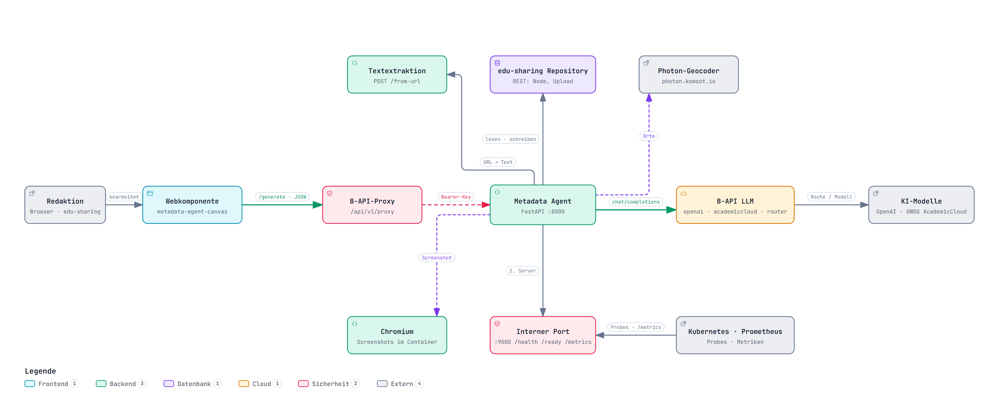

# Metadata Agent API

REST-API zur automatischen Extraktion von Metadaten aus Texten mittels KI (LLM).

Generiert strukturierte Metadaten nach dem [WLO/OEH-Schema](https://wirlernenonline.de) aus beliebigen Texten, URLs oder Repository-Nodes — inklusive Normalisierung, Geocoding, Validierung und Repository-Upload.

## Inhaltsverzeichnis

- [Quickstart](#quickstart)
- [LLM-Provider wählen](#llm-provider-wählen)
- [Architektur](#architektur)
- [API-Endpunkte](#api-endpunkte)
  - [POST /generate](#post-generate)
  - [POST /extract-field](#post-extract-field)
  - [POST /detect-content-type](#post-detect-content-type)
  - [POST /validate](#post-validate)
  - [POST /export/markdown](#post-exportmarkdown)
  - [POST /node](#post-node)
  - [POST /nodes](#post-nodes)
  - [POST /upload](#post-upload)
  - [POST /workflow/{node_id}](#post-workflownode_id)
  - [POST /upload/verify/{node_id}](#post-uploadverifynode_id)
  - [POST /screenshot](#post-screenshot)
  - [Info-Endpunkte](#info-endpunkte)
- [Nutzungsbeispiele](#nutzungsbeispiele)
- [Umgebungsvariablen](#umgebungsvariablen)
- [Widget / Webkomponente](#widget--webkomponente)
- [Deployment](#deployment)

**Auf einen Blick:** [Was der Dienst tut](#auf-einen-blick) ·
[Alle Umgebungsvariablen](ENV-PARAMETER.md)

### Weitere Dokumente

| Dokument | Inhalt |
|---|---|
| [ENV-PARAMETER.md](ENV-PARAMETER.md) | **Alle** Umgebungsvariablen mit Defaults und Betriebsbeispielen |
| [DEPLOYMENT.md](DEPLOYMENT.md) | Docker / Kubernetes, **[Update von 2.1.x auf 3.0.0](DEPLOYMENT.md#update-von-21x-auf-300)** (davor [2.0.x auf 2.1.0](DEPLOYMENT.md#update-von-20x-auf-210)), Prüfliste für die erste Installation, Rollback |
| [UEBERGABE.md](UEBERGABE.md) | Übergabe an den Betrieb: Ports, Header, Metriken, Alarmregeln, Skalierung, Kosten |
| [helm/metadata-agent/](helm/metadata-agent/README.md) | Helm-Chart mit ServiceMonitor und Alarmregeln (`PrometheusRule`) |
| [docs/steckbrief.md](docs/steckbrief.md) | Steckbrief für die IT-Übergabe: Status je Punkt, offene und kritische Punkte |
| [docs/team6-anforderungen.md](docs/team6-anforderungen.md) | Tabelle: welche Dienstanforderungen von Team 6 erfüllt, teilweise erfüllt oder offen sind |
| [docs/architektur/](docs/architektur/README.md) | Architektur-Map: interaktiv (HTML), als Bild (PNG, SVG) für Dokumente |
| [INSTALL.md](INSTALL.md) | Installation im Detail |
| [WIDGET-REFERENZ.md](WIDGET-REFERENZ.md) | Webkomponente: Layouts, Attribute, Events |
| [UPLOAD-RESPONSE.md](UPLOAD-RESPONSE.md) | Antwortformat von `/upload` |
| [WLO-REPO-FELDER.md](WLO-REPO-FELDER.md) | Welche Felder ins Repository geschrieben werden — und welche das Repository verwirft |
| [ENTWICKLER-UEBERSICHT.md](ENTWICKLER-UEBERSICHT.md) | Für Integratoren: Core-Felder, Sammlungen, Workflow |
| [CHANGELOG.md](CHANGELOG.md) | Änderungen gegenüber dem letzten Commit |

---

## Auf einen Blick

```
Text / URL / Node-ID
        │
        ▼
   /generate ──────► Metadaten als flaches JSON (Umschlag + Felder auf einer Ebene)
        │
        ├──► /validate          Pflichtfelder und Wertebereiche prüfen
        ├──► /export/markdown   Menschenlesbare Fassung
        └──► /upload ─────────► Knoten im WLO-Repository
                                  ├─ Metadaten (gefiltert auf repo_field)
                                  ├─ Extended Data (Inhaltstyp, LRT, Voll-JSON)
                                  ├─ Sammlungen (optional, collection_id)
                                  └─ Prüf-Workflow (200_tocheck)
```

Die Antwort von `/generate` geht **unverändert** in `/upload` — Umschlag und
Felder liegen auf einer Ebene, und alle drei Body-Formen sind gleichwertig
(siehe [POST /upload](#post-upload)).

**Drei Dinge, die beim ersten Mal überraschen:**

1. **Die Durchsatzgrenze hängt am Provider.** Standard `b-api-openai`: 20
   gleichzeitige LLM-Aufrufe ohne Ratengrenze. `b-api-academiccloud` erlaubt nur
   2 gleichzeitig und 2 pro Sekunde; `DEFAULT_MAX_WORKERS=20` wird darauf
   gedeckelt, eine Erschließung mit 50 Feldern dauert dort 26–90 s.
   Siehe [LLM-Provider wählen](#llm-provider-wählen).
2. **Das Repository verwirft unbekannte Properties stillschweigend** — mit
   `200` und ohne Hinweis in `fields_written`. Welche das betrifft, steht in
   [WLO-REPO-FELDER.md](WLO-REPO-FELDER.md).
3. **Ein Fehlschlag ist kein `200`.** Kommt kein einziges Feld zustande, etwa
   weil die B-API den Schlüssel ablehnt, antwortet `/generate` mit `502`
   (`503` bei Drosselung) und einem Fehlercode. Teilergebnisse kommen als `200`
   mit `processing.status: "partial"`. Siehe
   [Fehler und Teilergebnisse](#fehler-und-teilergebnisse).

---

## LLM-Provider wählen

Vier Provider, dieselbe Schnittstelle, jeder mit eigenem Durchsatzbudget. Die
Grenzen unten sind die Defaults. AcademicCloud ist gemessen (2026-08-12);
`b-api-openai` lief am 2026-10-06 mit 20 parallelen Requests ohne `429`.

| Provider | Modell (Default) | gleichzeitig | pro Sekunde |
|---|---|---:|---:|
| **`b-api-openai`** (Standard) | `gpt-6-luna` | 20 | keine Grenze |
| `b-api-academiccloud` | `deepseek-v4-flash` | 2 | 2 |
| `b-api-router` (Routen der B-API) | `openai/gpt-6-luna` (geht ohne Route) | 20 | keine Grenze |
| `openai` (nativ, ohne B-API) | `gpt-4o-mini` | 20 | keine Grenze |

### Kosten

Gemessen am 16.10.2026 mit `gpt-6-luna` über die B-API: **0,007 €** je
Erschließung einer kurzen Seite (6.000 Zeichen) bis **0,017 €** für eine lange
(66.000 Zeichen). Jeder Feld-Aufruf schickt den Seitentext mit; ein Vorlauf-Aufruf
legt ihn vorher in den Prompt-Cache, sodass die Feld-Aufrufe ihn zu einem Zehntel
des Preises lesen (nur bei den OpenAI-Providern). Preisbasis und Messwerte:
[UEBERGABE.md](UEBERGABE.md) §7.

### Laufzeit

Dieselbe Erschließung (50 Felder), 2026-08-12. Die Streuung ist erheblich und
kommt von der Warteschlange am Gateway, nicht vom Modell — bei zwei Läufen sind
das eher Größenordnungen als Messwerte:

| Modell | Läufe | Spanne | Ø | Ø Felder |
|---|---:|---:|---:|---:|
| `gpt-5.6-luna` (b-api-openai) | 1 | — | 25,2 s | 22 |
| `deepseek-v4-flash` | 6 | 26–90 s | **~46 s** | **~36** |
| `openai-gpt-oss-120b` | 4 | 53–79 s | ~64 s | ~30 |

Aktueller Standard, gemessen am 16.10.2026 an echten Webseiten (5.000–70.000
Zeichen), mit Input-Caching: **`gpt-6-luna` (b-api-openai) 12–22 s**, 28–34
von 50 Feldern, 52 KI-Aufrufe je Erschließung.

`deepseek-v4-flash` war in der Gegenüberstellung auf beiden Achsen besser als
`openai-gpt-oss-120b` — schneller **und** vollständiger (37 statt 30 von 50
Feldern, und es traf ein erwartetes Feld, das das andere ausließ). Beide lieferten
die exakt prüfbaren Werte richtig. Deshalb ist es der Standard für
`b-api-academiccloud`.

### Warum die Grenzen so eng sind

AcademicCloud (`b-api-academiccloud`) lässt **exakt zwei** Requests gleichzeitig
zu und etwa zwei pro Sekunde (gemessen 2026-08-12). Ein dritter paralleler
Request wird sofort mit `429` abgewiesen, und die Antwort enthält **kein
`retry-after`**: ein Client kann die Wartezeit nicht ablesen, er muss unter der
Grenze bleiben. Mehr Last hilft nicht, sie schadet — bei 3 req/s fällt der
effektive Durchsatz unter den Wert bei 2 req/s.

Dazu kommt das GWDG-Kontingent des B-API-Schlüssels: **~10 Aufrufe pro Minute**
(~200 pro Stunde, gemessen 2026-10-15 über den Router mit Qwen-Modellen). Für
eine ganze Erschließung (~50 Aufrufe) ist das die engere Grenze. Beide Grenzen
gelten für den Schlüssel, die Drosselung des Agenten je Prozess – mehrere
Instanzen teilen sie sich (Helm-Chart: `sharedLlmLimit`; siehe
[DEPLOYMENT.md](DEPLOYMENT.md#llm-provider-spezifisch)).

Für `b-api-openai` führt der Agent ein eigenes Budget (Default 20 gleichzeitig,
keine Ratengrenze). Die Messung vom August hatte noch ein gemeinsames Budget je
API-Key für beide B-API-Provider ergeben; ein echter `/generate`-Lauf am
2026-10-06 mit `gpt-6-luna` und 20 parallelen Requests lief jedoch ohne `429`
durch. Antwortet das Gateway doch mit `429`,
`METADATA_AGENT_LLM_MAX_CONCURRENT_REQUESTS` senken.

Der Agent hält die Grenzen des jeweiligen Providers selbst ein, an der einzigen
Stelle, durch die jeder LLM-Request läuft. `DEFAULT_MAX_WORKERS` wird darauf
gedeckelt und das beim Start ausgewiesen, hier für AcademicCloud:

```
Default Workers: 20 → 2 (limit of b-api-academiccloud)
LLM Throughput: max 2 in flight, max 2 req/s
```

### Umstellen

**Auf AcademicCloud mit `deepseek-v4-flash`:**

```env
METADATA_AGENT_LLM_PROVIDER=b-api-academiccloud
METADATA_AGENT_B_API_ACADEMICCLOUD_MODEL=deepseek-v4-flash
METADATA_AGENT_LLM_MAX_CONCURRENT_REQUESTS=2
METADATA_AGENT_LLM_MAX_REQUESTS_PER_SECOND=2
B_API_KEY=<Key>
```

Die Rate ist **pro Sekunde**, nicht pro Minute — `2` sind 120 Aufrufe/Minute.
Beide Werte entsprechen den Defaults von AcademicCloud; explizit gesetzt sind sie
in der Deployment-Oberfläche sichtbar — und gelten dann für jeden Provider, auch
für einen per Request gewählten.

⏱️ **Laufzeit des gewählten Hostings im Auge behalten** — die Streuung reicht
von 32 s bis 90 s; das Hosting muss ausreichend lange Requests erlauben.

**Auf einen eigenen OpenAI-kompatiblen Endpunkt** (Azure, vLLM, Gateway):

```env
METADATA_AGENT_LLM_PROVIDER=openai
METADATA_AGENT_OPENAI_API_BASE=https://mein-gateway.example/v1
METADATA_AGENT_OPENAI_MODEL=lokales-modell
METADATA_AGENT_LLM_MAX_REQUESTS_PER_SECOND=0
OPENAI_API_KEY=<was das Gateway erwartet>
```

`0` schaltet die Ratenbegrenzung ab.

**Über den B-API-Router** (Routen bündeln mehrere Modelle mit Ausweichen):

```env
METADATA_AGENT_LLM_PROVIDER=b-api-router
# provider/modell geht ohne Route; sonst erst die Route anlegen, dann den Namen setzen
METADATA_AGENT_B_API_ROUTER_MODEL=openai/gpt-6-luna
# bei einem Routennamen: reasoning (GPT-5/6) oder classic (alle anderen)
METADATA_AGENT_LLM_REQUEST_STYLE=auto
```

Die **Route selbst wird in der B-API angelegt**, nicht in der Env. Die Env nennt
nur ihren Namen und die Parameterfamilie ihrer Modelle. Ein Routenname verrät
nicht, welche Parameter die Modelle verstehen. Der Router reicht den Body
unverändert weiter; darum gehören in eine Route nur Modelle einer Familie.
Beide Muster (einzelnes Modell ohne Route, Route mit Reserve) samt Beispiel für
die Route, Fehlercodes und Cache:
[ENV-PARAMETER.md](ENV-PARAMETER.md#wo-routen-definiert-werden).

### Welcher Schlüssel die KI-Aufrufe trägt

**Es muss nichts gesetzt werden:** Der Default `auto` nimmt den Schlüssel, den
der B-API-Proxy mitschickt, und sonst `B_API_KEY`. Umstellen muss man nur in
Sonderfällen. `METADATA_AGENT_B_API_AUTH_MODE` kennt drei Werte:

- **`auto`:** Reicht der B-API-Proxy den Schlüssel des Aufrufers als
  `Authorization: Bearer …` weiter (`forwardApiKey`), wird genau dieser
  unverändert genutzt, sonst `B_API_KEY`.
- **`forward`:** nur der weitergereichte Schlüssel.
- **`static`:** nur `B_API_KEY`, wie in 2.0.x.

Der Schlüssel gilt nur für die eine Anfrage und wird weder gespeichert noch
geloggt. Hinter dem Proxy darf der Dienst nur über die B-API erreichbar sein.
Mehr in [ENV-PARAMETER.md](ENV-PARAMETER.md#b-api-authentifizierung).

### Pro Request überschreiben

`llm_provider` und `llm_model` im Body von `/generate`,
`/detect-content-type` und `/extract-field` überschreiben die Konfiguration für
diesen einen Aufruf — nützlich zum Vergleichen, ohne neu zu deployen:

```jsonc
{ "input_source": "text", "text": "…",
  "llm_provider": "b-api-academiccloud",
  "llm_model": "deepseek-v4-flash" }
```

Die Durchsatzgrenzen gelten trotzdem, und zwar prozessweit: sie hängen am
Provider, nicht an der Anfrage.

### Reasoning-Parameter

`METADATA_AGENT_LLM_VERBOSITY` und `…_LLM_REASONING_EFFORT` gehen **nur** an
Modelle mit den Präfixen `gpt-5`, `gpt-6`, `o1`, `o3`, `o4` — ältere antworten darauf mit
`400`. Dieselbe Erkennung stellt bei diesen Modellen `max_tokens` auf
`max_completion_tokens` um und lässt `temperature` weg. Das gilt
providerunabhängig, also auch bei nativem OpenAI und hinter `openai/` beim
Router. `deepseek-v4-flash` bekommt sie nicht. Nur für `b-api-router` lässt sich
die Familie mit `METADATA_AGENT_LLM_REQUEST_STYLE` festlegen.

---

## Quickstart

### Voraussetzungen

- Python 3.13+
- uv (`pip install uv` oder https://docs.astral.sh/uv/)
- API-Key: **B-API Key** (Standard) oder **OpenAI API Key**

### Lokal starten

```bash
# Repository klonen
git clone <repo-url>
cd metadata-agent-api

# Dependencies installieren
uv sync

# Für Screenshots: Chromium für Playwright (Screenshots laufen immer lokal)
uv run playwright install chromium

# API-Key konfigurieren
cp .env.template .env
# B_API_KEY eintragen

# Starten
uvicorn src.main:app --reload --host 0.0.0.0 --port 8000
```

### Mit Docker

Das Docker-Image enthält **Playwright + Chromium** für datenschutzfreundliche Screenshots (`screenshot_method=playwright`). Screenshots werden immer lokal aufgenommen — `pageshot` ist nur noch ein Alias dafür; ohne Chromium gibt es keine Screenshots.

```bash
# .env-Datei anlegen (siehe .env.template)
cp .env.template .env
# B_API_KEY eintragen, optional: WLO_GUEST_USERNAME/PASSWORD für /upload

# Mit docker-compose (empfohlen)
docker-compose up -d

# Oder manuell:
docker build -t metadata-agent-api .
docker run -d -p 127.0.0.1:8000:8000 --read-only --tmpfs /tmp --tmpfs /home/appuser --stop-timeout 120 --env-file .env metadata-agent-api
```

### Testen

```bash
curl http://localhost:8000/health
# → {"status": "healthy", "version": "3.0.0"}
# (Provider und Auth-Modus nennt /health nur auf dem internen Port)

curl -X POST http://localhost:8000/generate \
  -H "Content-Type: application/json" \
  -d '{"text": "Workshop KI in der Bildung am 15. März 2026 in Berlin"}'
```

Die interaktive API-Dokumentation ist unter **`/docs`** (Swagger UI) verfügbar. Sie lädt nur vom Agenten selbst, nicht von einem CDN oder Google Fonts (Swagger UI liegt unter `src/static/docs/`).

### Entwicklung: Tests, Lint, Typen

```bash
uv sync                                  # mit den Entwicklungswerkzeugen
uv run playwright install chromium       # für die Browser-Tests
uv run pytest -q -rs --cov               # Suite + Coverage-Untergrenze (pyproject.toml)
uv run ruff check && uv run ruff format --check
uv run mypy                              # ganz src/
```

| Variable | Wirkung |
|---|---|
| `REQUIRE_BROWSER=1` | Fehlt Chromium oder das Widget-Bundle, schlagen die Browser-Tests fehl statt sich zu überspringen (beide CI) |
| `REQUIRE_HELM=1` | Dasselbe für die Tests, die den Helm-Chart rendern (`helm` im `PATH`) |
| `RUN_NETWORK_TESTS=1` | Führt die mit `slow` markierten Tests gegen echte Dienste aus. Ohne den Schalter läuft die Suite offline: `tests/conftest.py` lässt nur Verbindungen zu Loopback zu und lässt jeden Test scheitern, der etwas anderes versucht |

Die Tests lesen weder `.env` noch die eigenen `METADATA_AGENT_*`-, `B_API_KEY`-
oder `OPENAI_API_KEY`-Variablen (`tests/conftest.py`). **Windows:** Startet
Chromium nicht (`EPERM … playwright-artifacts`), `TEMP` und `TMP` in PowerShell
auf ein Verzeichnis im Arbeitsbereich setzen. In Git Bash `TEMP` nicht
umsetzen – MSYS verbiegt den Pfad, und pytest legt dann `pytest-of-*/` im
Repository an (steht in `.gitignore`).

---

## Architektur



Die Map gibt es auch [interaktiv](docs/architektur/metadata-agent-architektur.html)
und als [SVG](docs/architektur/metadata-agent-architektur.svg); Hinweise zum
Neuerzeugen stehen in [docs/architektur/README.md](docs/architektur/README.md).

Ablauf einer Erschließung über die B-API – welcher Schlüssel wohin geht, welche
Dienste die Tracing-Header bekommen, Zeiten und Fehler:


Ablauf einer Anfrage im Agenten:

```
Request → Input Source → LLM Extraction → Normalization → Response
              │                │                │
              ├─ Text          ├─ Parallel       ├─ Field Normalizer
              ├─ URL/Crawler   │  Field          ├─ Output Normalizer
              ├─ Node ID       │  Extraction     ├─ Geocoding
              └─ Node+URL      └─ (Semaphore)    └─ Vocabulary Matching
```

**Kernkomponenten:**

| Komponente | Beschreibung |
|------------|--------------|
| `main.py` | App-Aufbau: Middleware, Lifespan, Router in fester Reihenfolge |
| `api/deps.py` | Gemeinsame Abhängigkeiten der Router (`settings`, Service-Zugriffe, Body-Hilfen) – zur Laufzeit nachgeschlagen, in Tests per `monkeypatch` ersetzbar |
| `api/responses.py`, `api/openapi.py` | Fehlerantworten (`detail` + `error`) bzw. OpenAPI-Dokument |
| `api/routers/*.py` | Ein Router je Bereich: `generate`, `extract`, `detect`, `validation`, `upload`, `save_node`, `nodes`, `verify`, `screenshot`, `schemata`, `widget`, `infra`, `docs` |
| `llm_service.py` | Feld-Extraktion: parallele Aufrufe, Cache-Vorlauf; Einstieg `get_llm_service`. Werte normalisiert `llm_values` lokal (ohne weiteren KI-Aufruf) |
| `llm_transport.py`, `llm_gate.py` | Ein LLM-Aufruf (Body, Auth-Header, Wiederholung, typisierte Fehler, Metriken) bzw. Durchsatz-Budget je Gateway |
| `llm_prompts.py`, `llm_content_type.py` | Prompts bzw. Inhaltsart-Erkennung |
| `llm_values.py`, `llm_dates_numbers.py` | Modellantworten auf Feldtypen bringen: JSON, Vokabular, URL, Koordinaten bzw. Zahlen, Datum, Zeit |
| `llm_auth.py` | Welcher Schlüssel einen B-API-Aufruf trägt (weitergereicht oder `B_API_KEY`), je Anfrage |
| `llm_errors.py` | Typisierte KI-Fehler mit Fehlercode und HTTP-Status (`LLM_AUTH_FORBIDDEN`, `LLM_RATE_LIMITED`, `LLM_ROUTE_*` …) |
| `metadata_service.py` | Ablauf einer Erschließung (Inhaltsart, Felder, KI, Normalisierung, Geocoding); Einstieg `get_metadata_service` |
| `metadata_generation.py` | Schritte ohne Dienst: Feldauswahl, Zusammenführen mit vorhandenen Werten (Herkunft `user` bleibt), Reihenfolge, Status |
| `metadata_validation.py`, `metadata_export.py` | `/validate` (Pflicht, Formate, Vokabular, Koordinaten) bzw. Markdown-Export |
| `api/input_resolver.py` | Eingangsquelle für detect/extract/generate: Text, URL, Node; Kürzen, Korrekturanweisung |
| `input_source_service.py` | Text-Beschaffung aus URL, Repository-Node, Crawler |
| `field_normalizer.py` | Typ-basierte Normalisierung (Datum, Boolean, Vokabular, etc.) |
| `output_normalizer.py` | Strukturanpassung für Canvas-Webkomponente |
| `geocoding_service.py` | Adressen → Koordinaten via Photon/Komoot API |
| `repository_service.py` | Abläufe ins WLO edu-sharing Repository: `create_node`, `upload_metadata`, `save_node`; Einstieg `get_repository_service` |
| `repository_nodes.py`, `repository_metadata.py` | Node anlegen, laden, verwerfen, Dublettenprüfung bzw. Metadaten, Extended-Felder und Aspects schreiben |
| `repository_review.py` | Zurücklesen und vergleichen (`/upload/verify`), Workflow-Status setzen |
| `repository_preview.py`, `repository_support.py` | Vorschaubild sicher laden bzw. Konfiguration und gemeinsame Hilfen |
| `repository_values.py` | Wert-Aufbereitung für die Repository-API: Feld-Filter, Flattening, Autor→VCARD, Koordinaten (rein, ohne HTTP) |
| `repository_licenses.py` | Lizenz-Erkennung: CC-Deed-Links und Vokabular-URIs → `ccm:commonlicense_key` + Version, alles andere bleibt als Freitext erhalten (rein) |
| `repository_diff.py` | SOLL/IST-Vergleich für `/upload/verify` — Vergleichsregeln für Arrays, Groß-/Kleinschreibung und Datumsformate (rein) |
| `repository_curation.py` | Was nach dem Schreiben passiert: Referenzierung in Sammlungen, Redaktions-Workflow Schritt für Schritt |
| `screenshot_service.py` | Lokale Screenshot-Erfassung mit Playwright (Chromium); `pageshot` ist ein Alias |
| `schema_loader.py` | Schema-Laden, Caching, Versions-Auflösung |
| `diagnostics.py` | `/debug/dependencies`: Erreichbarkeit von B-API, Textextraktion, Repository |
| `infra.py`, `metrics.py` | `/health`, `/ready`, interner Port, Prometheus-Metriken |
| `utils/request_id.py`, `utils/logging_setup.py` | Anfrage-ID und Tracing-Header; Logs als Text oder JSON |
| `utils/body_limit.py` | Obergrenze für Request-Bodies (`413`), bevor ein Endpunkt sie liest |

---

## API-Endpunkte

### POST /generate

Generiert vollständige Metadaten aus Text, URL oder Repository-Node.

> **Tipp:** Akzeptiert auch `Content-Type: text/plain` — einfach mehrzeiligen Text senden, alle Parameter werden auf Defaults gesetzt.

#### Request (JSON)

| Parameter | Typ | Default | Beschreibung |
|-----------|-----|---------|--------------|
| **Input** ||||
| `input_source` | enum | `text` | `text`, `url`, `node_id`, `node_url` |
| `text` | string | — | Direkter Text (bei `input_source=text`) |
| `source_url` | string | — | URL (bei `input_source=url` oder `node_url`) |
| `node_id` | string | — | Repository Node-ID (bei `node_id` oder `node_url`) |
| `repository` | string | `staging` | *Deprecated — wird ignoriert, siehe [Umgebungsvariablen](#umgebungsvariablen)* |
| `extraction_method` | enum | `browser` | `browser` (JS-Rendering, Standard) oder `simple` (schnell) |
| `output_format` | enum | `markdown` | `markdown` (Standard), `txt` (Klartext), `html` (rohes HTML) |
| **Schema** ||||
| `context` | string | `default` | Schema-Kontext |
| `version` | string | `latest` | Schema-Version (`latest` oder z.B. `1.8.0`) |
| `schema_file` | string | `auto` | Schema-Datei oder `auto` für LLM-Erkennung |
| **Optionen** ||||
| `language` | string | `de` | Sprache: `de` oder `en` |
| `max_workers` | int | aus `.env` (`20`) | Parallele LLM-Aufrufe (1–20). Ohne Angabe gilt `METADATA_AGENT_DEFAULT_MAX_WORKERS`; gedeckelt auf die Grenze des Providers |
| `include_core` | bool | `true` | Core-Felder (Titel, Keywords) einbeziehen |
| `enable_geocoding` | bool | `true` | Adressen zu Koordinaten konvertieren |
| `normalize` | bool | `true` | Normalisierung (Datum, Boolean, Vokabular, Struktur) |
| **LLM-Overrides** ||||
| `llm_provider` | string | aus `.env` | `b-api-academiccloud`, `b-api-openai`, `b-api-router`, `openai` |
| `llm_model` | string | aus `.env` | z.B. `gpt-6-luna`, `deepseek-v4-flash`, ein Routenname oder `openai/gpt-6-luna` (b-api-router), `gpt-4o-mini` |
| **Regeneration** ||||
| `existing_metadata` | object | — | Bestehende Metadaten als Basis |
| `regenerate_fields` | array | — | Nur diese Feld-IDs neu extrahieren |
| `regenerate_empty` | bool | `false` | Leere Felder in `existing_metadata` neu extrahieren |
| **Screenshot** ||||
| `screenshot_method` | string | — | `playwright` (lokal) oder der Legacy-Alias `pageshot` (nimmt ebenfalls lokal auf). Ohne Angabe: kein Screenshot |
| `preview_url` | string | — | URL für Screenshot (auto-detected aus `source_url` oder `ccm:wwwurl`) |

#### Input-Quellen

| `input_source` | Beschreibung | Benötigt |
|----------------|--------------|----------|
| `text` | Direkter Text (Standard) | `text` |
| `url` | Text von URL via Crawler | `source_url` |
| `node_id` | Volltext + Metadaten aus Repository | `node_id` |
| `node_url` | Repository-Daten, Crawler-Fallback via `ccm:wwwurl` | `node_id` |

> **Repository-Zugriff:** `node_id` und `node_url` lesen den Node mit dem Service-Account
> aus `WLO_GUEST_USERNAME` / `WLO_GUEST_PASSWORD`. Ohne konfigurierte Credentials wird
> anonym gelesen — dann sind nur öffentlich lesbare Nodes erreichbar, alle anderen
> antworten mit `403`.

> **Nur öffentliche URLs:** Jede URL, die der Dienst selbst öffnet — `source_url`
> bei `input_source=url`, Screenshots, Vorschaubild-URLs —, muss ein öffentliches
> http(s)-Ziel sein. Interne Ziele (`localhost`, `*.local`, `*.internal`, `*.lan`,
> `*.home.arpa`, Loopback, private Netze, Link-Local inkl. `169.254.169.254`),
> Zugangsdaten in der URL und andere Schemata werden abgelehnt: als `source_url`
> mit `400` und dem Grund in `detail` (z.B. „Interne Hostnamen sind nicht
> erlaubt.“) – bei `input_source=url` wie bei `node_url` mit eigener `source_url`
> (dort nur ohne gespeicherten Volltext; mit Volltext wird die URL nicht abgerufen);
> eine nicht öffentliche `ccm:wwwurl` des Nodes führt bei `node_url` zum
> Ersatztext aus Titel und Beschreibung (mit Hinweis in `warnings`). `502 Failed
> to fetch input: …` heißt dagegen: Die Quelle (Repository, Textextraktion) war
> nicht lesbar. Ein Screenshot zu einem solchen Ziel entfällt.
> Die Prüfung löst DNS im Container auf — ein Hostname, der dort auf eine private
> Adresse zeigt, wird ebenfalls abgelehnt.

#### Response (flaches Format)

Die Metadaten-Felder liegen **direkt auf Top-Level** (nicht in einem `metadata`-Objekt):

```json
{
  "contextName": "default",
  "schemaVersion": "1.8.1",
  "metadataset": "event.json",
  "language": "de",
  "exportedAt": "2026-01-23T08:00:00+00:00",

  "cclom:title": "Workshop KI in der Bildung",
  "cclom:general_description": "Ein Workshop über den Einsatz von KI...",
  "cclom:general_keyword": ["KI", "Bildung", "Workshop"],
  "schema:startDate": "2026-03-15T09:00",
  "schema:location": [
    {
      "name": "Berlin",
      "address": {
        "streetAddress": "",
        "postalCode": "",
        "addressLocality": "Berlin",
        "addressRegion": "Berlin",
        "addressCountry": "DE"
      },
      "geo": { "latitude": 52.5200066, "longitude": 13.404954 }
    }
  ],

  "processing": {
    "status": "success",
    "success": true,
    "fields_extracted": 15,
    "fields_failed": 0,
    "fields_total": 41,
    "processing_time_ms": 2500,
    "llm_provider": "b-api-openai",
    "llm_model": "gpt-6-luna",
    "auth_source": "static",
    "content_type_detection": { "method": "llm", "confidence": "high", "schema_file": "event.json" },
    "errors": [],
    "warnings": []
  },

  "_origins": {
    "cclom:title": "ai",
    "cclom:general_description": "ai",
    "schema:startDate": "ai"
  },
  "_source_text": "Workshop KI in der Bildung am 15. März 2026 in Berlin"
}
```

> **Hinweis:** Leere Default-Werte (`""`, `[]`, `{}`, `null`) werden aus der Response gefiltert — nur Felder mit tatsächlichen Werten erscheinen.
>
> **`_origins`:** Enthält die Herkunft jedes extrahierten Feldes (`"ai"` = KI-generiert, `"user"` = manuell). Wird bei Re-Extraktion (`existing_metadata` mit `_origins`) für unveränderte Felder beibehalten.
>
> **`_source_text`:** Rohtext vor der KI-Extraktion. Wird bei Text-Input oder nach URL-Crawling mitgeliefert.
> Ein neuer Text über 10.000 Zeichen zusammen mit `_source_text` gilt als neue Quelle (Hinweis in `processing.warnings`), nicht als Korrekturanweisung.
>
> **Screenshot:** Wenn `screenshot_method` angegeben wurde und ein Screenshot erfolgreich war, enthält die Response zusätzlich `preview_image_url` als Base64 Data-URL (`data:image/png;base64,...`).

#### Fehler und Teilergebnisse

| Ergebnis | HTTP | Kennzeichen |
|---|---|---|
| Alles erschlossen | `200` | `processing.status: "success"` |
| Teilergebnis | `200` | `processing.status: "partial"`, `fields_failed > 0`, Ursache in `processing.error` und `processing.errors` |
| Kein Feld erschlossen | `502` (Drosselung `503`) | `detail` (lesbar), `error.code`, `error.request_id`, dazu `processing` |
| Kontext, Version oder `schema_file` unbekannt | `404` | `error.code` `NOT_FOUND` – vor Abruf der Quelle, Screenshot und KI-Aufruf |
| Textextraktion gescheitert | `504` / `502` / `422` | `error.code` `TEXT_EXTRACTION_*` |
| Zeitlimit (`METADATA_AGENT_GENERATE_TIMEOUT`) | `504` | `error.code` `GENERATION_TIMEOUT` |

**Jede Fehlerantwort** aller Endpunkte hat dieselbe Form (`ErrorResponse` in der
OpenAPI-Spec): `detail` für Menschen – bei `422` die Liste der Schema-Verstöße –
und `error` mit `code` (z. B. `NOT_FOUND`, `VALIDATION_ERROR`, `SCHEMA_UNAVAILABLE`,
`UPSTREAM_ERROR`, `UPLOAD_TIMEOUT`, `LLM_*`), `message` und `request_id` (auch im Header
`X-Request-ID`, im Log des Dienstes zu finden).

`processing.content_type_detection.method` sagt, wie die Inhaltsart zustande
kam: `llm`, `preselected` (per `schema_file` vorgegeben) oder `keywords`. Bei
`keywords` gab die KI keine brauchbare Antwort; die Inhaltsart ist dann nur
geraten (`confidence: "low"`, Hinweis in `warnings`). `auth_source` nennt die
Herkunft des Schlüssels (`forwarded`, `static`, `openai`), nie den Schlüssel
selbst.

```json
{
  "detail": "KI-Metadatengenerierung fehlgeschlagen: Der KI-Dienst hat den Zugriff verweigert (HTTP 403; eigener B_API_KEY des Agents) …",
  "error": { "code": "LLM_AUTH_FORBIDDEN", "message": "…", "upstream_status": 403,
             "auth_source": "static", "request_id": "3f9c2a7d1b4e5f60" },
  "processing": { "status": "failed", "fields_extracted": 0, "fields_failed": 1 }
}
```

Fehlercodes der KI-Aufrufe:

| Code | Bedeutung |
|---|---|
| `LLM_AUTH_MISSING` | kein Schlüssel |
| `LLM_AUTH_REJECTED` | Schlüssel abgelehnt (401) |
| `LLM_AUTH_FORBIDDEN` | Schlüssel ohne Berechtigung (403) |
| `LLM_MODEL_NOT_FOUND` | Modell bzw. Adresse unbekannt |
| `LLM_RATE_LIMITED` | Drosselung |
| `LLM_UNREACHABLE` | KI-Dienst nicht erreichbar |
| `LLM_UPSTREAM_ERROR` | Serverfehler |
| `LLM_REQUEST_REJECTED` | Anfrage abgelehnt |
| `LLM_ROUTE_NOT_FOUND` | Route unbekannt |
| `LLM_ROUTE_MISCONFIGURED` | Route falsch eingerichtet oder falsche Parameter |

Die Anfrage-ID steht auch im Header `X-Request-ID` und im Log des Agenten.

#### Verfügbare Schemas

| Schema | Beschreibung |
|--------|--------------|
| `auto` | Automatische Erkennung via LLM |
| `core.json` | Nur Core-Felder (Titel, Beschreibung, Keywords, Fach, Bildungsstufe) |
| `event.json` | Veranstaltungen, Workshops, Seminare, Konferenzen |
| `learning_material.json` | Lernmaterialien, Arbeitsblätter, Videos |
| `education_offer.json` | Bildungsangebote, Kurse, Studiengänge |
| `person.json` | Personen, Autoren, Referenten |
| `organization.json` | Organisationen, Institutionen, Vereine |
| `tool_service.json` | Tools, Software, Dienste |
| `source.json` | Quellen, Datenbanken |
| `didactic_planning_tools.json` | Didaktische Planungsinstrumente, Methoden, Unterrichtsphasen |
| `occupation.json` | Berufe, Qualifikationen, Fähigkeiten |
| `prompt.json` | KI-Prompts, Eingabe-/Ausgabeformate, Szenarien |

#### Schema-Kontexte

| Kontext | Beschreibung | Schemas |
|---------|--------------|--------|
| `default` | WLO/OEH Standard | 11 Schemas (+ 3 deaktiviert) |
| `mds_oeh` | OEH Metadatenset | 11 Schemas (+ 3 deaktiviert) |

> **Deaktivierte Schemas:** `education_program.json`, `course.json`, `curriculum.json` — vorhanden aber nicht in der automatischen Erkennung.

---

### POST /extract-field

Extrahiert oder regeneriert ein einzelnes Feld. Nützlich um einzelne Felder zu korrigieren ohne alles neu zu extrahieren.

#### Request

| Parameter | Typ | Default | Beschreibung |
|-----------|-----|---------|--------------|
| `input_source` | enum | `text` | `text`, `url`, `node_id`, `node_url` |
| `text` | string | — | Text zur Analyse |
| `source_url` | string | — | URL (bei `url`/`node_url`) |
| `node_id` | string | — | Node-ID (bei `node_id`/`node_url`) |
| `repository` | string | `staging` | *Deprecated — wird ignoriert, siehe [Umgebungsvariablen](#umgebungsvariablen)* |
| `extraction_method` | enum | `browser` | `browser` (Standard) oder `simple` |
| `output_format` | enum | `markdown` | `markdown`, `txt`, `html` |
| `schema_file` | string | **erforderlich** | Schema-Datei (z.B. `event.json`, `core.json`) |
| `field_id` | string | **erforderlich** | Feld-ID (z.B. `schema:startDate`, `cclom:title`) |
| `existing_metadata` | object | — | Bestehende Werte als Kontext |
| `context` | string | `default` | Schema-Kontext |
| `version` | string | `latest` | Schema-Version |
| `language` | string | `de` | Sprache |
| `normalize` | bool | `true` | Normalisierung anwenden |
| `llm_provider` | string | — | LLM-Provider Override |
| `llm_model` | string | — | LLM-Model Override |

#### Response

```json
{
  "field_id": "schema:startDate",
  "field_label": "Startdatum",
  "value": "2026-03-15T09:00",
  "raw_value": null,
  "previous_value": "2026-03-10T09:00",
  "changed": true,
  "normalized": false,
  "context": "default",
  "version": "1.8.1",
  "schema_file": "event.json",
  "processing": {
    "llm_provider": "b-api-openai",
    "llm_model": "gpt-6-luna",
    "processing_time_ms": 450
  }
}
```

| Feld | Beschreibung |
|------|--------------|
| `value` | Extrahierter (und normalisierter) Wert |
| `raw_value` | Wert vor Normalisierung (nur wenn normalisiert) |
| `previous_value` | Vorheriger Wert aus `existing_metadata` |
| `changed` | Ob sich der Wert geändert hat |
| `normalized` | Ob Normalisierung angewendet wurde |
| `processing.warnings` | Hinweise zur Eingabe, z.B. wenn bei `node_url` der Webseitentext fehlte und nur Titel und Beschreibung des Repository-Eintrags genutzt wurden |

Scheitert der KI-Aufruf, antwortet der Endpunkt mit dem Fehlercode wie
`/generate` (`502`, bei Drosselung `503`), siehe
[Fehler und Teilergebnisse](#fehler-und-teilergebnisse). Dauert der Lauf länger
als `METADATA_AGENT_GENERATE_TIMEOUT`, kommt `504` mit `error.code`
`GENERATION_TIMEOUT`; ein unbekanntes Feld ist `404`, noch vor dem Abruf der Quelle.

---

### POST /detect-content-type

Erkennt den Inhaltstyp (Schema) eines Textes via LLM.

#### Request

| Parameter | Typ | Default | Beschreibung |
|-----------|-----|---------|--------------|
| `input_source` | enum | `text` | `text`, `url`, `node_id`, `node_url` |
| `text` | string | — | Text zur Analyse |
| `source_url` | string | — | URL |
| `node_id` | string | — | Node-ID |
| `repository` | string | `staging` | *Deprecated — wird ignoriert, siehe [Umgebungsvariablen](#umgebungsvariablen)* |
| `extraction_method` | enum | `browser` | `browser` (Standard) oder `simple` |
| `output_format` | enum | `markdown` | `markdown`, `txt`, `html` |
| `context` | string | `default` | Schema-Kontext |
| `version` | string | `latest` | Schema-Version |
| `language` | string | `de` | Sprache |
| `llm_provider` | string | — | LLM-Provider Override |
| `llm_model` | string | — | LLM-Model Override |

#### Response

```json
{
  "detected": {
    "schema_file": "event.json",
    "profile_id": "event",
    "label": { "de": "Veranstaltung", "en": "Event" },
    "confidence": "high"
  },
  "available": [
    {
      "schema_file": "event.json",
      "profile_id": "event",
      "label": { "de": "Veranstaltung", "en": "Event" },
      "confidence": null
    },
    {
      "schema_file": "learning_material.json",
      "profile_id": "learning_material",
      "label": { "de": "Lernmaterial", "en": "Learning Material" },
      "confidence": null
    }
  ],
  "context": "default",
  "version": "1.8.1",
  "processing_time_ms": 800,
  "method": "llm",
  "warnings": []
}
```

`method: "keywords"` heißt: Die KI gab keine brauchbare Antwort, die
Schlüsselwort-Erkennung ist eingesprungen (`confidence: "low"`, Grund in
`warnings`). Lehnt die B-API den Schlüssel ab oder ist sie nicht erreichbar,
kommt `502` (bzw. `503`) mit Fehlercode, nicht mehr stillschweigend
`learning_material.json`. Dauert der Lauf länger als
`METADATA_AGENT_GENERATE_TIMEOUT`, kommt `504` mit `error.code`
`GENERATION_TIMEOUT`.

---

### POST /validate

Validiert Metadaten gegen das Schema. Prüft Core-Felder und Schema-spezifische Felder.

> **Einfache Nutzung:** Den kompletten Output von `/generate` direkt als Body senden — Context, Version und Schema werden automatisch erkannt.

#### Request

Der Body kann **direkt der `/generate`-Output** sein (flaches Format) oder ein
Objekt mit `metadata`-Wrapper — beide Formen sind gleichwertig, siehe
[Body-Format](#body-format) bei `/upload`. Entscheidend ist `metadataset`:
daran hängt, gegen welches Typschema geprüft wird.

```bash
# Variante 1: Direkter /generate-Output
curl -X POST http://localhost:8000/validate \
  -H "Content-Type: application/json" \
  -d '{"contextName":"default","schemaVersion":"1.8.1","metadataset":"event.json",
       "cclom:title":"Mein Workshop","schema:startDate":"2026-03-15"}'

# Variante 2: Explizit mit metadata-Wrapper
curl -X POST http://localhost:8000/validate \
  -H "Content-Type: application/json" \
  -d '{"metadata": {...}, "context": "default", "version": "1.8.1"}'
```

| Parameter | Typ | Default | Beschreibung |
|-----------|-----|---------|--------------|
| `metadata` | object | **erforderlich** | Metadaten (oder direkt als Body) |
| `context` | string | `auto` | Schema-Kontext (`auto` = aus `contextName` lesen) |
| `version` | string | `auto` | Schema-Version (`auto` = aus `schemaVersion` lesen) |
| `schema_file` | string | `auto` | Schema-Datei (`auto` = aus `metadataset` lesen) |

#### Validierungsprüfungen

- **Pflichtfelder** — Sind alle `required`-Felder ausgefüllt? (Core + Schema)
- **Datentypen** — Stimmen Werte mit erwarteten Typen überein? (number, boolean, array)
- **Datumsformate** — ISO 8601 (`YYYY-MM-DD`, `YYYY-MM-DDTHH:MM:SS`); der Tag muss existieren (kein `2026-02-30`)
- **Zeitformate** — `HH:MM:SS` oder `HH:MM`
- **URL-Formate** — Protokoll vorhanden (`http://` / `https://`)
- **Geo-Koordinaten** — Felder, deren ID auf `latitude`/`lat` bzw. `longitude`/`lon`/`lng` endet: Latitude (−90 bis 90), Longitude (−180 bis 180)
- **Vokabular** — Geschlossene Vokabulare mit Fuzzy-Matching; Vorschläge für die ersten 5 ungültigen Werte je Feld

#### Response

```json
{
  "valid": true,
  "schema_used": "event.json",
  "errors": [],
  "warnings": [
    {
      "field_id": "oeh:eventType",
      "message": "Value 'Worksho' not in vocabulary. Did you mean 'http://w3id.org/openeduhub/vocabs/eventType/workshop'?",
      "severity": "warning"
    }
  ],
  "coverage": 85.7
}
```

| Feld | Beschreibung |
|------|--------------|
| `valid` | `true` wenn keine Errors |
| `schema_used` | Verwendete Schema-Datei |
| `errors` | Kritische Fehler (z.B. fehlende Pflichtfelder) |
| `warnings` | Hinweise (z.B. falsche Formate, ungültige Vokabular-Werte) |
| `coverage` | Prozent der ausgefüllten Pflichtfelder |

---

### POST /export/markdown

Exportiert Metadaten als menschenlesbares Markdown-Dokument.

> **Einfache Nutzung:** Den kompletten `/generate`-Output direkt als Body senden.

#### Request

| Parameter | Typ | Default | Beschreibung |
|-----------|-----|---------|--------------|
| `metadata` | object | **erforderlich** | Metadaten (oder direkt als Body) |
| `context` | string | `auto` | Schema-Kontext |
| `version` | string | `auto` | Schema-Version |
| `schema_file` | string | `auto` | Schema-Datei |
| `language` | string | `auto` | Ausgabesprache (`auto` = aus Metadaten, Fallback: `de`) |
| `include_empty` | bool | `false` | Leere Felder anzeigen |

#### Response

```json
{
  "markdown": "# Veranstaltung\n\n## Allgemein\n\n**Titel:** Workshop KI in der Bildung\n**Beschreibung:** Ein Workshop über...\n**Schlagwörter:** KI, Bildung\n\n## Veranstaltungsdetails\n\n**Startdatum:** 2026-03-15T09:00\n...",
  "schema_used": "event.json"
}
```

---

### POST /node

Legt einen Node im Eingangsordner an und gibt seine ID zurück — **ohne**
Metadaten zu schreiben. Die erste Hälfte eines Uploads für sich genommen.

Gedacht für Aufrufer, die eine Node-ID brauchen, bevor die Metadaten existieren:
um sie anzuzeigen, zu verlinken oder einer Redaktion zu übergeben. Die ID geht
später als `node_id` an `POST /upload`.

```bash
curl -X POST http://localhost:8000/node \
  -H "Content-Type: application/json" \
  -d '{"metadata": {"cclom:title": "Bruchrechnung Klasse 6"}}'
```

```json
{
  "success": true,
  "node": {
    "nodeId": "5443240c-43a2-4961-8324-0c43a22961dd",
    "title": "Bruchrechnung Klasse 6",
    "repositoryUrl": "https://repository.staging.openeduhub.net/edu-sharing/components/render/5443240c-..."
  }
}
```

| Parameter | Typ | Default | Beschreibung |
|---|---|---|---|
| `metadata` | object | **erforderlich** | Mindestens `cclom:title` |
| `check_duplicates` | bool | `false` | Vor dem Anlegen nach `ccm:wwwurl` suchen |

**Geschrieben werden nur fünf Felder** — dieselben, die der Upload beim Anlegen
setzt: `cclom:title`, `cclom:general_description`, `cclom:general_keyword`,
`ccm:wwwurl`, `cclom:general_language`, dazu `ccm:linktype: USER_GENERATED`.
Alles andere wird ignoriert; es braucht den Schemafilter und gehört in den
zweiten Schritt.

**Der Titel ist Pflicht** (`400` ohne ihn). Ein Node ohne Titel ist im
Eingangsordner nicht auffindbar, und der Zweck dieses Aufrufs ist gerade, etwas
Referenzierbares zu bekommen.

**Zum Knotennamen (`cm:name`).** edu-sharing verlangt ihn beim Anlegen und leitet
ihn aus `ccm:wwwurl` ab — aus `cclom:title` nie. Fehlt die URL, antwortet das
Repository mit `500 missing name`. Deshalb setzt der Dienst `cm:name` selbst,
sobald keine URL vorliegt: aus dem Titel, bereinigt um die von Alfresco
verbotenen Zeichen (`* " \ > < ? / : |`) und auf 200 Zeichen gekürzt. Mit URL
bleibt es beim abgeleiteten Namen. Ein eigenes `cm:name` in den Metadaten hat
Vorrang.

`check_duplicates` steht standardmäßig auf `false`, weil die URL zu diesem
Zeitpunkt oft noch nicht feststeht. Findet die Prüfung eine Dublette, kommt
`success: false`, `duplicate: true` und die ID des bestehenden Nodes.

| Status | Bedeutung |
|---|---|
| `200` | angelegt (`success: true`, `node`) oder Dublette (`success: false`, `duplicate: true`) |
| `400` | kein Titel |
| `422` | Body passt nicht zum Schema |
| `502` | Repository-Fehler beim Anlegen |
| `503` | Repository-Zugangsdaten nicht konfiguriert |
| `504` | `METADATA_AGENT_UPLOAD_TIMEOUT` überschritten (`UPLOAD_TIMEOUT`); ein inzwischen gefundener Node steht in `node` – verworfen wird hier nie, der Node gehört dem Aufrufer |

---

### POST /nodes

Speichert Metadaten im Repository: **legt einen Node an** (ohne `node_id`) oder
**aktualisiert einen bestehenden** (mit `node_id`). Die Antwort enthält immer den
vollständigen Node (`node_full`). Für Änderungen an einem Node, den der Agent
angelegt hat, ist das der vorgesehene Weg – nicht ein Schreibaufruf direkt
gegen edu-sharing.

> Erfordert `WLO_GUEST_USERNAME` und `WLO_GUEST_PASSWORD` (sonst `503`).
> Geschrieben wird mit diesem Dienstkonto; in der Historie des Nodes steht es.

```bash
# anlegen
curl -X POST http://localhost:8000/nodes -H "Content-Type: application/json" -d '{
  "metadataset": "learning_material.json",
  "cclom:title": "Bruchrechnung Klasse 6",
  "ccm:wwwurl": "https://example.com/bruchrechnung",
  "write_extended_data": true
}'

# aktualisieren: nur die mitgeschickten Felder ändern sich
curl -X POST http://localhost:8000/nodes -H "Content-Type: application/json" -d '{
  "metadataset": "learning_material.json",
  "node_id": "177fba93-3885-479e-bfba-933885c79e1c",
  "cclom:general_keyword": ["Bruchrechnung", "Klasse 6"]
}'
```

**Body:** wie bei `/upload` – die `/generate`-Antwort unverändert (flach) oder
die Felder unter `metadata`. **`metadataset` immer mitschicken:** Es entscheidet,
welches Typschema neben `core.json` gilt; ohne es fallen typspezifische Felder
wie `ccm:oeh_event_begin` still weg.

| Parameter | Default | Beschreibung |
|---|---|---|
| `node_id` | leer | Node, der aktualisiert wird. Leer: neuer Node im Eingangsordner |
| `collection_id` | – | Liste von Sammlungs-IDs oder -URLs; der Inhalt wird dort referenziert |
| `write_extended_data` | **`false`** | `ccm:oeh_extendedType`, `ccm:oeh_extendedData`, `ccm:oeh_extendedText` schreiben |
| `extended_text` | – | Rohtext vor der Extraktion (nur mit `write_extended_data: true`) |
| `preview` | – | Vorschaubild als URL, Data-URL oder Base64 |
| `start_review_workflow` | `false` | zur Prüfung übergeben (`200_tocheck`) |
| `start_quality_workflow` | `false` | Qualität bestätigen (`140_ELEMENT_LEGALLY_APPROVED`), nach der Übergabe |

- **Aktualisieren schreibt nur, was im Body steht.** Leere Werte (`null`, `""`,
  `[]`) gelten als nicht gesetzt und löschen nichts. Ausnahme:
  `ccm:oeh_extendedData` ist ein JSON-Block und wird beim Schreiben ganz
  ersetzt – deshalb ist `write_extended_data` hier standardmäßig aus. Für einen
  vollständigen Datensatz einschalten.
- **Zwei-Stunden-Fenster:** Ein Node lässt sich nur bis **2 Stunden nach dem
  Anlegen** (`cm:created`) aktualisieren; Bearbeiten verlängert das Fenster
  nicht. Danach hat der Inhalt in der Regel die Redaktion erreicht, spätere
  Änderungen gehören in die Redaktionsoberfläche.
- **Vorschaubild:** Ohne `preview` bleibt ein vorhandenes unverändert. Scheitert
  das Bild, gilt das Schreiben trotzdem: `success: true`, der Grund steht in
  `preview.error` und `error`.
- **Workflows** sind standardmäßig aus; ohne Schalter landet der Node in keiner
  Warteschlange.
- **Anders als `/upload`:** keine Dublettenprüfung, kein Screenshot, der Node
  wird immer zurückgelesen.

| Status | Bedeutung |
|---|---|
| `200` | Ergebnis im Body: `success`, `node`, `node_full`, `node_created` (`true` beim Anlegen, `false` beim Update), `fields_written`, `fields_skipped`, `field_errors`; `preview`, `collections`, `workflow` nur, wenn angefordert. Scheitert ein Schritt, nachdem der Node angelegt bzw. geändert wurde (Teilergebnis), kommt `success: false` mit `step` und `error` |
| `400` | Body ist kein JSON-Objekt |
| `403` | Update außerhalb des Zwei-Stunden-Fensters, oder die Erstellungszeit ist nicht lesbar |
| `404` | Node existiert nicht, oder das Dienstkonto hat keinen Zugriff |
| `422` | Body passt nicht zum Schema (z.B. `collection_id` als String statt Liste); beim Schreiben ohne Ergebnis (nichts angelegt, nichts geändert) auch `VALIDATION_ERROR` (Objektform eines Felds verletzt) oder `SCHEMA_UNAVAILABLE` (Kontext/Version unbekannt) |
| `502` | Update: der Node ließ sich wegen eines Repository-Fehlers nicht lesen (Fenster nicht prüfbar) – erneut versuchen. Beim Schreiben ohne Ergebnis: `UPSTREAM_ERROR` (Repository lehnte ab oder war nicht erreichbar); `detail` mit dem Fehlertext, dazu `discarded_node`/`node`/`step`/`field_errors`, wenn gesetzt |
| `503` | Repository-Zugangsdaten nicht konfiguriert |
| `504` | `METADATA_AGENT_UPLOAD_TIMEOUT` überschritten (`UPLOAD_TIMEOUT`); `discarded_node` nennt einen dabei angelegten, unvollständigen und verworfenen Node; `node` einen, der bleibt: schon im Workflow, vollständig geschrieben, nicht verwerfbar oder (mit `node_id`) der bestehende Node |

Alle Felder und Beispiele: `/docs`, Abschnitt Repository.

---

### POST /upload

Lädt Metadaten ins WLO edu-sharing Repository hoch.

> Erfordert `WLO_GUEST_USERNAME` und `WLO_GUEST_PASSWORD` Umgebungsvariablen.
>
> **Einfache Nutzung:** Den kompletten `/generate`-Output direkt als Body senden. Optional `repository`, `check_duplicates`, `start_workflow` mit übergeben.

#### Body-Format

**Empfohlen ist Form 1:** die `/generate`-Antwort unverändert weiterreichen.
`/generate` liefert **flach** — Umschlag und Felder auf einer Ebene. Nichts
umbauen, nichts verlieren.

Die anderen beiden sind **gleichwertig** und schreiben dieselben Felder — sie
existieren, weil beide Formen im Umlauf sind:

```jsonc
// 1) EMPFOHLEN — genau das, was /generate zurückgibt
{
  "contextName": "default", "schemaVersion": "2.0.0",
  "metadataset": "event.json",
  "cclom:title": "…", "ccm:oeh_event_begin": "…",
  "start_workflow": true                       // Optionen daneben
}

// 2) Felder unter `metadata` (so exportiert die Webkomponente)
{
  "contextName": "default", "schemaVersion": "2.0.0",
  "metadataset": "event.json",
  "metadata": { "cclom:title": "…", "ccm:oeh_event_begin": "…" }
}

// 3) Alles unter `metadata` (so sendet die Webkomponente)
{ "metadata": { "contextName": "…", "metadataset": "event.json",
                "metadata": { "cclom:title": "…" } } }
```

> **`metadataset` mitschicken.** Der Schlüssel entscheidet, welches Typschema
> zusätzlich zu `core.json` geladen wird — und damit, welche Felder überhaupt
> geschrieben werden dürfen. Ohne ihn gelten nur die 22 Core-Felder: bei einer
> Veranstaltung fallen `ccm:oeh_event_begin`, `ccm:oeh_event_end`, `ccm:price`
> und `ccm:competence` stillschweigend weg. `/generate` liefert den Schlüssel
> mit; wer die Antwort umbaut, muss ihn behalten.

#### Request

| Parameter | Typ | Default | Beschreibung |
|-----------|-----|---------|--------------|
| `metadata` | object | **erforderlich** | Metadaten — siehe [Body-Format](#body-format) oben |
| `repository` | string | `staging` | *Deprecated — wird ignoriert, siehe [Umgebungsvariablen](#umgebungsvariablen)* |
| `check_duplicates` | bool | `true` | Dublettenprüfung via `ccm:wwwurl` |
| `start_workflow` | bool | `true` | Review-Workflow starten |
| `source` | string | — | Bezugsquelle / Publisher-Override. Überschreibt `ccm:oeh_publisher_combined` |
| `preview_url` | string | — | URL für Vorschaubild-Screenshot. Wenn leer, wird `ccm:wwwurl` aus den Metadaten verwendet. Nur öffentliche http(s)-Ziele — sonst meldet `preview` `success: false`, der Upload selbst bleibt erfolgreich |
| `screenshot_method` | string | `playwright` | Screenshot-Methode: `playwright` (lokal) oder der Legacy-Alias `pageshot` (nimmt ebenfalls lokal auf) |
| `write_extended_data` | bool | `true` | Extended-Felder schreiben (`ccm:oeh_extendedType`, `ccm:oeh_extendedData`, `ccm:oeh_extendedText`) |
| `extended_text` | string | — | Rohtext vor der KI-Extraktion. Wird in `ccm:oeh_extendedText` geschrieben |
| `return_full_node` | bool | `false` | Node nach dem Schreiben zurücklesen und als `node_full` mitliefern |
| `collection_id` | string[] | — | Sammlung(en), in der/denen der Inhalt referenziert wird. **Immer eine Liste**, Einträge sind IDs oder Sammlungs-URLs |
| `workflow_steps` | string[] | `["200_tocheck"]` | Workflow-Status, die nach dem Upload der Reihe nach gesetzt werden |
| `workflow_comment` | string | `Upload via Metadata Agent API` | Kommentar zu jedem Workflow-Schritt |
| `workflow_receiver` | string[] | siehe unten | Authority-Namen, die je Schritt benachrichtigt werden |
| `node_id` | string | — | Bestehender Node, in den geschrieben wird — z.B. aus [POST /node](#post-node). Ohne Angabe wird einer angelegt |

Alle Parameter außer `metadata` sind optional und stehen mitsamt Beschreibung im
Schema unter `/docs`.

#### Leere Felder

Die Beispiele unter `/docs` sind wie ein Formular aufgebaut: jede Option ist
aufgeführt, die ungenutzten leer. **Ein leer gelassenes Feld zählt als nicht
angegeben** — es gilt derselbe Standard wie beim Weglassen, kein Fehler und kein
leerer Wert im Repository:

```jsonc
{ "node_id": "", "collection_id": [], "workflow_comment": "" }
// identisch zu: {}
```

Zwei Ausnahmen, weil „leer" dort etwas anderes heißt als „nicht angegeben":

| Feld | leere Liste bedeutet |
|------|----------------------|
| `workflow_receiver` | **niemanden benachrichtigen.** Weggelassen benachrichtigt bei `200_tocheck` die Uploadmanager-Gruppe |
| `workflow_steps` | wird mit `422` abgelehnt — weggelassen läuft der Standardschritt und übergibt an die Redaktion, was das Gegenteil von „kein Schritt" ist. Dafür gibt es `start_workflow: false` |

#### Zweistufiger Upload mit `node_id`

Wer die Node-ID früher braucht als die Metadaten, legt sie mit
[POST /node](#post-node) an und reicht sie hier nach:

```jsonc
// 1. Node anlegen
POST /node   { "metadata": { "cclom:title": "Bruchrechnung Klasse 6" } }
// → { "success": true, "node": { "nodeId": "5443240c-…" } }

// 2. innerhalb von 2 Stunden: Metadaten schreiben
POST /upload { "metadata": { …aus /generate… }, "node_id": "5443240c-…" }
// → { "success": true, "node_created": false, "fields_written": 25 }
```

Der Parameter ist rein optional; ohne ihn ändert sich nichts. Mit ihm gelten drei
Abweichungen:

| | einstufig | mit `node_id` |
|---|---|---|
| Dublettenprüfung | läuft | **entfällt** — der Node trägt die URL schon und fände sich selbst |
| Node bei Fehler | wird verworfen | **bleibt** — er gehört dem Aufrufer, nicht diesem Dienst |
| Bearbeitungsfenster | — | **2 Stunden** nach dem Anlegen, wie bei `/nodes`; danach `403`, unbekannter Node `404` |

`node_created` in der Antwort sagt, welcher Fall vorlag. Beide antworten mit
`200` und derselben `nodeId`, sonst unterscheidet sie nichts. Das Fenster
schützt die Arbeit der Redaktion: nach zwei Stunden hat der Node sie in der
Regel erreicht.

#### Sammlungen

`collection_id` legt den hochgeladenen Inhalt zusätzlich als **Referenz** in eine
oder mehrere Sammlungen. Das Original bleibt im Inbox-Ordner, die Sammlung
bekommt einen Verweis darauf.

Der Parameter ist **immer eine Liste** — auch bei einer einzelnen Sammlung.
Ein nackter String wird mit `422` abgelehnt, statt ihn stillschweigend zu
deuten. Als Einträge wird akzeptiert, was man aus der Redaktionsumgebung
kopiert:

```jsonc
{ "collection_id": ["3039bdb2-f51f-4cc8-b1d9-3fb6b0ffc1d9"] }
{ "collection_id": ["3039bdb2-…", "7a1e0c44-…"] }
{ "collection_id": ["https://repository.staging.openeduhub.net/edu-sharing/components/collections?id=3039bdb2-…"] }
```

Sammlungen aus den Metadaten (`virtual:collection_id_primary`, `ccm:collection_id`)
werden zusätzlich berücksichtigt; Duplikate werden entfernt. Die Antwort enthält
`collections` mit einem Ergebnis pro Sammlung.

#### Prüf-Workflow

Ohne weitere Angabe endet der Upload bei `200_tocheck` — der Inhalt liegt damit
zur Prüfung durch Menschen bereit (bisheriges Verhalten). Über `workflow_steps`
lässt sich der Redaktions-Workflow weiter durchlaufen:

```jsonc
{ "workflow_steps": ["200_tocheck", "140_ELEMENT_LEGALLY_APPROVED"] }
```

Jeder Schritt ist ein eigener Aufruf und damit ein eigener Eintrag in der
Workflow-Historie des Nodes — inklusive ausführendem Nutzer. Genau darüber lässt
sich später abfragen, wer die Qualität bestätigt hat. Ausgeführt wird unter dem
Service-Account aus `WLO_GUEST_USERNAME`; bei Gast-Zugang
erscheint entsprechend der hinterlegte Gast-Nutzer.

`workflow_receiver` ist standardmäßig `["GROUP_ORG_WLO-Uploadmanager"]` für
`200_tocheck` und leer für alle anderen Status. Die verfügbaren Status stehen
unter [POST /workflow/{node_id}](#post-workflownode_id); unbekannte Status werden
mit `422` abgelehnt. Für einen Upload **ohne** Workflow-Schritt
`start_workflow: false` setzen — eine leere `workflow_steps`-Liste wird ebenfalls
mit `422` abgelehnt, weil sie sonst still auf den Standard zurückfiele und den
Node damit doch in die Prüf-Warteschlange legen würde.

Für bereits hochgeladene Nodes gibt es denselben Ablauf als eigenen Endpoint.

#### `node_full` — vollständiger Node in der Antwort

Mit `return_full_node: true` liefert die Antwort zusätzlich zum bisherigen `node`-Objekt
ein Feld `node_full` mit dem kompletten edu-sharing Node — gleiche Struktur wie das
`node`-Objekt von `GET /node/v1/nodes/-home-/{id}/metadata` bzw. der Antwort von
`createChild`.

Gedacht für Clients, die den Node nicht selbst nachlesen können, weil sie als Gast
keinen Repository-Zugriff haben. Die Felder liegen dort in edu-sharing-Notation:

| `node` | `node_full` |
|--------|-------------|
| `nodeId` | `ref.id` |
| `title` | `properties["cclom:title"][0]` |
| `wwwurl` | `properties["ccm:wwwurl"][0]` |

`node` bleibt unverändert erhalten — bestehende Clients sind nicht betroffen. Der
Read-Back kostet einen zusätzlichen Repository-Aufruf; schlägt er fehl, bleibt
`node_full` leer und der Upload gilt weiterhin als erfolgreich.

#### Repositories

| Name | URL |
|------|-----|
| `staging` | https://repository.staging.openeduhub.net/edu-sharing |
| `prod` | https://redaktion.openeduhub.net/edu-sharing |

#### Upload-Workflow

1. **Duplikat-Check** — Prüft ob `ccm:wwwurl` bereits existiert (optional)
2. **Node erstellen** — Legt neuen Node mit Basisdaten an
3. **Aspects setzen** — Fügt benötigte Alfresco-Aspects hinzu (siehe unten)
4. **Metadaten setzen** — Überträgt alle Metadaten-Felder (`obeyMds=false`)
5. **Collections** — Referenziert den Node in Sammlungen (`collection_id` und/oder Metadaten)
6. **Extended Fields** — Schreibt `ccm:oeh_extendedType/Data/Text` (optional, Standard: aktiv)
7. **Workflow** — Durchläuft `workflow_steps` Schritt für Schritt (optional)

#### Extended Metadata Fields

Wenn `write_extended_data=true` (Standard), werden nach dem Haupt-Metadaten-Upload drei zusätzliche Felder geschrieben:

| Feld | Inhalt | Quelle |
|------|--------|--------|
| `ccm:oeh_extendedType` | URI des Inhaltstyps | `metadataset` → `core.json` Vocabulary-URI (z.B. `http://w3id.org/openeduhub/vocabs/contentTypes/event`) |
| `ccm:oeh_extendedData` | Vollständiges Metadaten-JSON | Alle Metadaten-Felder als JSON-String (ohne interne Processing-Keys) |
| `ccm:oeh_extendedText` | Rohtext vor Extraktion | `extended_text`-Parameter (User-Eingabe, extrahierter Seiteninhalt, etc.) |

Diese Felder werden mit `obeyMds=false` geschrieben und umgehen den MDS-Filter.

#### Automatische Transformationen beim Upload

Die API führt vor dem Schreiben automatisch folgende Transformationen durch:

| Transformation | Beschreibung |
|----------------|-------------|
| **VCARD Author** | `cm:author: ["Max Müller"]` → `ccm:lifecyclecontributer_author: ["BEGIN:VCARD\nVERSION:3.0\nFN:Max Müller\nN:Müller;Max;;;\nEND:VCARD"]`. Feldreihenfolge und die fünf `N`-Komponenten folgen dem, was edu-sharing selbst schreibt — der Parser zerlegt `N` positionell nach `ccm:lifecyclecontributer_authorVCARD_SURNAME` / `_GIVENNAME`. Zeilenumbrüche im Namen werden zu Leerzeichen, `;` und `,` in den `N`-Komponenten escaped (RFC 6350); `FN` bleibt unescaped |
| **Geo-Extraktion** | `schema:location[].geo.latitude/longitude` → `cm:latitude` / `cm:longitude` (String-Arrays) |
| **Geo-Fallback** | `schema:geo.latitude/longitude` (organization.json) → `cm:latitude` / `cm:longitude` |
| **Lizenz (CC-Link)** | `https://creativecommons.org/licenses/by-sa/4.0/` → `ccm:commonlicense_key: ["CC_BY_SA"]` + `ccm:commonlicense_cc_version: ["4.0"]`. Die Version kommt aus der URL, ein Länderkürzel (`/3.0/de/`) wird nicht mitgelesen. `publicdomain/zero` → `CC_0`, `publicdomain/mark` → `PDM` (ohne Version) |
| **Lizenz (Vokabular)** | `…/vocabs/licenses/CC_BY_40` → `ccm:commonlicense_key` (+ Version) |
| **Lizenz (Rest)** | Freitext und nicht zuordenbare Links bleiben als `ccm:custom_license` erhalten und werden mit `CUSTOM` markiert. Steht ein erkannter Link **innerhalb** eines Satzes, wird der Key gesetzt **und** der Text behalten — der Satz kann mehr sagen als die Lizenz |
| **Keine Lizenz** | Wird keine erkannt, bleibt `ccm:commonlicense_key` **leer**. Die API setzt bewusst keinen Default, weil sonst „unbekannt" als „urheberrechtsfrei" veröffentlicht würde — die Entscheidung trifft die Redaktion im Prüf-Workflow |
| **obeyMds=false** | Umgeht den MDS-Filter, damit auch Felder wie `cm:latitude`, `ccm:oeh_event_begin` geschrieben werden |

#### Aspects

Nach Node-Erstellung werden automatisch Aspects hinzugefügt, die für bestimmte Properties benötigt werden:

| Aspect | Trigger | Ermöglicht |
|--------|---------|------------|
| `cm:geographic` | Geo-Daten in `schema:location` oder `schema:geo` | `cm:latitude`, `cm:longitude` |
| `cm:author` | `cm:author` in Metadaten | `ccm:lifecyclecontributer_author` |

#### Response (Erfolg)

```json
{
  "success": true,
  "fields_written": 12,
  "schema_used": "event.json",
  "repo_fields_available": 33,
  "node": {
    "nodeId": "abc123-def456-...",
    "title": "Workshop KI in der Bildung",
    "description": "Ein Workshop über...",
    "wwwurl": "https://example.com/workshop",
    "repositoryUrl": "https://repository.staging.openeduhub.net/edu-sharing/components/render/abc123-..."
  },
  "collections": [
    { "collectionId": "3039bdb2-f51f-4cc8-b1d9-3fb6b0ffc1d9", "success": true }
  ],
  "workflow": [
    { "status": "200_tocheck", "success": true },
    { "status": "140_ELEMENT_LEGALLY_APPROVED", "success": true }
  ],
  "field_errors": []
}
```

`collections` erscheint nur, wenn Sammlungen angegeben waren; `workflow` nur bei
`start_workflow: true`.

#### Response (Dublette)

```json
{
  "success": false,
  "duplicate": true,
  "node": { "nodeId": "existing-id", "title": "Existierender Workshop" },
  "error": "URL existiert bereits: \"Existierender Workshop\""
}
```

#### Response (Teilerfolg mit Feldfehlern)

```json
{
  "success": true,
  "fields_written": 10,
  "node": { "nodeId": "abc123-..." },
  "field_errors": [
    { "field_id": "ccm:oeh_event_begin", "error": "Invalid date format" }
  ]
}
```

#### Fehler

| Fall | HTTP | Kennzeichen |
|---|---|---|
| Body verstößt gegen das Schema | `422` | `error.code` `VALIDATION_ERROR` |
| Schreiben ohne Ergebnis (nichts angelegt, nichts geändert): Objektform verletzt / Kontext oder Version unbekannt | `422` | `error.code` `VALIDATION_ERROR` / `SCHEMA_UNAVAILABLE`; `detail` mit dem Fehlertext, dazu `field_errors` |
| Schreiben ohne Ergebnis: Repository lehnte ab oder war nicht erreichbar | `502` | `error.code` `UPSTREAM_ERROR`; `discarded_node`/`node`/`step`/`field_errors`, wenn gesetzt |
| Dublette, Teilergebnis (der Node existiert) | `200` | `success: false` |
| `node_id` außerhalb des Bearbeitungsfensters / unbekannt | `403` / `404` | wie `/nodes` |
| `node_id` wegen eines Repository-Fehlers nicht lesbar | `502` | erneut versuchen |
| ohne `WLO_GUEST_USERNAME`/`WLO_GUEST_PASSWORD` | `503` | |
| länger als `METADATA_AGENT_UPLOAD_TIMEOUT` | `504` | `error.code` `UPLOAD_TIMEOUT`; `discarded_node` nennt einen dabei angelegten, unvollständigen und verworfenen Node; `node` einen, der bleibt: schon im Workflow, vollständig geschrieben, nicht verwerfbar oder (mit `node_id`) der bestehende Node |

---

### POST /workflow/{node_id}

Führt den Prüf-Workflow eines bereits hochgeladenen Nodes schrittweise weiter.

> Erfordert `WLO_GUEST_USERNAME` und `WLO_GUEST_PASSWORD` Umgebungsvariablen.

`POST /upload` endet standardmäßig bei `200_tocheck` — der Inhalt liegt zur
Prüfung durch Menschen bereit. Dieser Endpoint setzt von dort aus die weiteren
Status.

#### Request

| Parameter | Typ | Default | Beschreibung |
|-----------|-----|---------|--------------|
| `steps` | string \| string[] | **erforderlich** | Status, die der Reihe nach gesetzt werden |
| `comment` | string | `Upload via Metadata Agent API` | Kommentar je Schritt |
| `receiver` | string[] | siehe unten | Authority-Namen, die benachrichtigt werden |

`node_id` muss eine Node-UUID sein — der Wert landet in der Repository-URL, die
der Dienst daraus baut, und diese Anfrage trägt die Zugangsdaten des
Service-Accounts. Alles andere wird mit `400` abgelehnt.

#### Status des WLO-Redaktions-Workflows

| Status | Bedeutung |
|--------|-----------|
| `100_unchecked` | Ungeprüft |
| `110_METADATA_RECORD_REQUESTED` | Metadaten-Erfassung angefordert |
| `120_METADATA_QUALITY_CONFIRMED` | Metadaten-Qualität bestätigt |
| `125_METADATA_QUALITY_FOR_BUFFET` | Für Redaktionsbuffet qualifiziert |
| `130_ELEMENT_REJECTED` | Element abgelehnt |
| `140_ELEMENT_LEGALLY_APPROVED` | Qualität bestätigt / Element freigegeben |
| `150_PUBLISH_IN_SEARCH` | In der Suche veröffentlicht |
| `160_REMOVE_FROM_SEARCH` | Aus der Suche entfernt |
| `200_tocheck` | Zur Prüfung übergeben (Standard nach `/upload`) |
| `TASK_CREATE_TREE`, `TASK_CHECK_COLLECTION_PROPOSAL`, `TASK_CHECK_QUALITY` | Aufgaben-Status |

Die Liste stammt aus der Repository-Konfiguration (`/rest/config/v1/values` →
`workflow.workflows`) plus den beiden Status, die in den Live-Daten vorkommen,
dort aber nicht gelistet sind (`200_tocheck`, `125_METADATA_QUALITY_FOR_BUFFET`).
Unbekannte Status werden mit `422` abgelehnt, bevor etwas ins Repository geht.

`receiver` ist standardmäßig `["GROUP_ORG_WLO-Uploadmanager"]` für `200_tocheck`
und leer für alle anderen Status.

#### Warum Schritt für Schritt

edu-sharing legt für **jeden** Aufruf einen eigenen Eintrag in der
Workflow-Historie an — mit Status, Kommentar, Zeitpunkt und ausführendem Nutzer.
Genau darüber lässt sich abfragen, wer die Qualität bestätigt hat. Ein Sprung
direkt auf den Endstatus würde diese Spur verlieren.

#### Beispiel

```bash
curl -X POST http://localhost:8000/workflow/3039bdb2-f51f-4cc8-b1d9-3fb6b0ffc1d9 \
  -H "Content-Type: application/json" \
  -d '{"steps": ["140_ELEMENT_LEGALLY_APPROVED"], "comment": ""}'
```

#### Response

```json
{
  "success": true,
  "nodeId": "3039bdb2-f51f-4cc8-b1d9-3fb6b0ffc1d9",
  "steps": [{ "status": "140_ELEMENT_LEGALLY_APPROVED", "success": true }],
  "current_status": "140_ELEMENT_LEGALLY_APPROVED",
  "history": [
    { "status": "140_ELEMENT_LEGALLY_APPROVED", "comment": "", "editor": "…", "time": 1786343291000 }
  ],
  "repositoryUrl": "https://repository.staging.openeduhub.net/edu-sharing/components/render/3039bdb2-…"
}
```

`current_status` wird nach den Schritten aus dem Repository zurückgelesen,
`history` enthält die Workflow-Historie des Nodes (mit den Benutzernamen der
Bearbeitenden). Schlägt eine der beiden Leseoperationen fehl, bleibt das Feld
leer — die bereits ausgeführten Schritte gelten trotzdem als erfolgreich.

| Status | Bedeutung |
|---|---|
| `200` | Ergebnis im Body; scheitert ein Schritt nach einem gesetzten, kommt `success: false` |
| `400` | `node_id` keine Node-UUID, Body fehlt oder ist kein JSON-Objekt |
| `404` | Node unbekannt – es wird kein Status gesetzt |
| `503` | Repository-Zugangsdaten nicht konfiguriert |
| `504` | `METADATA_AGENT_UPLOAD_TIMEOUT` überschritten (`UPLOAD_TIMEOUT`), mit `node` |

---

### POST /upload/verify/{node_id}

Prüft hochgeladene Metadaten gegen die tatsächlichen Werte im Repository (SOLL/IST-Vergleich).

#### Request

| Parameter | Typ | Default | Beschreibung |
|-----------|-----|---------|--------------|
| `node_id` | string (URL-Pfad) | **erforderlich** | Node-ID des hochgeladenen Objekts |
| `expected_metadata` | object | — | Erwartete Metadaten (z.B. Output von `/generate`). Für SOLL/IST-Diff |

`node_id` muss eine Node-UUID sein — der Wert landet in der Repository-URL, die
der Dienst daraus baut, und diese Anfrage trägt die Zugangsdaten des
Service-Accounts. Alles andere wird mit `400` abgelehnt.

**Ohne Body** werden die aktuellen Repository-Metadaten gelesen und auf tote
Werte geprüft (kein SOLL/IST-Diff, aber `unresolved` — siehe unten).

#### Tote Werte: `unresolved`

Ein Feld kann exakt den gesendeten Wert tragen und trotzdem nichts bedeuten. Das
Repository nimmt jeden String an; ob es daraus einen Wert macht, sieht man nur
daran, ob es ein Label dazu findet:

```
Vokabularfeld       → <feld>_DISPLAYNAME muss gefüllt sein
commonlicense_key   → virtual:licenseurl muss da sein
alles andere        → nichts aufzulösen, kein Urteil
```

```jsonc
"unresolved": [
  { "field_id": "ccm:oeh_lrt",
    "value": ["…/vocabs/new_lrt/8e83b3f9-…"],
    "known": false,
    "reason": "leeres _DISPLAYNAME — der Wert steht in keinem Vokabular" }
]
```

**`known: true`** markiert Felder, für die es im MDS gar keinen Wertebereich gibt
— `ccm:oeh_quality_correctness` und die drei `ccm:commonlicense_ai_*`. Die sind
korrekt gespeichert, es gibt nur kein Label; sie erscheinen auf jedem Knoten.
Echte Befunde stehen zuerst in der Liste.

Wird `expected_metadata` mitgeschickt, trägt zusätzlich **jeder Diff-Eintrag**
eine `resolution` (`resolved` / `unresolved` / `null`), und `summary` zählt
`unresolved`. Das steht **neben** `status`: ein Feld kann `match` sein und
trotzdem tot.

**Diesen Endpunkt braucht es, weil `200` nichts beweist.** Drei Fehler dieser Art
sind in dieser Sitzung aufgetreten — ein Feld ohne Property im Content-Modell,
ein Lizenzschlüssel in der falschen Schreibweise, eine Vokabular-URI, die es
nicht gibt. Keiner war im Statuscode, in `fields_written` oder im SOLL/IST-Diff
zu sehen.

**Fehlerhafter Body** wird abgelehnt — ungültiges JSON oder kein JSON-Objekt mit `400`,
ein Verstoß gegen das Schema mit `422`; ein unbekannter Node ist `404`. Wer einen Vergleich anfordert, bekommt entweder einen
Vergleich oder einen Fehler; ein stillschweigender Rückfall auf „nur lesen" würde eine
Prüfung als erfolgt melden, die nie stattgefunden hat.

#### Response

```json
{
  "success": true,
  "node_id": "abc123-def456-...",
  "actual_metadata": { "cclom:title": ["Workshop KI"], ... },
  "diff": [
    { "field_id": "cclom:title", "status": "match", "expected": "Workshop KI", "actual": ["Workshop KI"] },
    { "field_id": "schema:startDate", "status": "mismatch", "expected": "2026-03-15T09:00", "actual": ["1742166000000"] },
    { "field_id": "cclom:general_keyword", "status": "missing_in_repo", "expected": ["KI", "Bildung"], "actual": null }
  ],
  "summary": {
    "match": 8,
    "mismatch": 2,
    "missing_in_repo": 1,
    "extra_in_repo": 3,
    "not_written": 0
  }
}
```

| Status | Bedeutung |
|--------|----------|
| `match` | SOLL = IST |
| `mismatch` | SOLL ≠ IST (Wert wurde geschrieben, aber unterscheidet sich) |
| `missing_in_repo` | Feld im SOLL, aber nicht im Repository |
| `extra_in_repo` | Feld im Repository, aber nicht im SOLL |
| `not_written` | Feld hat kein `repo_field` — wird nicht ins Repository geschrieben |

---

### POST /screenshot

Erstellt einen Screenshot einer Webseite. Optional kann der Screenshot direkt als Vorschaubild auf einen edu-sharing Node hochgeladen werden.

#### Request

| Parameter | Typ | Default | Beschreibung |
|-----------|-----|---------|--------------|
| `url` | string | **erforderlich** | URL der Webseite |
| `method` | enum | `playwright` | `playwright` (lokal) oder der Legacy-Alias `pageshot` (nimmt ebenfalls lokal auf) |
| `width` | int | `1920` | Viewport-Breite (320–3840) |
| `height` | int | `1080` | Viewport-Höhe (200–2160) |
| `format` | string | `png` | Bildformat: `png` oder `jpeg`. Andere Werte (z.B. `webp`) werden als PNG geliefert und als PNG ausgewiesen |
| `full_page` | bool | `false` | Gesamte scrollbare Seite erfassen |
| `delay` | int | `2000` | Wartezeit vor Aufnahme in ms (0–10000) |
| `node_id` | string | — | Optional: Screenshot als Vorschaubild auf diesen Node hochladen |
| `repository` | string | `staging` | *Deprecated — wird ignoriert, siehe [Umgebungsvariablen](#umgebungsvariablen)* |

#### Methoden

| Methode | Datenschutz | Geschwindigkeit | Beschreibung |
|---------|-------------|-----------------|-------------|
| `playwright` | ✅ Intern, keine Daten nach außen | ~3–5s | Lokaler Chromium-Browser (Standard) |
| `pageshot` | ✅ wie `playwright` | wie `playwright` | Legacy-Alias — nimmt ebenfalls lokal auf; die Antwort meldet `playwright` |

Nur öffentliche http(s)-Ziele werden aufgenommen; interne Adressen beantwortet
der Dienst mit `400` (siehe [Input-Quellen](#input-quellen)). Direkte Anfragen der
Seite an interne Hosts blockiert der Browser; führt eine Weiterleitung oder
Navigation (auch in Frames oder für Bilder) zu einem internen Ziel, wird die
Aufnahme verworfen und ebenfalls mit `400` beantwortet. Höchstens zwei Aufnahmen
laufen gleichzeitig, weitere warten (Gesamtfrist 90 s).

Mit `node_id` setzt der Dienst das Vorschaubild nur in einen Node im
Bearbeitungsfenster – geprüft vor der Aufnahme: außerhalb `403`, ein unbekannter
Node `404` (wie `/upload`), ist das Repository nicht lesbar `502`. Aufnahme,
Prüfung und Upload zusammen begrenzt `METADATA_AGENT_UPLOAD_TIMEOUT`; danach
`504` mit `error.code` `UPLOAD_TIMEOUT` und dem Node unter `node`.

Aufgenommen wird, sobald das HTML der Seite steht (`domcontentloaded`) und das
Netz ruht — auf die Ruhe wartet der Dienst höchstens 10 s und nimmt sonst
trotzdem auf, weil Seiten mit Analytics oder Long-Polling nie ganz ruhig werden.
Danach folgt `delay`. Lässt sich die Seite nicht laden oder scheitert eine
spätere Navigation der Seite (Chromium zeigt dann seine Fehlerseite), antwortet
der Dienst mit `502` und einer neutralen Meldung; die Browser-Details stehen nur
im Log.

#### Response

```json
{
  "success": true,
  "method": "playwright",
  "url": "https://example.com",
  "format": "png",
  "mimetype": "image/png",
  "width": 1920,
  "height": 1080,
  "size_bytes": 245000,
  "capture_time_ms": 2800,
  "image_base64": "iVBORw0KGgo...",
  "preview_uploaded": null,
  "node_id": null
}
```

#### Mit Preview-Upload

```bash
curl -X POST http://localhost:8000/screenshot \
  -H "Content-Type: application/json" \
  -d '{
    "url": "https://example.com/event",
    "method": "playwright",
    "node_id": "abc123-def456-..."
  }'
```

> **Hinweis:** Für Preview-Upload werden `WLO_GUEST_USERNAME` und `WLO_GUEST_PASSWORD` benötigt.

---

### Info-Endpunkte

#### GET /health, GET /ready

```json
{ "status": "healthy", "version": "3.0.0" }
```

Auf dem internen Port nennt `/health` zusätzlich `llm_provider` und
`b_api_auth_mode`; der öffentliche Port verrät keine Konfiguration.

`/ready` antwortet `{"status": "ready"}` oder `503`, wenn die Konfiguration
nicht arbeiten kann – etwa `B_API_KEY` fehlt im Modus `static`, oder
`WLO_GUEST_USERNAME`/`WLO_GUEST_PASSWORD` fehlen (außer mit
`METADATA_AGENT_REQUIRE_REPOSITORY=false` für ein Deployment, das nur
erschließt). Das `503` hat wie jeder Fehler `detail` und `error`
(`NOT_READY`); die Gründe stehen im Log und auf dem internen Port. Abhängige Dienste ruft
es nicht auf. Beide stehen nicht in der OpenAPI-Spec.

- Mit `METADATA_AGENT_INTERNAL_PORT` gibt es sie zusätzlich auf einem internen
  Port, dort auch `GET /metrics` (Prometheus).
- `GET /debug/auth` und `GET /debug/dependencies` helfen beim Einrichten des
  B-API-Proxys. Sie antworten nur mit `METADATA_AGENT_DEBUG_ENDPOINTS=true`,
  sonst mit `404`; siehe [ENV-PARAMETER.md](ENV-PARAMETER.md#b-api-authentifizierung).

#### GET /info/schemata

Listet alle verfügbaren Schema-Kontexte mit Versionen.

```json
{
  "contexts": [
    {
      "name": "default",
      "display_name": "WLO/OEH Standard",
      "versions": ["1.8.1", "1.8.0"],
      "default_version": "1.8.1"
    },
    {
      "name": "mds_oeh",
      "display_name": "OEH Metadatenset",
      "versions": ["1.8.1", "1.8.0"],
      "default_version": "1.8.1"
    }
  ],
  "default_context": "default"
}
```

#### GET /info/schemas/{context}/{version}

Listet alle Schemas für einen Kontext und Version. Version kann `latest` sein.

```json
[
  {
    "file": "core.json",
    "profile_id": "core",
    "label": { "de": "Core-Felder", "en": "Core Fields" },
    "groups": ["general", "classification"],
    "field_count": 12
  },
  {
    "file": "event.json",
    "profile_id": "event",
    "label": { "de": "Veranstaltung", "en": "Event" },
    "groups": ["event_details", "location", "organization"],
    "field_count": 29
  }
]
```

#### GET /info/schema/{context}/{version}/{schema_file}

Gibt die vollständige Schema-Definition als JSON zurück (Felder, Gruppen, Vokabulare, Datentypen).

---

## Nutzungsbeispiele

### curl — Einfache Textextraktion

```bash
curl -X POST http://localhost:8000/generate \
  -H "Content-Type: application/json" \
  -d '{
    "text": "Workshop KI in der Bildung am 15. März 2026 in Berlin. Zielgruppe: Lehrkräfte.",
    "schema_file": "event.json"
  }'
```

### curl — Mehrzeiliger Text (ohne JSON)

```bash
curl -X POST http://localhost:8000/generate \
  -H "Content-Type: text/plain" \
  -d 'Workshop KI in der Bildung
Am 15. März 2026 in Berlin.
Zielgruppe: Lehrkräfte aller Schulformen.
Kosten: 49 Euro'
```

### curl — URL als Quelle

```bash
curl -X POST http://localhost:8000/generate \
  -H "Content-Type: application/json" \
  -d '{
    "input_source": "url",
    "source_url": "https://example.com/event-page",
    "extraction_method": "browser",
    "output_format": "markdown",
    "schema_file": "auto"
  }'
```

### curl — Repository-Node

```bash
curl -X POST http://localhost:8000/generate \
  -H "Content-Type: application/json" \
  -d '{
    "input_source": "node_url",
    "node_id": "cbf66543-fb90-4e69-a392-03f305139e3f",
    "extraction_method": "browser",
    "schema_file": "auto"
  }'
```

### curl — Einzelnes Feld extrahieren

```bash
curl -X POST http://localhost:8000/extract-field \
  -H "Content-Type: application/json" \
  -d '{
    "text": "Der Workshop wurde auf den 20. März 2026 verschoben.",
    "schema_file": "event.json",
    "field_id": "schema:startDate",
    "existing_metadata": {"schema:startDate": "2026-03-15T09:00"}
  }'
```

### curl — Validieren (direkter /generate-Output)

```bash
# Generieren und direkt validieren
curl -s http://localhost:8000/generate -H "Content-Type: application/json" \
  -d '{"text": "Workshop am 15.03.2026"}' | \
  curl -X POST http://localhost:8000/validate \
  -H "Content-Type: application/json" -d @-
```

### Python — Vollständiger Workflow

```python
import httpx

API = "http://localhost:8000"

# 1. Metadaten generieren
result = httpx.post(f"{API}/generate", json={
    "text": """
    Fortbildung: Digitale Werkzeuge im Unterricht
    Am 20. April 2026 in der Stadthalle Hamburg,
    Dammtorwall 10, 20355 Hamburg.
    Zielgruppe: Lehrkräfte aller Schulformen
    Kosten: 49 Euro
    """,
    "schema_file": "event.json",
    "enable_geocoding": True
}).json()

print(f"Titel: {result.get('cclom:title')}")
print(f"Felder: {result['processing']['fields_extracted']}/{result['processing']['fields_total']}")

# 2. Validieren (ganzer Output direkt rein)
validation = httpx.post(f"{API}/validate", json=result).json()
print(f"Valid: {validation['valid']}, Coverage: {validation['coverage']}%")

# 3. Markdown-Export
md = httpx.post(f"{API}/export/markdown", json=result).json()
print(md["markdown"])

# 4. Hochladen (ganzer Output + Optionen)
if validation["valid"]:
    upload_body = {**result, "check_duplicates": True}
    upload = httpx.post(f"{API}/upload", json=upload_body).json()
    if upload["success"]:
        print(f"Hochgeladen: {upload['node']['repositoryUrl']}")
```

### JavaScript/TypeScript

```typescript
const API = "http://localhost:8000";

// 1. Generieren
const result = await fetch(`${API}/generate`, {
  method: "POST",
  headers: { "Content-Type": "application/json" },
  body: JSON.stringify({
    text: "Workshop am 15.03.2026 in Berlin",
    schema_file: "event.json",
  }),
}).then((r) => r.json());

console.log(result["cclom:title"]);       // "Workshop ..."
console.log(result["schema:startDate"]);   // "2026-03-15T09:00"

// 2. Validieren (direkter Output)
const validation = await fetch(`${API}/validate`, {
  method: "POST",
  headers: { "Content-Type": "application/json" },
  body: JSON.stringify(result),
}).then((r) => r.json());

console.log(`Valid: ${validation.valid}, Coverage: ${validation.coverage}%`);
```

---

## Umgebungsvariablen

Alle Variablen können in `.env` oder als System-Umgebungsvariablen gesetzt werden.
Prefix `METADATA_AGENT_` wird automatisch vorangestellt (außer API-Keys).

> Unten die gebräuchlichen. **Vollständig** — jede Variable, die `src/config.py`
> liest, gegen das Settings-Modell getestet — in
> [ENV-PARAMETER.md](ENV-PARAMETER.md).

### API-Keys (ohne Prefix)

| Variable | Beschreibung |
|----------|--------------|
| `B_API_KEY` | B-API Key für OpenEduHub LLM-Zugriff. Im Modus `auto` der Rückfall, wenn kein Schlüssel weitergereicht wird; im Modus `forward` nicht nötig |
| `OPENAI_API_KEY` | OpenAI API Key (nur für `provider=openai`) |
| `WLO_GUEST_USERNAME` | WLO Repository Upload Username |
| `WLO_GUEST_PASSWORD` | WLO Repository Upload Password |

### LLM-Konfiguration

| Variable | Default | Beschreibung |
|----------|---------|--------------|
| `METADATA_AGENT_LLM_PROVIDER` | `b-api-openai` | `b-api-openai`, `b-api-academiccloud`, `b-api-router`, `openai` (ohne B-API) |
| `METADATA_AGENT_B_API_AUTH_MODE` | `auto` | `auto`, `forward` oder `static`, siehe [Welcher Schlüssel](#welcher-schlüssel-die-ki-aufrufe-trägt) |
| `METADATA_AGENT_LLM_TEMPERATURE` | `0.3` | Kreativität (0.0–1.0) |
| `METADATA_AGENT_LLM_MAX_TOKENS` | `2000` | Max Tokens pro LLM-Aufruf |
| `METADATA_AGENT_LLM_MAX_RETRIES` | `3` | Versuche je KI-Aufruf (`1` = keine Wiederholung) und zusätzliche Aufrufe bei ungültigem Feldwert; mindestens `1` |
| `METADATA_AGENT_LLM_RETRY_DELAY` | `1.0` | Wartezeit zwischen Retries (Sekunden) |

### Provider-spezifische Einstellungen

**B-API OpenAI (Standard):**

| Variable | Default |
|----------|---------|
| `METADATA_AGENT_B_API_OPENAI_BASE` | *(abgeleitet aus `B_API_BASE_URL`)* |
| `METADATA_AGENT_B_API_OPENAI_MODEL` | `gpt-6-luna` |
| `METADATA_AGENT_LLM_VERBOSITY` | `low` |
| `METADATA_AGENT_LLM_REASONING_EFFORT` | `low` |

**B-API AcademicCloud:**

| Variable | Default |
|----------|---------|
| `METADATA_AGENT_B_API_ACADEMICCLOUD_BASE` | *(abgeleitet aus `B_API_BASE_URL`)* |
| `METADATA_AGENT_B_API_ACADEMICCLOUD_MODEL` | `deepseek-v4-flash` |

**B-API Router:**

| Variable | Default |
|----------|---------|
| `METADATA_AGENT_B_API_ROUTER_BASE` | *(abgeleitet aus `B_API_BASE_URL`)* |
| `METADATA_AGENT_B_API_ROUTER_MODEL` | `openai/gpt-6-luna` (Routenname oder `provider/modell`) |
| `METADATA_AGENT_LLM_REQUEST_STYLE` | `auto` (`reasoning`, `classic`; nur für den Router) |
| `METADATA_AGENT_B_API_ROUTER_REASONING_EFFORT` | leer (`none` für denkende Modelle wie `qwen3.6-35b-a3b`) |
| `METADATA_AGENT_B_API_IGNORE_CACHE` | `false` |

**OpenAI (nativ):**

| Variable | Default |
|----------|---------|
| `METADATA_AGENT_OPENAI_API_BASE` | `https://api.openai.com/v1` — beliebiger OpenAI-kompatibler Endpunkt |
| `METADATA_AGENT_OPENAI_MODEL` | `gpt-4o-mini` |
| `METADATA_AGENT_OPENAI_TEMPERATURE` | folgt `METADATA_AGENT_LLM_TEMPERATURE` |

### Worker & Durchsatz

| Variable | Default | Beschreibung |
|----------|---------|--------------|
| `METADATA_AGENT_DEFAULT_MAX_WORKERS` | `20` | Parallele LLM-Aufrufe, auch für `/generate` ohne `max_workers`; gedeckelt auf die Grenze des Providers |
| `METADATA_AGENT_LLM_MAX_CONCURRENT_REQUESTS` | providerabhängig | Gleichzeitige Requests. Leer = Default des Providers |
| `METADATA_AGENT_LLM_MAX_REQUESTS_PER_SECOND` | providerabhängig | Requests pro Sekunde. `0` = keine Begrenzung |
| `METADATA_AGENT_REQUEST_TIMEOUT` | `90` | Timeout je KI-Aufruf in Sekunden |

Jeder Provider hat ein eigenes Budget: **`b-api-openai` und nativ OpenAI 20
gleichzeitig ohne Ratenbegrenzung**, **`b-api-academiccloud` 2 gleichzeitig / 2
pro Sekunde** (gemessen 2026-08-12). Gesetzte Werte gelten für jeden Provider.
Vollständige Liste aller Variablen: [ENV-PARAMETER.md](ENV-PARAMETER.md).

### Schema-Defaults

| Variable | Default | Beschreibung |
|----------|---------|--------------|
| `METADATA_AGENT_DEFAULT_CONTEXT` | `default` | Standard-Kontext |

### Externe Dienste (B-API, Text-Extraction, Repository)

Jede URL ist einzeln konfigurierbar. Defaults sind Staging-URLs.

| Variable | Default (Staging) | Prod-Wert | Beschreibung |
|----------|---|---|---|
| `METADATA_AGENT_B_API_BASE_URL` | `https://b-api.staging.openeduhub.net` | `https://b-api.prod.openeduhub.net` | B-API Basis-URL (LLM-Zugriff). Endpoint-Pfade werden automatisch abgeleitet. |
| `METADATA_AGENT_TEXT_EXTRACTION_API_URL` | `https://text-extraction.staging.openeduhub.net` | `https://text-extraction.prod.openeduhub.net` | Text-Extraction API |
| `METADATA_AGENT_REPOSITORY_URL` | `https://repository.staging.openeduhub.net/edu-sharing/rest` | `https://redaktion.openeduhub.net/edu-sharing/rest` | Repository-URL (Metadaten-Abruf & Upload) |
| `METADATA_AGENT_WLO_INBOX_ID` | `21144164-30c0-4c01-ae16-264452197063` | — | Inbox-ID für Uploads |

> **Hinweis:** Der Request-Parameter `repository` ist in **allen** Endpunkten deprecated
> und wird ignoriert — die Repository-URL kommt ausschließlich aus der Umgebungsvariable.
> Er wird weiterhin akzeptiert (beliebiger Wert, keine Validierung) und ist im OpenAPI-Schema
> als `deprecated` markiert. Bei einer künftigen Breaking-Change-Version entfällt er.

### Sonstige

| Variable | Default | Beschreibung |
|----------|---------|--------------|
| `METADATA_AGENT_CORS_ORIGINS` | `*` | CORS-Origins (komma-separiert oder `*`) |
| `METADATA_AGENT_LOG_FORMAT` | `text` | `text` oder `json` (ein Objekt je Zeile mit `trace_id`) |
| `METADATA_AGENT_LOG_LEVEL` | `INFO` | `DEBUG`, `INFO`, `WARNING`, `ERROR` |
| `METADATA_AGENT_INTERNAL_PORT` | leer | interner Port für `/health`, `/ready`, `/metrics`; nur mit einem Worker je Container |
| `METADATA_AGENT_MAX_REQUEST_BYTES` | `20971520` | größter Request-Body in Bytes, darüber `413` |
| `METADATA_AGENT_DEBUG_ENDPOINTS` | `false` | schaltet `/debug/auth` und `/debug/dependencies` frei |

### `.env` Beispiel

```env
# LLM Provider (Standard: B-API)
B_API_KEY=xxxxxxxx-xxxx-xxxx-xxxx-xxxxxxxxxxxx
METADATA_AGENT_LLM_PROVIDER=b-api-openai

# Externe Dienste (Default: Staging — für Prod URLs anpassen)
# METADATA_AGENT_B_API_BASE_URL=https://b-api.prod.openeduhub.net
# METADATA_AGENT_TEXT_EXTRACTION_API_URL=https://text-extraction.prod.openeduhub.net

# Optional: Repository Upload
# WLO_GUEST_USERNAME=upload-user
# WLO_GUEST_PASSWORD=upload-password
```

---

## Widget / Webkomponente

Die API liefert eine einbettbare Angular-Webkomponente (`<metadata-agent-canvas>`) als statische Dateien mit aus. Damit können andere Anwendungen die Metadaten-Erfassung oder -Anzeige ohne eigenen Build einbinden.

> **Vollständige Referenz:** [WIDGET-REFERENZ.md](WIDGET-REFERENZ.md) — alle 7 Layouts mit
> ihren Defaults, sämtliche Attribute inklusive ihrer Boolean-Semantik, die vier Events
> mit Payload-Struktur und die Grenzen beim Lesen/Schreiben von Bestandsinhalten.

### Widget bereitstellen

Im Widget-Repository:

```bash
npm run build:elements
```

Das baut die Komponente und kopiert Bundles samt `.gz`, Schriften,
Übersetzungen und Lizenztexten (`3rdpartylicenses.txt`, `LICENSE`, `NOTICE`,
`fonts/OFL.txt`) nach `src/static/widget/` dieses Repositorys. Vorher bricht es
ab, wenn ein Bundle Google Fonts, einen Vercel-Host oder die PageShot-API
referenziert, eine Schrift oder ein Lizenztext fehlt, oder wenn der Agent im
Ziel eine andere Hauptversion hat (überschreibbar mit `--force`). Das Ziel lässt
sich mit `--target=<pfad>` oder `WIDGET_TARGET` ändern; ohne Angabe müssen beide
Repositorys nebeneinander liegen. Nur kopieren, ohne Neubau:
`node scripts/build-elements.js`.

### Einbindung in eigene Anwendungen

```html
<!-- API-URL vor den Scripts setzen (für Early Bootstrap: i18n, Schema) -->
<script>window.__ENV = { agentUrl: 'https://DEINE-API-URL' };</script>

<!-- Widget (Roboto und Material Icons kommen selbst gehostet mit styles.css) -->
<link rel="stylesheet" href="https://DEINE-API-URL/widget/dist/styles.css">
<script src="https://DEINE-API-URL/widget/dist/runtime.js" defer></script>
<script src="https://DEINE-API-URL/widget/dist/polyfills.js" defer></script>
<script src="https://DEINE-API-URL/widget/dist/main.js" defer></script>

<!-- Nutzung -->
<metadata-agent-canvas
  api-url="https://DEINE-API-URL"
  layout="default"
  show-input-area="true"
  show-status-bar="true"
  show-floating-controls="true">
</metadata-agent-canvas>
```

### API-URL Konfiguration (`window.__ENV`)

Die Webkomponente verwendet ohne Konfiguration die Herkunft, von der sie geladen wurde: alles vor `/widget/dist/` in der URL von `main.js`, inklusive eines Proxy-Präfixes wie `/edu-sharing/rest/bapi/api/v1/proxy/metadata-agent-canvas`. Lässt sich die nicht bestimmen, gilt Same-Origin. Für abweichende API- oder Proxy-Pfade gibt es drei Konfigurationswege; zusammen gilt folgende **Prioritätsreihenfolge**:

| Priorität | Methode | Wann gesetzt | Beschreibung |
|:---------:|---------|-------------|-------------|
| 1 (höchste) | `api-url` HTML-Attribut | Nach Angular-Bootstrap (via `@Input`) | Überschreibt alles — Standardmethode |
| 2 | `window.__ENV.agentUrl` | **Vor** Angular-Bootstrap | Early Bootstrap: wird sofort beim Laden der Übersetzungen und der initialen API-Aufrufe verwendet |
| 3 | Herkunft von `main.js` | Beim Laden der Scripts | Alles vor `/widget/dist/` in der Script-URL, inklusive Proxy-Präfix |
| 4 (niedrigste) | `environment.apiUrl` | Build-Zeit | Fallback aus `environment.ts`; leer bedeutet Same-Origin |

#### Warum `window.__ENV`?

Das `api-url` HTML-Attribut wird erst verarbeitet, nachdem Angular vollständig gebootet hat. Bestimmte Initialisierungen (vor allem i18n) starten aber **vor** dem ersten `@Input`-Zyklus. `window.__ENV.agentUrl` stellt diesen frühen Requests sofort den richtigen Proxy-Prefix bereit; ohne Angabe verwenden sie die Herkunft von `main.js`, sonst Same-Origin.

**Empfohlene Einbindung mit `window.__ENV`:**

```html
<!-- 1. API-URL VOR den Scripts setzen -->
<script>
  window.__ENV = { agentUrl: 'https://DEINE-API-URL' };
</script>

<!-- 2. Widget-Styles (inkl. selbst gehosteter Schriften) und Scripts (defer: laden parallel, ausführen in Reihenfolge) -->
<link rel="stylesheet" href="https://DEINE-API-URL/widget/dist/styles.css">
<script src="https://DEINE-API-URL/widget/dist/runtime.js" defer></script>
<script src="https://DEINE-API-URL/widget/dist/polyfills.js" defer></script>
<script src="https://DEINE-API-URL/widget/dist/main.js" defer></script>

<!-- 3. Komponente (api-url ist optional wenn window.__ENV gesetzt) -->
<metadata-agent-canvas
  api-url="https://DEINE-API-URL"
  layout="default">
</metadata-agent-canvas>
```

> **Wichtig:** Das `<script>window.__ENV = { ... }</script>` muss **vor** den Widget-Scripts stehen, damit es beim Laden von `main.js` bereits verfügbar ist.
>
> **Tipp:** Auch wenn `window.__ENV.agentUrl` gesetzt ist, sollte das `api-url` Attribut trotzdem angegeben werden — es dient als autoritativer Wert und wird z.B. bei dynamischem URL-Wechsel per JavaScript korrekt übernommen.

### Layouts

Jedes Layout ist eine eigenständige Angular-Komponente mit eigener Darstellung.

| Layout | Beschreibung |
|--------|-------------|
| `default` | Vollständige Bearbeitung — Eingabe, Statusbar, Floating Controls, Footer |
| `plugin` | Kompakte Sidebar für Browser-Extension — Eingabe, Fortschrittsbalken |
| `dialog` | Review-Dialog für Modals — kein Eingabebereich, schwebende Speichern/Abbrechen-Buttons |
| `detail` | Mehrspaltige (1–4) Nur-Lese-Vorschau — Standard: readonly |
| `clean` | Minimale rahmenlose Ansicht für Einbettung/Review — editierbar, kompakt, borderless |
| `prueftisch` | 1-spaltige Prüftabelle mit gruppierten Karten |
| `prueftisch-org` | Organisatorischer Prüftisch — borderless, readonly, graue Gruppen-Header |

> **Aliase:** `metadatenpruefdialog` → `clean`, `prueftisch-gross` → `prueftisch`, `prueftisch-org-large` → `prueftisch-org`. Aliase lösen nur den Namen auf; für 2 Spalten zusätzlich `columns="2"` setzen.

> **Hinweis:** `readonly` ist kein Layout, sondern ein universelles Attribut, kombinierbar mit jedem Layout via `readonly="true"`.

### Alle Attribute

Alle Attribute können auch per JavaScript gesetzt werden: `canvas.layout = 'detail'`

#### Konfiguration

| Attribut | Werte | Beschreibung |
|----------|-------|-------------|
| `api-url` | URL | Optionale URL bzw. Proxy-Basis der Metadata Agent API; Standard ist die Herkunft von `main.js` (alles vor `/widget/dist/`), sonst Same-Origin |
| `layout` | siehe oben | Layout-Variante |
| `context-name` | `default`, `mds_oeh` | Schema-Kontext |
| `schema-version` | `1.8.1`, `latest` | Schema-Version |
| `columns` | `1`–`4` | Spaltenanzahl (Standard: 1, detail-Layout: 4) |
| `background-color` | CSS-Farbe | Hintergrundfarbe, z.B. `#f5f5f5` |
| `input-mode` | `text`, `url`, `nodeId` | Eingabemodus |
| `instance-id` | String | Instanz-Kennung für Multi-Instanz-Betrieb (Default: `default`) |

#### Multi-Instanz

Mehrere `<metadata-agent-canvas>` Elemente auf einer Seite können isoliert oder synchron arbeiten:

```html
<!-- Isoliert: verschiedene IDs → eigener State + eigene Events -->
<metadata-agent-canvas api-url="..." instance-id="editor-a" layout="default"></metadata-agent-canvas>
<metadata-agent-canvas api-url="..." instance-id="editor-b" layout="plugin"></metadata-agent-canvas>

<!-- Synchron: gleiche ID → geteilter State, Events feuern nur 1× -->
<metadata-agent-canvas api-url="..." instance-id="shared" layout="default"></metadata-agent-canvas>
<metadata-agent-canvas api-url="..." instance-id="shared" layout="plugin"></metadata-agent-canvas>
```

Runtime-Wechsel per JavaScript: `element.instanceId = 'new-id';`

#### Sichtbarkeit (true/false)

| Attribut | Beschreibung |
|----------|-------------|
| `show-input-area` | Eingabebereich anzeigen |
| `show-status-bar` | Statusleiste mit Fortschritt |
| `show-core-fields` | Kernfelder (Titel, Beschreibung, Keywords) |
| `show-special-fields` | Spezialfelder (Fach, Bildungsstufe etc.) |
| `show-footer` | Fußzeile |
| `show-floating-controls` | Floating Controls (Content-Type-Selector, Buttons) |
| `show-field-actions` | Feld-Aktionsbuttons (Status, Info, Geo, Copy) |
| `show-upload-button` | Upload-Button in Floating Controls |
| `show-save-button` | Save/Download-Button in Floating Controls |
| `show-json-loader` | JSON-Import-Button in Floating Controls |
| `show-language-switcher` | Sprachumschalter (de/en) in Floating Controls |
| `show-reset-button` | Reset-Button (Eingabe + Floating Controls) |
| `show-content-type` | Content-Type-Button in Floating Controls |
| `show-page-mode` | Seitenmodus-Umschalter (Plugin: „Webseite laden“) |
| `show-content-type-only` | Nur Content-Type-Selector in Controls |
| `show-preview` | Vorschaubild anzeigen (Standard: `true`) |
| `controls` | Alias für `show-floating-controls` (OEH-Kompatibilität) |

#### Verhalten

| Attribut | Beschreibung |
|----------|-------------|
| `readonly` | Nur-Lese-Modus |
| `viewer-mode` | Alias für `readonly` (Rückwärtskompatibilität) |
| `borderless` | Rahmenloser Modus |
| `highlight-ai` | KI-generierte Felder farblich hervorheben (Standard: `false`) |
| `flat-groups` | Feldgruppen pro Schema zusammenfassen (Standard: `false`) |
| `auto-extract` | Automatisch extrahieren nach Laden |
| `force-reset` | Programmatischer Reset ohne Bestätigungsdialog |
| `enable-screenshot` | Screenshot bei URL-Extraktion (Standard: `true`) |
| `screenshot-method` | Screenshot-Methode: `playwright` (Standard) oder der Legacy-Alias `pageshot` — beide nehmen lokal auf |
| `debug` | Debug-Logging in die Browser-Konsole (i18n, instanceId, apiUrl) |

#### Daten direkt setzen

| Attribut | Beschreibung |
|----------|-------------|
| `text` | Text direkt als Eingabe |
| `url` | URL als Eingabe (löst URL-Modus aus) |
| `metadata-input` | JSON-Objekt mit vorausgefüllten Metadaten (per JavaScript) |
| `content-type` | Inhaltstyp setzen — per Schema-Dateiname (`event.json`) oder Vokabular-URI (`http://w3id.org/openeduhub/vocabs/contentTypes/event`) |
| `preview-image` | Vorschaubild als Base64 Data-URL oder URL (per JavaScript) |

### Events

```javascript
const canvas = document.querySelector('metadata-agent-canvas');

// Metadaten wurden geändert (bei jeder Feldänderung)
canvas.addEventListener('metadataChange', (e) => console.log(e.detail));

// Metadaten abgesendet (Speichern/Submit-Button geklickt)
canvas.addEventListener('metadataSubmit', (e) => console.log(e.detail));

// Upload-Ergebnis (Erfolg oder Fehler)
canvas.addEventListener('uploadResult', (e) => console.log(e.detail));

// Nutzer hat "Seite neu laden" geklickt (Plugin-Modus)
canvas.addEventListener('reloadFromPage', () => console.log('reload'));
```

### Beispiel-Seiten

Unter `/widget/examples/` sind interaktive Beispiele verfügbar:

| Seite | Beschreibung |
|-------|-------------|
| `boilerplate.html` | **Minimales Copy-Paste-Template** für Einbettung (`window.__ENV`, relative Assets, passive Events) |
| `full.html` | Vollständige Webkomponente mit allen Attributen |
| `default.html` | Standard-Layout |
| `detail.html` | Detail-Ansicht (mehrspaltig, readonly) |
| `minimal.html` | Minimale Einbindung |
| `clean.html` | Clean-Layout (Metadatenprüfdialog) mit Fortschritt |
| `prueftisch.html` | 1-spaltige Prüftabelle |
| `prueftisch-gross.html` | 2-spaltige Prüftabelle (Prueftisch Org) |
| `json-import.html` | JSON-Import mit Layout-Switcher und allen Toggles |
| `uri-test.html` | URI-basierte Content-Type-Steuerung |
| `review-demo.html` | Dialog-Layout mit JSON-Import, Content-Type-Umschalter, KI-Highlight |
| `canvas-parameter-demo.html` | Interaktive Demo aller Parameter (Sidebar mit Toggles) |
| `floating-controls-demo.html` | Demo der Floating Controls mit allen Button-Toggles |
| `dual-instance-test.html` | Multi-Instanz-Test: 2× Komponente, Toggle isoliert/synchron |
| `test.html` | Interaktiver Test mit Controls-Panel (Layout, Attribute, Events) |

> **Alle Beispiele** enthalten einen **Layout-Switcher** (alle 7 Layouts) und einen **Flat Groups Toggle**.

### API-Endpunkt

- **`GET /widget/info`** — Gibt alle Script-URLs, Layouts und Beispiel-Snippets als JSON zurück

---

## Deployment

> **Bestehendes Deployment auf 3.0.0 aktualisieren:** Vorher
> [Update von 2.1.x auf 3.0.0](DEPLOYMENT.md#update-von-21x-auf-300) lesen. Mit
> dem Helm-Chart müssen die Namespaces und Ports der NetworkPolicy zum Cluster
> passen (sonst erreicht die B-API den Dienst nicht), und ein eigenes
> `env.METADATA_AGENT_INTERNAL_PORT` muss aus den Values (sonst bricht
> `helm upgrade` ab). Ohne `WLO_GUEST_USERNAME`/`WLO_GUEST_PASSWORD` meldet
> `/ready` den Pod nicht bereit. Von 2.0.x kommend zusätzlich
> [Update von 2.0.x auf 2.1.0](DEPLOYMENT.md#update-von-20x-auf-210).

### Docker (empfohlen)

Das Docker-Image enthält **Playwright + Chromium** für datenschutzfreundliche Screenshots (`screenshot_method=playwright`).

```bash
# Fertiges Image aus der internen Registry
docker pull $DOCKER_REGISTRY/projects/wlo/meta-services/metadata-agent-api:v3.0.0
docker run -d -p 127.0.0.1:8000:8000 --read-only --tmpfs /tmp --tmpfs /home/appuser --stop-timeout 120 \
  -e B_API_KEY=<key> $DOCKER_REGISTRY/projects/wlo/meta-services/metadata-agent-api:v3.0.0

# Oder lokal bauen:
cp .env.template .env
# B_API_KEY eintragen
docker-compose up -d
```

#### Erforderliche Umgebungsvariablen (Docker)

| Variable | Erforderlich | Beschreibung |
|----------|:---:|-------------|
| `B_API_KEY` | ✅ | B-API Key für LLM-Zugriff (oder `OPENAI_API_KEY`) |
| `METADATA_AGENT_LLM_PROVIDER` | — | `b-api-openai` (Standard), `b-api-academiccloud`, `b-api-router`, `openai` |
| `WLO_GUEST_USERNAME` | für `/upload` | WLO Repository Upload-Benutzername |
| `WLO_GUEST_PASSWORD` | für `/upload` | WLO Repository Upload-Passwort |

> Alle weiteren Variablen siehe [Umgebungsvariablen](#umgebungsvariablen) und `.env.template`.

#### Container-Funktionen

| Feature | Verfügbarkeit |
|---------|---------------|
| Screenshot `playwright` | ✅ Intern (Chromium im Container) |
| Screenshot `pageshot` | ✅ Legacy-Alias, nimmt ebenfalls im Container auf |
| `/upload` Endpoint | ✅ Mit `WLO_GUEST_*` Env-Vars |
| Widget/Webkomponente | ✅ Unter `/widget/dist/` |
| Health Check | ✅ Integriert (`/health`) |

#### Wichtig: HTTPS-Anforderung bei Einbettung

Wenn die Webkomponente auf einer **HTTPS-Seite** eingebettet wird (CMS, LMS, Portal), **muss** die API ebenfalls über **HTTPS** erreichbar sein. Andernfalls blockieren alle modernen Browser die Requests als **Mixed Content** — ohne sichtbare Fehlermeldung im Widget.

| Szenario | Ergebnis |
|---|---|
| HTTPS-Seite → `api-url="https://api.example.com"` | ✅ Funktioniert |
| HTTPS-Seite → `api-url="http://192.168.1.100:8000"` | ❌ Blockiert (Mixed Content) |
| HTTPS-Seite → `api-url="http://localhost:8000"` | ✅ Ausnahme (nur lokal) |

**Empfehlung:** Einen Reverse-Proxy (nginx, Caddy, Traefik) mit HTTPS/TLS vor den Docker-Container stellen. Caddy generiert automatisch Let's Encrypt-Zertifikate — allerdings nur für **Domainnamen**, nicht für bare IPs.

### Railway

```bash
npm i -g @railway/cli
railway login
railway init
railway up
```

### Render

1. Repository mit Render verbinden
2. Web Service erstellen
3. Build Command: `uv sync --locked --no-dev && uv run playwright install --with-deps chromium`
   (ohne Chromium keine Screenshots; ohne `--with-deps` fehlen auf dem Build-Image
   ggf. die Systembibliotheken – dann das Docker-Image verwenden)
4. Start Command: `uv run uvicorn src.main:app --host 0.0.0.0 --port $PORT`
5. Environment Variables konfigurieren

### Kubernetes

Für Kubernetes gibt es einen Helm-Chart unter
[`helm/metadata-agent/`](helm/metadata-agent/README.md) (Deployment, Service,
Secret, ServiceMonitor, Alarmregeln; kein Ingress hinter der B-API). Kurzform:

```bash
kubectl create secret generic metadata-agent \
  --from-literal=B_API_KEY='<B_API_KEY>' \
  --from-literal=WLO_GUEST_USERNAME='<WLO_GUEST_USERNAME>' \
  --from-literal=WLO_GUEST_PASSWORD='<WLO_GUEST_PASSWORD>'
helm install metadata-agent helm/metadata-agent \
  --set image.repository=$DOCKER_REGISTRY/projects/wlo/meta-services/metadata-agent-api \
  --set secret.existingSecret=metadata-agent
```

---

## Lizenz

Apache License 2.0, siehe [LICENSE](LICENSE). Drittkomponenten im Image
(Python-Pakete, Chromium, Schriften, Swagger UI, Webkomponente) und ihre
Lizenzen: [NOTICE](NOTICE).
