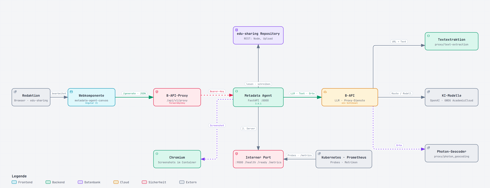

# Metadata Agent API

**English** · [Deutsch](README.de.md)

The Metadata Agent API extracts structured metadata from educational content
with a large language model (LLM). It reads a text, a web page or a repository
node, returns metadata that follows the
[WLO/OEH schema](https://wirlernenonline.de), and can write the result to a
WLO edu-sharing repository. The service is a FastAPI application for
Python 3.13 (version 4.0.3). It also serves the web component
`<metadata-agent-canvas>` that displays and edits the metadata.

## Contents

- [What the service does](#what-the-service-does)
- [Quick start](#quick-start)
- [Choosing the LLM provider](#choosing-the-llm-provider)
- [Architecture](#architecture)
- [Endpoints](#endpoints)
- [Configuration](#configuration)
- [Web component](#web-component)
- [Deployment](#deployment)
- [Documents](#documents)
- [License](#license)

## What the service does

```
Text / URL / node ID
        │
        ▼
   /generate ──────► metadata as flat JSON (envelope and fields on one level)
        │
        ├──► /validate          check required fields and value ranges
        ├──► /export/markdown   human-readable version
        └──► /upload ─────────► node in the WLO repository
                                  ├─ metadata (filtered to repository fields)
                                  ├─ extended data (content type, LRT, full JSON)
                                  ├─ collections (optional, collection_id)
                                  └─ review workflow (200_tocheck)
```

- **Input:** a text, a URL (fetched through a text extraction service), a
  repository node (`node_id`), or a node with the crawler as fallback
  (`node_url`).
- **Extraction:** the agent detects the content type (for example
  `event.json`), extracts the fields in parallel LLM calls, normalizes dates,
  booleans and vocabulary values, and geocodes addresses. The schemas come in
  two contexts, `default` and `mds_oeh` (versions 1.8.0, 1.8.1 and 2.0.0).
- **Repository:** create a node, write metadata, add the node to collections,
  set the review workflow, read the node back and compare.
- **Screenshots:** always captured locally with Chromium (Playwright). No
  external screenshot service is called.
- **Access control:** the service checks no credentials itself. Run it behind
  a proxy that restricts access. In edu-sharing this is the B-API proxy.

Good to know before the first run:

1. **Throughput depends on the provider.** The default `b-api-openai` allows
   20 LLM calls in flight. `b-api-academiccloud` allows 2 in flight and 2 per
   second. See [Choosing the LLM provider](#choosing-the-llm-provider).
2. **A run can take minutes.** With the default model the extraction of a web
   page took 12–22 s (measured 2026-10-16); a text of 4,400 characters takes
   about 5 s (measured 2026-11-15). The deadline for `/generate` is 300 s. A
   proxy in front of the service needs a timeout of about 310 s or more.
3. **A failure is never a `200`.** If not a single field can be extracted,
   `/generate` answers `502` (`503` when the gateway throttles) with an error
   code. Partial results come as `200` with `processing.status: "partial"`.
4. **The repository drops unknown properties silently.**
   [WLO-REPO-FELDER.md](WLO-REPO-FELDER.md) (German) lists which fields are
   written and which are discarded.

## Quick start

You need a **B-API key** (default provider) or an **OpenAI API key**, and
either Docker with Compose 2.24 or newer, or Python 3.13 with
[uv](https://docs.astral.sh/uv/). Details and troubleshooting:
[INSTALL.md](INSTALL.md).

### Docker

```bash
cp .env.template .env       # then set B_API_KEY
docker compose up -d
```

The compose file builds the image, publishes port 8000 on `127.0.0.1` only,
runs the container read-only and sets `stop_grace_period: 320s`, so a running
`/generate` is not cut off on restart. The same without Compose:

```bash
docker build -t metadata-agent-api .
docker run -d -p 127.0.0.1:8000:8000 --read-only --tmpfs /tmp --tmpfs /home/appuser \
  --stop-timeout 320 --env-file .env metadata-agent-api
```

### Local with uv

```bash
uv sync                                 # dependencies and development tools
uv run playwright install chromium      # only needed for screenshots
cp .env.template .env                   # then set B_API_KEY
uv run uvicorn src.main:app --reload --port 8000
```

### Check that it runs

```bash
curl http://localhost:8000/health
# → {"status":"healthy","version":"4.0.3"}

curl -X POST http://localhost:8000/generate \
  -H "Content-Type: application/json" \
  -d '{"text": "Workshop KI in der Bildung am 15. März 2026 in Berlin"}'
```

The interactive API documentation (Swagger UI) is at
`http://localhost:8000/docs`. The agent serves it itself; nothing is loaded
from a CDN. Without `WLO_GUEST_USERNAME` and `WLO_GUEST_PASSWORD` the service
still generates metadata, but `/ready` and the repository endpoints (`/upload`,
`/nodes`, `/node`, `/workflow`, `/upload/verify`) answer `503`.

### Tests, lint, types

```bash
uv run pytest -q -rs --cov              # suite with the coverage floor from pyproject.toml
uv run ruff check && uv run ruff format --check
uv run mypy                             # all of src/
```

The suite runs offline and does not read `.env`. `REQUIRE_BROWSER=1` and
`REQUIRE_HELM=1` turn skipped tests into failures when Chromium, the widget
bundle or `helm` is missing. `RUN_NETWORK_TESTS=1` also runs the tests marked
`slow` against real services. On Windows, if Chromium does not start
(`EPERM … playwright-artifacts`), set `TEMP` and `TMP` in PowerShell to a
directory inside the workspace.

## Choosing the LLM provider

`METADATA_AGENT_LLM_PROVIDER` selects how the agent reaches the model. Three
providers go through the B-API, one talks to an OpenAI-compatible endpoint
directly. `<B-API>` stands for `METADATA_AGENT_B_API_BASE_URL`.

| Provider | Endpoint | Default model | Key | In flight | Per second |
|---|---|---|---|---:|---:|
| `b-api-openai` (default) | `<B-API>/api/v1/llm/openai` | `gpt-6-luna` | B-API key | 20 | no cap |
| `b-api-academiccloud` | `<B-API>/api/v1/llm/academiccloud` | `deepseek-v4-flash` | B-API key | 2 | 2 |
| `b-api-router` | `<B-API>/api/v1/llm/router` | `openai/gpt-6-luna` | B-API key | 20 | no cap |
| `openai` | `METADATA_AGENT_OPENAI_API_BASE`: any OpenAI-compatible endpoint that takes a Bearer token (default `https://api.openai.com/v1`) | `gpt-4o-mini` | `OPENAI_API_KEY` | 20 | no cap |

The last two columns are the default throughput limits. The agent enforces
them for the whole process, not per request, and caps
`METADATA_AGENT_DEFAULT_MAX_WORKERS` (default 20) to them. The startup log
shows the limits that apply.

- **Limits.** `METADATA_AGENT_LLM_MAX_CONCURRENT_REQUESTS` and
  `METADATA_AGENT_LLM_MAX_REQUESTS_PER_SECOND` (`0` = no rate cap) override
  the defaults. A value that is set applies to every provider.
- **AcademicCloud.** The gateway rejects a third parallel request with `429`
  and without `retry-after`. The B-API key also has a quota of about 10 calls
  per minute (measured 2026-10-15); one extraction makes about 50 calls. Both
  limits apply to the key, while the agent throttles per process. Several
  instances must share them (Helm chart: `sharedLlmLimit`).
- **Router.** Routes are defined in the B-API, not in the environment.
  `METADATA_AGENT_B_API_ROUTER_MODEL` names a route or `provider/model`; the
  latter works without a route. A route must hold models of one parameter
  family only. With a route name, set `METADATA_AGENT_LLM_REQUEST_STYLE` to
  `reasoning` (GPT-5, GPT-6, o-models) or `classic` (all others); with `auto`
  a route name is sent as `classic`.
- **Per request.** `llm_provider` and `llm_model` in the body of `/generate`,
  `/detect-content-type` and `/extract-field` override the configuration for
  that call. The throughput limits still apply.
  `METADATA_AGENT_ALLOWED_LLM_MODELS` restricts the models a request may name
  (otherwise `422`).

### Which key carries the LLM calls

For the three B-API providers `METADATA_AGENT_B_API_AUTH_MODE` decides which
key the agent sends to the B-API. With `openai` the agent always uses
`OPENAI_API_KEY`.

| Mode | Request arrives with `Authorization: Bearer …` | Request arrives without it |
|---|---|---|
| `auto` (default) | The header is passed on unchanged | `B_API_KEY` |
| `forward` | The header is passed on unchanged | `502` with `LLM_AUTH_MISSING` |
| `static` | The header is ignored | `B_API_KEY` |

A forwarded key is used for that one request only. It is neither stored nor
logged. `processing.auth_source` in the response names the source
(`forwarded` or `static`).

### Behind the B-API proxy or standalone

| | Behind the B-API proxy | Standalone |
|---|---|---|
| Caller | edu-sharing and the web component, through the B-API proxy entry `metadata-agent-canvas` (`/api/v1/proxy/metadata-agent-canvas/…`) | Any client that reaches port 8000 |
| Key for the LLM calls | The caller's credential (user or guest key). The proxy forwards the key (`forwardApiKey`, older B-API) or a delegation token for it (`forwardDelegation`), and the B-API books usage and limits on it | `B_API_KEY`, or `OPENAI_API_KEY` with the provider `openai` |
| Auth mode | `auto`, or `forward` to run on forwarded keys only (no `B_API_KEY` needed) | `auto` or `static` |
| Access | The service must be reachable through the B-API only. The NetworkPolicy of the Helm chart enforces this | Put an access restriction in front. In mode `auto` anyone who reaches the port runs extractions on `B_API_KEY` |

### Text extraction and geocoder

Text extraction (for URL input) and the geocoder exist once per environment.
`METADATA_AGENT_B_API_SERVICES` decides how the agent reaches them:

| Value | Text extraction | Geocoder |
|---|---|---|
| `auto` (default) | As `proxy` if the provider is a B-API provider and its LLM calls go to `METADATA_AGENT_B_API_BASE_URL`, otherwise as `direct` | Same rule |
| `proxy` | `<B-API>/api/v1/proxy/text-extraction` | `<B-API>/api/v1/proxy/photon_geocoding/api` |
| `direct` | The OpenEduHub text extraction that matches the repository address (staging or production) | `https://photon.komoot.io/api` |

- Calls through the B-API carry the same key as the LLM calls. Every key in
  use needs the rights for the proxy services `text-extraction` and
  `photon_geocoding`, in addition to the LLM endpoints. Direct calls carry no
  key.
- If the right is missing, the agent with `auto` tries its own `B_API_KEY`
  and then the service directly (Photon, the text extraction of the
  repository's environment). Only when every way fails, or with `proxy`,
  extraction from a URL ends with `502` `TEXT_EXTRACTION_AUTH_REFUSED`, and
  places stay without coordinates (`processing.warnings` says why).
- `METADATA_AGENT_TEXT_EXTRACTION_API_URL` names a text extraction of your
  own and overrides the choice. Set it when `direct` applies and the
  repository is not an OpenEduHub host; otherwise extraction from a URL
  answers `503` `TEXT_EXTRACTION_NOT_CONFIGURED`.

All variables, routing examples and error codes:
[ENV-PARAMETER.md](ENV-PARAMETER.md). A short guide to routing and
authentication: [docs/b-api-kurzinfo.md](docs/b-api-kurzinfo.md) (German).

## Architecture



The map shows operation through the B-API (labels in German). The variant
with direct calls, the request flow diagrams and the interactive versions are
described in [docs/architektur/README.md](docs/architektur/README.md)
(German).

Inside the agent a request passes four stages: the input source (text, URL,
node), the parallel LLM field calls under the throughput budget, the
normalization (field types, vocabularies, geocoding, output structure) and
the response. The modules, with paths relative to `src/`:

| Module | Responsibility |
|---|---|
| `main.py` | Builds the app: middleware, lifespan, routers in fixed order, static files |
| `config.py` | Settings from the environment, provider limits, startup warnings |
| `infra.py`, `metrics.py` | `/health`, `/ready`, the internal port; Prometheus metrics |
| `api/routers/` | One router per area: `generate`, `extract`, `detect`, `validation`, `upload`, `save_node`, `nodes`, `verify`, `screenshot`, `schemata`, `widget`, `operations`, `docs`; `generate_docs.py` holds the description and request examples of `/generate` for `/docs` |
| `api/deps.py`, `api/input_resolver.py`, `api/request_body.py`, `api/generate_request.py`, `api/schema_resolution.py` | Shared dependencies of the routers; the text a request works on (text, URL, node); reading and refusing request bodies; reading a `/generate` request and the texts of its run; context, version and schema of a request |
| `api/responses.py`, `api/openapi.py`, `api/params.py`, `api/disconnect.py` | Error responses (`detail` and `error`), the OpenAPI document, path parameters, stopping work when the client disconnects |
| `models/common.py`, `models/extraction.py`, `models/validation.py`, `models/schema_info.py`, `models/screenshot.py`, `models/repository.py` | Request and response models, one module per family: shared validators, limits and the error envelope; `/generate`, `/detect-content-type` and `/extract-field`; `/validate` and `/export/markdown`; `/info/schemata`; `/screenshot`; the repository writes |
| `models/schemas.py`, `models/repository_rules.py` | The facade that re-exports every model (`from ..models.schemas import X`); repository IDs and workflow states |
| `services/metadata_service.py`, `services/metadata_generation.py` | One extraction run: content type, field selection, LLM calls, normalization, geocoding, merge with existing values, status |
| `services/metadata_validation.py`, `services/metadata_export.py` | Validation against the schema; Markdown export |
| `services/llm_service.py`, `services/llm_prompts.py`, `services/llm_content_type.py` | Parallel field extraction; prompts; content type detection |
| `services/llm_transport.py`, `services/llm_gate.py`, `services/llm_auth.py`, `services/llm_errors.py` | One LLM call over HTTP; throughput budget per gateway; which key a call carries; typed errors with code and HTTP status |
| `services/llm_values.py`, `services/llm_dates_numbers.py`, `services/vocabulary_matching.py`, `services/field_normalizer.py`, `services/output_normalizer.py` | Fit model answers to field types; match a value to the concepts of a vocabulary; normalize by field type; shape the output for the web component |
| `services/object_shapes.py` | Which fields hold objects, and whether the values of a record have that shape (checked before a write) |
| `services/input_source_service.py`, `services/geocoding_service.py`, `services/screenshot_service.py` | Text from a URL or a repository node; addresses to coordinates (Photon); screenshots with local Chromium |
| `services/repository_service.py`, `services/repository_write.py`, `services/repository_nodes.py`, `services/repository_metadata.py`, `services/repository_preview_upload.py`, `services/repository_curation.py`, `services/repository_review.py` | Write path to edu-sharing: the flow of one write (`write_node`) and what a write asks for; create and find nodes; write metadata; store the preview image; collections and workflow; read back |
| `services/repository_edit_window.py`, `services/repository_cut_off.py` | How long after its creation a node may be rewritten; what becomes of the node when a write is cut off or fails |
| `services/repository_values.py`, `services/repository_licenses.py`, `services/repository_diff.py`, `services/repository_preview.py`, `services/repository_result.py`, `services/repository_support.py` | Value shaping for the repository API, license detection, expected/actual comparison, decoding or fetching a preview image, the results of a write and the response built from them, shared helpers |
| `services/diagnostics.py`, `services/lifecycle.py` | Reachability checks behind `/debug/dependencies`; closing the HTTP clients at shutdown |
| `utils/request_id.py`, `utils/logging_setup.py`, `utils/loggable.py` | Request ID and tracing headers; logs as text or JSON; URLs made safe for log lines |
| `utils/body_limit.py`, `utils/security_headers.py`, `utils/public_url.py` | Request body limit (`413`); security headers; only public targets for user-supplied URLs |
| `utils/schema_loader.py`, `utils/vocabulary.py`, `utils/dates_numbers.py`, `utils/scalar_values.py`, `utils/text_utils.py`, `utils/tls_context.py` | Loading and caching schemas; closed vocabularies; numbers and dates; booleans and URLs; text helpers; one TLS context for the outgoing clients |
| `schemata/`, `static/` | Schema contexts with vocabularies; Swagger UI assets and the built web component |

## Endpoints

The public port is 8000. The OpenAPI document lists 16 operations: every row
from `/generate` to `/widget/i18n/{lang}.json`. The rows below them are not
part of it.

| Method | Path | Purpose |
|---|---|---|
| `POST` | `/generate` | Generate metadata from a text, a URL or a repository node |
| `POST` | `/detect-content-type` | Detect the content type (schema) of an input |
| `POST` | `/extract-field` | Extract or regenerate a single field |
| `POST` | `/validate` | Validate metadata against the schema: required fields, types, vocabularies |
| `POST` | `/export/markdown` | Convert metadata to a readable Markdown document |
| `POST` | `/upload` | Write metadata to the repository as a node, with collections and workflow |
| `POST` | `/node` | Create a node without metadata and return its ID for a later `/upload` |
| `POST` | `/nodes` | Save a node: create it, or update an existing one by `node_id` |
| `POST` | `/workflow/{node_id}` | Advance the review workflow of a node step by step |
| `POST` | `/upload/verify/{node_id}` | Read a node back and optionally compare it with the expected metadata |
| `POST` | `/screenshot` | Capture a screenshot of a public web page |
| `GET` | `/info/schemata` | List schema contexts and their versions |
| `GET` | `/info/schemas/{context}/{version}` | List the schemas (content types) of a context and version |
| `GET` | `/info/schema/{context}/{version}/{schema_file}` | Return one schema definition |
| `GET` | `/widget/info` | Describe the web component: script URLs (relative to this endpoint), layouts, attributes, events, snippets |
| `GET` | `/widget/i18n/{lang}.json` | UI texts of the web component (`de`, `en`) |
| `GET` | `/widget/dist/…`, `/widget/examples/…` | Static files: bundles of the web component, example pages |
| `GET` | `/docs`, `/openapi.json` | Swagger UI (assets under `/docs-assets/`) and the OpenAPI document |
| `GET` | `/health` | Liveness: status and version |
| `GET` | `/ready` | Readiness: `503` while the configuration is incomplete |
| `GET` | `/debug/auth`, `/debug/dependencies` | Setup checks; `404` unless `METADATA_AGENT_DEBUG_ENDPOINTS=true` |
| `GET` | `/health`, `/ready`, `/metrics` on the internal port | With details and Prometheus metrics; only with `METADATA_AGENT_INTERNAL_PORT` |

Every response carries `X-Request-ID`. Errors have the same shape everywhere:
`detail` plus `error` with `code`, `message` and `request_id`. The agent
redirects no path: a trailing slash (`/generate/`) answers `404`.

Requests, responses, status codes and examples for each endpoint:
[docs/API.md](docs/API.md).

## Configuration

The agent reads its settings from the environment or from a `.env` file in
the working directory. Secrets keep their plain names; every other variable
has the prefix `METADATA_AGENT_`. An empty variable counts as not set. These
are the variables you need first:

| Variable | Default | Purpose |
|---|---|---|
| `B_API_KEY` | empty | B-API key for LLM calls, text extraction and geocoder. Fallback in mode `auto`, not needed in mode `forward` |
| `OPENAI_API_KEY` | empty | Only for the provider `openai` |
| `WLO_GUEST_USERNAME`, `WLO_GUEST_PASSWORD` | empty | Repository account for the write endpoints and node input |
| `METADATA_AGENT_LLM_PROVIDER` | `b-api-openai` | `b-api-openai`, `b-api-academiccloud`, `b-api-router` or `openai` |
| `METADATA_AGENT_B_API_AUTH_MODE` | `auto` | `auto`, `forward` or `static` |
| `METADATA_AGENT_B_API_BASE_URL` | `https://b-api.staging.openeduhub.net` | B-API address. Production: `https://b-api.prod.openeduhub.net` |
| `METADATA_AGENT_REPOSITORY_URL` | `https://repository.staging.openeduhub.net/edu-sharing/rest` | Repository address. Production: `https://redaktion.openeduhub.net/edu-sharing/rest` |
| `METADATA_AGENT_B_API_SERVICES` | `auto` | How text extraction and geocoder are reached: `auto`, `proxy` or `direct` |
| `METADATA_AGENT_REQUIRE_REPOSITORY` | `true` | `false`: `/ready` does not require the repository account (generate-only deployment) |
| `METADATA_AGENT_GENERATE_TIMEOUT` | `300` | Deadline in seconds for a whole `/generate` |
| `METADATA_AGENT_CORS_ORIGINS` | `*` | Allowed origins, comma-separated |
| `METADATA_AGENT_LOG_FORMAT` | `text` | `json` writes one object per line for a log collector |
| `METADATA_AGENT_INTERNAL_PORT` | empty | Second port for `/health`, `/ready` and `/metrics`; needs exactly one worker per container |
| `METADATA_AGENT_DEBUG_ENDPOINTS` | `false` | Enables `/debug/auth` and `/debug/dependencies` |

The address defaults point to staging. At startup the agent logs the
effective addresses and warns when settings cannot work together, for example
when the addresses belong to different environments. The repository address
comes from the environment only; the request parameter `repository` is
deprecated and ignored.

Every variable with its default and examples per mode of operation:
[ENV-PARAMETER.md](ENV-PARAMETER.md). A commented template:
[`.env.template`](.env.template).

## Web component

The agent serves the built web component `<metadata-agent-canvas>` (Angular
Elements) as static files, so other applications can embed it without a build
of their own.

| Path | Content |
|---|---|
| `/widget/dist/` | `runtime.js`, `polyfills.js`, `main.js`, `styles.css` and the self-hosted fonts (`fonts/`) |
| `/widget/examples/` | Example pages, for example `boilerplate.html` (minimal template), `full.html`, `detail.html` |
| `/widget/i18n/{lang}.json` | UI texts in `de` and `en` |
| `/widget/info` | JSON with script URLs, layouts, layout aliases, attributes, events and ready-made snippets. The URLs are relative to the address of `/widget/info` (`dist/main.js`, `examples/full.html`); in the snippets `{AGENT_URL}` stands for the address of the agent |

A minimal embed:

```html
<!-- Fonts and icons are self-hosted and come with styles.css -->
<link rel="stylesheet" href="https://AGENT-URL/widget/dist/styles.css">
<script src="https://AGENT-URL/widget/dist/runtime.js" defer></script>
<script src="https://AGENT-URL/widget/dist/polyfills.js" defer></script>
<script src="https://AGENT-URL/widget/dist/main.js" defer></script>

<metadata-agent-canvas layout="default"></metadata-agent-canvas>
```

- **API address.** The component calls the address it was loaded from:
  everything before `/widget/dist/` in the URL of `main.js`, including a proxy
  prefix such as `/edu-sharing/rest/bapi/api/v1/proxy/metadata-agent-canvas`.
  To use another address, set the attribute `api-url`, or set
  `window.__ENV = { agentUrl: '…' }` before the scripts.
- **HTTPS.** A page served over HTTPS can only call an agent that is also
  reachable over HTTPS. Browsers block the requests otherwise (mixed content).
- **Versions.** The web component 3.x needs the agent 3.x; update both together.
- **Updating the bundle.** In the widget repository, `npm run build:elements`
  builds the component and copies bundles, fonts, translations and license
  texts to `src/static/widget/` of an agent checkout. Name the target with
  `--target=<agent>/src/static/widget` or `WIDGET_TARGET`. The script stops if
  the target agent has another major version. The example pages are
  maintained in this repository and are not copied.

Layouts, attributes, events and data exchange:
[WIDGET-REFERENZ.md](WIDGET-REFERENZ.md) (German). Source code, development
and embedding in edu-sharing: the README of the
[widget repository](https://scm.edu-sharing.com/edu-sharing/projects/wlo/metaservices/metadata-agent-webcomponent).

## Deployment

[DEPLOYMENT.md](DEPLOYMENT.md) covers Docker and Kubernetes in detail: update
notes for an existing deployment, the checklist for the first installation and
the rollback. Read its update notes before you update. The handover to
operations (ports, headers, metrics, alert rules, scaling, costs) is in
[UEBERGABE.md](UEBERGABE.md) (German).

### Docker image

The CI publishes the image `metadata-agent-api` to the internal registry: tag
`v<version>` for a release tag, `main` and `develop` for the branches.

```bash
docker pull $DOCKER_REGISTRY/projects/wlo/meta-services/metadata-agent-api:v4.0.3
docker run -d --name metadata-agent-api -p 127.0.0.1:8000:8000 \
  --read-only --tmpfs /tmp --tmpfs /home/appuser --stop-timeout 320 \
  -e B_API_KEY=<key> \
  $DOCKER_REGISTRY/projects/wlo/meta-services/metadata-agent-api:v4.0.3
```

- The image contains Chromium (the headless shell) for screenshots and the
  built web component. It runs as the non-root user `appuser` with one worker,
  started through `tini`; scale with replicas.
- The root file system can be read-only if `/tmp` and `/home/appuser` are
  writable. `--stop-timeout 320` lets a running `/generate` (up to 300 s)
  finish; Docker's default of 10 s would cut it off.
- To serve other hosts, publish the port only behind an access restriction.

### Kubernetes

The Helm chart in [`helm/metadata-agent/`](helm/metadata-agent/README.md)
(German) creates the Deployment, two Services (`<name>` with port 8000 for the
API, `<name>-internal` with port 9000 for the internal endpoints), a
NetworkPolicy, a PodDisruptionBudget, a ServiceMonitor and alert rules
(`PrometheusRule`). An Ingress and a Secret are optional.

```bash
kubectl create secret generic metadata-agent \
  --from-literal=B_API_KEY='<B_API_KEY>' \
  --from-literal=WLO_GUEST_USERNAME='<WLO_GUEST_USERNAME>' \
  --from-literal=WLO_GUEST_PASSWORD='<WLO_GUEST_PASSWORD>'
helm install metadata-agent helm/metadata-agent \
  --set image.repository=$DOCKER_REGISTRY/projects/wlo/meta-services/metadata-agent-api \
  --set secret.existingSecret=metadata-agent
```

- `image.repository` is required. The chart values point to production (B-API
  and repository), unlike the defaults of the service. `image.digest` pins
  the image; in an IPv6 cluster set `listenHost: "::"`.
- Behind the B-API the service needs no Ingress: the B-API proxy calls the
  Service inside the cluster.
- Adapt the namespaces and ports of the NetworkPolicy to the cluster before
  you install. By default only the namespace `b-api` may call port 8000.

### Other runtimes

Without Docker, a runtime must allow requests that run up to 300 s, provide
Chromium for screenshots, and ship `src/static/widget/` with the application.
Build with `uv sync --locked --no-dev && uv run playwright install --with-deps chromium`,
start with `uv run uvicorn src.main:app --host 0.0.0.0 --port $PORT`.

## Documents

Documents marked "(German)" exist in German only.

| Document | Content |
|---|---|
| [INSTALL.md](INSTALL.md) | Installation in detail: local, Docker, Compose, checks, troubleshooting |
| [DEPLOYMENT.md](DEPLOYMENT.md) | Deployment with Docker and Kubernetes, updates, first installation, rollback |
| [ENV-PARAMETER.md](ENV-PARAMETER.md) | Every environment variable with default and examples per mode of operation |
| [docs/API.md](docs/API.md) | API reference: requests, responses, status codes, usage examples |
| [UEBERGABE.md](UEBERGABE.md) (German) | Handover to operations: ports, headers, metrics, alert rules, scaling, costs |
| [helm/metadata-agent/README.md](helm/metadata-agent/README.md) (German) | Helm chart with ServiceMonitor and alert rules |
| [docs/steckbrief.md](docs/steckbrief.md) (German) | Service profile for the handover to operations, in the common schema for services: master data, architecture, deployment, security, monitoring, resources and costs, each with its status; open and critical items |
| [docs/team6-anforderungen.md](docs/team6-anforderungen.md) (German) | Coverage of the operations team's service requirements, as of 3.0.0 (historical) |
| [docs/b-api-kurzinfo.md](docs/b-api-kurzinfo.md) (German) | Short guide to B-API routing and authentication |
| [docs/architektur/README.md](docs/architektur/README.md) (German) | Architecture map and request flow as HTML, PNG and SVG, and how to regenerate them |
| [WIDGET-REFERENZ.md](WIDGET-REFERENZ.md) (German) | Web component: layouts, attributes, events |
| [UPLOAD-RESPONSE.md](UPLOAD-RESPONSE.md) (German) | Response format of `/upload` |
| [WLO-REPO-FELDER.md](WLO-REPO-FELDER.md) (German) | Which fields are written to the repository, and which the repository discards |
| [OBJEKTFELDER.md](OBJEKTFELDER.md) (German) | Rule for object fields in `ccm:oeh_extendedData`, for work on schemas and normalizers |
| [ENTWICKLER-UEBERSICHT.md](ENTWICKLER-UEBERSICHT.md) (German) | For integrators: core fields, collections, workflow |
| [CHANGELOG.md](CHANGELOG.md) (German) | Changes per version, including unreleased ones |

## License

Apache License 2.0, see [LICENSE](LICENSE). Third-party components in the
image (Python packages, Chromium, fonts, Swagger UI, web component) and their
licenses: [NOTICE](NOTICE).
