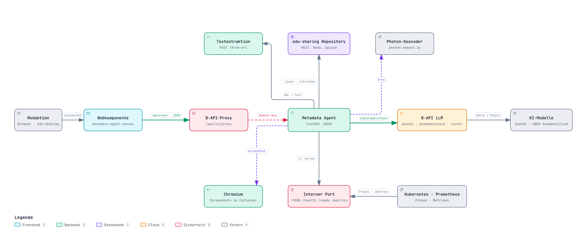

# Übergabe an den Betrieb (Team 6)

Stand 2.1.1. Gegliedert nach der Checkliste „Übergabepaket“ aus den
Anforderungen von Team 6. Einzelheiten stehen in
[ENV-PARAMETER.md](ENV-PARAMETER.md) und [DEPLOYMENT.md](DEPLOYMENT.md);
dieses Dokument verweist dorthin, statt sie zu wiederholen. Felder in
**[eckigen Klammern]** muss T4 noch ausfüllen. Eine Kurzübersicht, welche
Anforderungen erfüllt sind, steht in
[docs/team6-anforderungen.md](docs/team6-anforderungen.md).

## 1. Repo, CI, Image

| | |
|---|---|
| Repo | API: <https://scm.edu-sharing.com/edu-sharing/projects/wlo/metaservices/metadata-agent>; Webkomponente: <https://scm.edu-sharing.com/edu-sharing/projects/wlo/metaservices/metadata-agent-webcomponent> (das gebaute Widget liegt im API-Repo unter `src/static/widget/`). Ob T6 Zugriff hat, ist noch zu bestätigen. |
| CI | `.gitlab-ci.yml` baut bei jedem Push auf `main`/`develop` ein Image mit dem Branch als Tag und bei jedem Git-Tag ein Image mit der Version (z.B. `v2.1.1`). Produktion nur mit Versions-Tags. |
| GitLab-CI/CD-Variablen | Die Docker-Jobs in `.gitlab-ci.yml` brauchen: `DIND_IMAGE`, `DIND_HOST`, `DIND_DRIVER`, `DIND_TLS_CERTDIR` (Docker-in-Docker), `DOCKER_REGISTRY`, `DOCKER_USERNAME`, `DOCKER_PASSWORD` (maskiert). Test- und Ruff-Jobs brauchen keine. Die Webkomponente braucht keine eigenen Variablen. |
| GitHub-Spiegel | `.github/workflows/docker-publish.yml`: Tests, Chart-Prüfung und Image-Bau bei jedem Push; nach DockerHub nur mit Secret `DOCKERHUB_PASSWORD` |
| Helm-Chart | [`helm/metadata-agent/`](helm/metadata-agent/README.md); die CI prüft ihn mit `helm lint` und die Alarmregeln mit `promtool` (Jobs `helm lint`, `alert rules`) |
| Image | Multi-Stage auf `python:3.13-slim`, läuft als Nutzer `appuser` (UID 1000), `.dockerignore` vorhanden, HEALTHCHECK auf `/health`. Enthält Chromium für Screenshots (~400 MB), daher größer als ein reiner API-Dienst. |
| Daten im Image | nur die Schemata (wenige MB); keine Modelle oder Korpora |

## 2. API

- **OpenAPI-Spec:** `/openapi.json`, Swagger-UI unter `/docs`. Die Spec wird
  aus dem Code erzeugt. Swagger UI liefert der Agent selbst aus (keine Anfragen
  an CDNs oder Google Fonts); `/redoc` gibt es nicht mehr.
- **Anzeigename:** `Metadata Agent API`.
- **Beschreibung für Endnutzende** (steht als `info.summary` in der Spec):
  „Erschließt Bildungsinhalte mit KI: Aus einem Text, einer Webseite oder einem
  Repository-Eintrag erzeugt der Dienst passende Metadaten wie Titel,
  Beschreibung, Schlagworte, Bildungsstufe und Inhaltsart.“

### Ports und auszublendende Pfade

| Port | Inhalt | Ingress |
|---|---|---|
| 8000 | öffentliche API, `/docs`, `/openapi.json`, Widget unter `/widget/*` | ja |
| `METADATA_AGENT_INTERNAL_PORT` (z.B. 9000) | `/health`, `/ready`, `/metrics` | **nein** |

- Nicht in der Spec stehen `/health`, `/ready`, `/debug/auth` und
  `/debug/dependencies`.
- `/health` und `/ready` gibt es zusätzlich auf Port 8000, damit bestehende
  Probes und der Docker-HEALTHCHECK weiter funktionieren.
- `/debug/*` antwortet nur mit `METADATA_AGENT_DEBUG_ENDPOINTS=true`, sonst mit
  `404`. Diese Pfade bitte zusätzlich am Ingress sperren.
- `/metrics` gibt es nur auf dem internen Port.

### Header

| Header | Richtung | Wozu |
|---|---|---|
| `Authorization: Bearer <key>` | ein | Schlüssel des Aufrufers, den der B-API-Proxy weiterreicht (`forwardApiKey`). Er wird für die KI-Aufrufe unverändert weitergegeben. |
| `x-client-trace-id`, `x-request-id`, `x-b3-*`, `b3` | ein → weiter | Tracing. Wird unverändert an B-API, Textextraktion und Repository weitergegeben, nie an Fremddienste. |
| `X-Request-ID` | aus | Anfrage-ID (gleich `x-client-trace-id`, wenn vorhanden). Steht auch in Fehlerantworten als `error.request_id` und in der Logzeile zum Fehler. Ohne diesen Header können Nutzer einen Fehler nicht eindeutig melden. |

### Content-Types und Antwortzeiten

- **Content-Types:** Die API spricht nur `application/json`; Bilder kommen
  base64-kodiert im JSON. Das Widget liefert statische Dateien aus: JS, CSS,
  `woff2`-Schriften, HTML-Demoseiten und JSON-Übersetzungen. Es gibt keine
  Streams und keine Datei-Uploads per multipart.
- **Antwortzeiten:**
  - `/generate` mit etwa 50 Feldern: mit `gpt-6-luna` 12–22 s (gemessen
    16.10.2026), mit AcademicCloud bis 90 s (Warteschlange am Gateway).
  - `/extract-field`, `/detect-content-type`: wenige Sekunden.
  - Screenshots: höchstens 90 s.
  - **Proxy- und Ingress-Timeout für `/generate`: mindestens 120 s.**
- **Async-Jobs** (Job anlegen, Status abfragen) gibt es nicht. Das wäre der
  nächste Schritt, falls 120 s im Proxy nicht gehen.

## 3. B-API

**Variante A (Standard): über die B-API geroutet.**

- **Virtueller Key:** wird gebraucht, denn der Dienst ruft selbst LLMs auf.
  `METADATA_AGENT_B_API_AUTH_MODE=auto` nutzt den weitergereichten Schlüssel
  und fällt sonst auf `B_API_KEY` zurück; `forward` nutzt nur den
  weitergereichten.
- **Rechte des Keys:** Zugriff auf die LLM-Endpunkte der B-API (`openai`, bei
  Routing `router`). **Kein** `LLM_ROUTE_MANAGE`.
- **Modell-Routing** (`METADATA_AGENT_LLM_PROVIDER=b-api-router`):
  - Der Default `openai/gpt-6-luna` braucht keine Route.
  - Die Route legt ein Administrator **in der B-API** an; in der Env steht nur
    ihr Name. Muster in
    [ENV-PARAMETER.md](ENV-PARAMETER.md#wo-routen-definiert-werden).
  - **Qualität reicht, Durchsatz nicht:** Laut Kurztest vom 15.10.2026 (siehe
    unten) genügen die Qwen-Modelle inhaltlich. Das gemeinsame GWDG-Kontingent
    (~10 Aufrufe pro Minute) reicht für den Produktivbetrieb aber nicht. Bis
    das Kontingent steigt, bleibt `b-api-openai` mit `gpt-6-luna` der
    Standard.

**Kurztest Qwen gegen `gpt-6-luna`, 15.10.2026.** Getestet wurden zwei Seiten,
LEIFIphysik „Gleichförmige Bewegung“ (Lernmaterial) und DHM „Ausstellungen“
(Veranstaltung). Gemessen wurden die Erkennung der Inhaltsart und 13 Felder je
Seite, über den Router mit `academiccloud/<modell>` und dem Code des Agenten.

Erster Lauf, mit den damaligen Fehlern im Agenten:

| | `gpt-6-luna` | `qwen3-30b-a3b-instruct-2507` | `qwen3.6-35b-a3b` |
|---|---|---|---|
| Inhaltsart erkannt | 2/2 | 2/2 | 0/2 (Antwort unter falschem Schlüssel, s.u.) |
| Felder gefüllt | 10 + 10 von 13 | 11 + 11 von 13 | 10 + 4 von 13; mit `reasoning_effort: none` 9 + 9 |
| Titel, Beschreibung, Schlagworte | gut | gut | gut, sobald es antwortet |
| Daten (Beginn/Ende) | richtig | richtig | richtig |
| Ort (DHM) | „Zeughaus“ (dort geschlossen) | „Pei-Bau“ (richtig) | – |
| Fach (Physik-Seite) | Physik | Chemie ✗ | Chemie ✗ |
| Dauer für 14 Aufrufe | ~4 s | ~90 s | ~90 s |

Nachtest nach den Korrekturen: vollständiges Vokabular, Schlüssel `value`
angenommen, `qwen3.6` mit `METADATA_AGENT_B_API_ROUTER_REASONING_EFFORT=none`.

| | `gpt-6-luna` | `qwen3-30b-a3b-instruct-2507` | `qwen3.6-35b-a3b` |
|---|---|---|---|
| Inhaltsart erkannt | 2/2 | 2/2 | 1/2 (eine Antwort als Liste, inzwischen behoben) |
| Felder gefüllt | 12 + 9 von 13 | 11 + 11 von 13 | 10 + 9 von 13 |
| Fach | Physik, Geschichte | Physik, Geschichte | Physik, Geschichte |
| Leere Antworten | – | – | keine |

Bei Qwen bestimmt die Drosselung auf 9 Aufrufe pro Minute die Dauer, nicht
das Modell.

- **Qualität der Texte:** Bei Titel, Beschreibung, Schlagworten und Daten
  reicht `qwen3-30b-a3b-instruct-2507`. Es rät aber eher Werte, die nicht im
  Text stehen, etwa Bildungsstufe und Fach für die Ausstellung.
- **Ergebnis:** Mit den Korrekturen erreichen beide Qwen-Modelle bei den
  getesteten Feldern etwa das Niveau von `gpt-6-luna`. `qwen3-30b` füllt
  etwas mehr Felder, rät aber eher Werte, die nicht im Text stehen.
- **Drei Ursachen lagen im Agenten, nicht im Modell; alle sind behoben:**
  1. Der Prompt zeigte nur die ersten 20 Begriffe eines Vokabulars. „Physik“
     steht in der Fächerliste an Position 46 von 69, „Chemie“ an Position 10.
     Wer sich an die Liste hielt, konnte Physik gar nicht wählen. Jetzt stehen
     bis zu 300 Begriffe im Prompt.
  2. Für die Inhaltsart nutzt der Agent den System-Prompt der Feldextraktion.
     Der verlangt den Schlüssel `value`, der Nutzer-Prompt `content_type`.
     `qwen3.6` folgte dem System-Prompt (`{"value": "event.json"}`), und der
     Agent verwarf die richtige Antwort. Jetzt gilt beides, auch eine Antwort
     als Liste mit einem Eintrag.
  3. Denkende Modelle wie `qwen3.6` brauchen `reasoning_effort: "none"`. Ohne
     den Parameter verbrauchen sie das Token-Budget fürs Nachdenken und liefern
     `content: null`, was der Agent als „kein Wert“ zählte. Jetzt sendet ihn
     `METADATA_AGENT_B_API_ROUTER_REASONING_EFFORT`, und eine leere Antwort
     ist der Fehler `LLM_EMPTY_ANSWER`.
- **Durchsatz:** Ein vollständiges `/generate` braucht ~50 Aufrufe. Beim
  gemeinsamen GWDG-Limit von ~10 pro Minute sind das 5–6 Minuten je
  Erschließung, unabhängig von der Qualität. Für die interaktive Nutzung
  reicht das ohne höheres GWDG-Kontingent nicht.

**Variante B (ohne B-API).**

- **LLM-Zugang per Env (ausgehend):** wie in 2.0.x `B_API_KEY` für die
  LLM-Endpunkte der B-API (`METADATA_AGENT_B_API_AUTH_MODE=static`, oder
  `auto` ohne weitergereichten Header). Alternativ
  `METADATA_AGENT_LLM_PROVIDER=openai` mit `OPENAI_API_KEY` und optional
  `METADATA_AGENT_OPENAI_API_BASE` für einen anderen OpenAI-kompatiblen
  Endpunkt.
- **Lücke, Auth für Aufrufer (eingehend):** Der Dienst prüft nicht, wer ihn
  aufruft. Ohne B-API muss ein anderer Proxy den Zugang absichern.

**Netzwerk:** In Variante A darf der Dienst nur über die B-API erreichbar sein.
Sonst laufen Anfragen ohne Header im Modus `auto` auf den eigenen `B_API_KEY`.

## 4. Monitoring und Logging

- **`/metrics`** (Prometheus) auf dem internen Port:
  - Prozess- und Python-Laufzeitmetriken;
  - `metadata_agent_http_requests_total` und `…_duration_seconds` (nach
    Methode, Routen-Vorlage, Status);
  - `metadata_agent_llm_requests_total` und `…_duration_seconds` (nach
    Provider und Ergebnis: `ok` oder Fehlercode); der Zähler zusätzlich nach
    `auth_source` (`forwarded`, `static`, `openai`, `none`) und `config`
    (`default`, oder `override`, wenn die Anfrage Provider/Modell gewählt hat);
  - `metadata_agent_generations_total` (nach `success`, `partial`, `failed`);
  - `metadata_agent_upstream_requests_total` (gesendet),
    `…_responses_total` (beantwortet, nach HTTP-Status) und
    `…_response_duration_seconds` je abhängigem Dienst (`llm`,
    `text-extraction`, `repository`, `geocoder`); gesendet minus beantwortet
    sind Aufrufe ohne Antwort;
  - `metadata_agent_llm_tokens_total` (nach Provider und `prompt`, `cached`,
    `completion`), auch für den Cache-Vorlauf.
- **Logs** gehen nach stdout. `METADATA_AGENT_LOG_FORMAT=json` schreibt ein
  Objekt je Zeile mit `time`, `level`, `logger`, `message` und `trace_id`.
  `METADATA_AGENT_LOG_LEVEL` steuert die Schwelle.
- **Alarmregeln:** zehn Regeln in
  [`helm/metadata-agent/files/alerts.yaml`](helm/metadata-agent/files/alerts.yaml),
  vom Chart als `PrometheusRule` installiert und je Namespace ausgewertet.
  Kritisch sind nur Fehler mit dem eigenen Schlüssel und dem konfigurierten
  Modell; Fehler mit dem weitergereichten Schlüssel eines Aufrufers oder einem
  per Anfrage gewählten Modell warnen nur.
  | Regel | Schwere | Löst aus bei |
  |---|---|---|
  | `MetadataAgentLlmKeyRefused` | critical | einem `LLM_AUTH_*` in 10 min mit eigenem oder fehlendem Schlüssel und konfiguriertem Modell |
  | `MetadataAgentLlmRouteMisconfigured` | critical | einem `LLM_ROUTE_*` oder `LLM_MODEL_NOT_FOUND` in 10 min mit konfiguriertem Modell |
  | `MetadataAgentLlmCallerKeyRefused` | warning | mehr als 5 × `LLM_AUTH_*` in 15 min mit weitergereichtem Schlüssel |
  | `MetadataAgentLlmRequestedModelRejected` | warning | mehr als 5 Fehlern zu Route, Modell oder Berechtigung in 15 min mit per Anfrage gewähltem Modell |
  | `MetadataAgentLlmThrottled` | warning | mehr als 5 × `LLM_RATE_LIMITED` in 15 min |
  | `MetadataAgentLlmUnreachable` | warning | mehr als 3 × `LLM_UNREACHABLE` in 10 min |
  | `MetadataAgentGenerationsFailing` | warning | über 50 % `failed` in 30 min (ab 3 Läufen) |
  | `MetadataAgentUpstreamUnanswered` | warning | mehr als 3 Aufrufen ohne Antwort in 10 min (je Dienst, ohne `llm`) |
  | `MetadataAgentUpstreamServerErrors` | warning | mehr als 5 Antworten mit 5xx in 10 min (je Dienst) |
  | `MetadataAgentGenerateSlow` | warning | p95 von `/generate` über 100 s, 15 min lang |

  `promtool test rules helm/metadata-agent/tests/alerts.test.yaml` prüft jede
  Regel mit Testdaten (auslösend und nicht auslösend). Pod-Ausfälle melden die
  Cluster-Regeln (`TargetDown`, `KubePodCrashLooping`). Wer den Alarm bekommt,
  legt T6 im Alertmanager fest.

## 5. Zustand, Skalierung, Architektur



Als Bild für Dokumente: [PNG](docs/architektur/metadata-agent-architektur.png)
oder [SVG](docs/architektur/metadata-agent-architektur.svg); interaktiv:
[HTML](docs/architektur/metadata-agent-architektur.html).

Ablauf einer Anfrage über die B-API (Schlüssel, Tracing-Header, Timeouts):
[PNG](docs/architektur/metadata-agent-ablauf.png),
[SVG](docs/architektur/metadata-agent-ablauf.svg),
[HTML](docs/architektur/metadata-agent-ablauf.html). Kurzfassung der Übergabe
als Steckbrief: [docs/steckbrief.md](docs/steckbrief.md).

- **Zustandslos:** keine Datenbank, keine Sessions, keine Dateien zur Laufzeit.
  Jeder Pod kann jede Anfrage beantworten, auch mehrere Pods nebeneinander.
- **Grenzen je Pod:** gleichzeitige KI-Aufrufe (Default 20) und
  Screenshot-Plätze (2) gelten pro Prozess. Bei N Pods addieren sie sich.
  Das gemeinsame GWDG-Limit (~10/min) teilen sich dagegen alle, deshalb dort
  nicht über Replicas skalieren.
- **Ein Worker je Container:** Der interne Port und die Metriken setzen das
  voraus. Skaliert wird über Replicas.

```
Browser ─ edu-sharing ─ B-API-Proxy ─┐
                                      ▼
                         Metadata Agent (FastAPI, 1 Prozess)
            ┌───────────────┬──────────┴────────┬────────────────┬──────────────┐
            ▼               ▼                   ▼                ▼              ▼
   B-API LLM (OpenAI/   Textextraktion    edu-sharing      Photon-Geocoder   Chromium im
   AcademicCloud/Router)  (/from-url)      Repository       (photon.komoot.io) Container (Screenshots)
```

## 6. Ressourcen, Daten, Konfiguration

- **Ressourcen:** Request 500m CPU / 512Mi, Limit 2 CPU / 2Gi. Das ist
  geschätzt und **nicht unter Last gemessen**; empfohlen ist ein Lauf mit
  `docker stats` während eines `/generate` mit Screenshot. Speicherspitzen
  entstehen durch Chromium.
- **Datenbanken, Redis, Volumes:** keine. Im Helm-Chart gibt es nichts
  abzuschalten.
- **Konfiguration:** alles per Env, mit Defaults in
  [ENV-PARAMETER.md](ENV-PARAMETER.md). Secrets: `B_API_KEY` (im Modus
  `forward` nicht nötig), `OPENAI_API_KEY` (nur Variante B),
  `WLO_GUEST_USERNAME`, `WLO_GUEST_PASSWORD`. Referenz: `Dockerfile`,
  `docker-compose.yml`. `METADATA_AGENT_REQUEST_TIMEOUT` (Timeout je
  KI-Aufruf) ist in Code, Compose und Template einheitlich 90 s, ein Puffer
  unter dem Ingress-Timeout von 120 s.

Helm-Chart: [`helm/metadata-agent/`](helm/metadata-agent/README.md) mit
Deployment (Probes auf dem internen Port, 120 s Grace-Period für laufende
Erschließungen), Service, PodDisruptionBudget, Secret, `ServiceMonitor` und
`PrometheusRule`. Ein Ingress (Annotationen `proxy-read-timeout 120`,
`proxy-body-size 20m`) ist abschaltbar vorhanden, gehört aber nicht vor einen
Dienst hinter der B-API: Der Proxy ruft den Service im Cluster auf; bei
aktivem Ingress im Modus `auto` warnt `helm install`.
Die Werte in `values.yaml` sind per Test mit dem Code abgeglichen. Geprüft mit
`helm lint --strict` und kubeconform gegen Kubernetes 1.33 (16.10.2026), nicht
in einem echten Cluster installiert. `/debug/*` ist per
`METADATA_AGENT_DEBUG_ENDPOINTS=false` aus; der interne Port ist nicht im
Ingress.

## 7. Kosten

**Gemessen am 16.10.2026** mit `gpt-6-luna` über die B-API (Staging), echte
Webseiten als Eingabe, Standardeinstellungen des Agenten. Ein `/generate`
macht 52 KI-Aufrufe (Inhaltsart, ein Cache-Vorlauf, ein Aufruf je Feld; mit
AcademicCloud ohne Vorlauf 51) und dauert 12–22 s.

| Seite (Textlänge) | aus dem Cache | Kosten je Erschließung | je 1.000 | ohne Caching |
|---|---:|---:|---:|---:|
| LEIFIphysik „Kreisbewegung“ (6.100 Zeichen) | 66 % | 0,007 € | 7 € | 0,017 € |
| Klexikon „Saturn“ (12.900 Zeichen) | 79 % | 0,008 € | 8 € | 0,029 € |
| Wikipedia „Atomkern“ (66.600 Zeichen) | 93 % | 0,017 € | 17 € | 0,115 € |

- **Preisbasis:** OpenAI-Listenpreis „Standard, Short context“
  (developers.openai.com/api/docs/pricing, abgerufen 16.10.2026), je 1 Mio.
  Tokens: Eingabe 0,10 $, gecachte Eingabe 0,01 $, Cache-Schreiben 0,125 $,
  Ausgabe 0,50 $; umgerechnet mit 1 € = 1,1186 $ (EZB, 08.10.2026). Für
  Datenresidenz-Endpunkte verlangt OpenAI 10 % Aufschlag; welchen Weg die
  B-API nutzt, ist zu klären.
- **Input-Caching:** Jeder Feld-Aufruf schickt den ganzen Seitentext mit. Der
  Cache der B-API trifft aber nur dort, wo ein früherer Prompt endete. Deshalb
  steht der Text als eigene Nachricht vor der Feldanweisung, und ein kurzer
  Vorlauf-Aufruf, der genau nach dem Text endet, läuft vor den Feld-Aufrufen
  (`LLMService._prime_text_cache`, nur für `b-api-openai` und `openai`). Ohne
  Vorlauf kamen 0 % aus dem Cache, und jede Eingabe wurde als
  Cache-Schreibvorgang (0,125 $) berechnet; das ist die Spalte „ohne Caching“.
- **Die Kosten hängen weiter vor allem an der Textlänge**, aber deutlich
  schwächer: Die lange Wikipedia-Seite kostet jetzt etwa das 2,5-Fache der
  kurzen statt des 7-Fachen. Ausgabe-Tokens (inklusive Reasoning) machen
  unter 10 % aus. Dieselbe Seite kurz danach erneut erschlossen: gemessen
  0,002 €.
- Gebucht wird auf den Schlüssel des Aufrufers (Variante A). Die Nutzungsdaten
  der B-API zeigen nach den ersten Produktivwochen die tatsächlichen Kosten.
- **Externe Dienste:** Photon-Geocoder (frei, ohne Schlüssel),
  Textextraktion und Repository (eigene Dienste).

## 8. Ansprechperson und Wartung

- Ansprechperson T4: **[Name, Kontakt]**
- Updates (Abhängigkeiten, Sicherheitspatches, Modellwechsel) stößt
  **[wer]** an. Modelle wechseln ohne Code-Änderung über Env oder Route.
