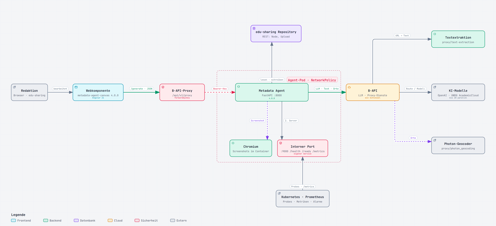

# Architektur-Map

Überblick über den Metadata Agent: Webkomponente, B-API-Proxy, Agent,
LLM-Anbindung, angebundene Dienste und Betrieb. Die Map für den Betrieb über
die B-API zeigt den Stand 4.0.0.

Es gibt zwei Sätze, je eine Map und einen Anfrageablauf:

| Betrieb | Textextraktion und Geocoder | Dateien |
|---|---|---|
| **über die B-API** (Standard mit einem B-API-Provider, `METADATA_AGENT_B_API_SERVICES=auto`) | über die Pfade der B-API, mit dem Schlüssel des Aufrufers | `metadata-agent-architektur-b-api.*`, `metadata-agent-ablauf-b-api.*` |
| **direkt** (ohne B-API, oder `METADATA_AGENT_B_API_SERVICES=direct`) | direkte Aufrufe, ohne Schlüssel | `metadata-agent-architektur.*`, `metadata-agent-ablauf.*` |



> **Stand der Dateien (19.10.2026):** 3.0.0 – Titel, NetworkPolicy und
> schreibgeschütztes Dateisystem im Chart. HTML am 18.10. mit Archify 3.1.0
> erzeugt (alle Prüfungen bestanden), PNG und SVG daraus exportiert. Am 19.10.
> nur die Zeitlimits nachgezogen: `/generate` höchstens 300 s (vorher 110 s),
> Ingress und Grace-Period 320 s, Proxys davor mindestens ~310 s – in den
> JSON-Quellen, im HTML und im SVG ersetzt (gleich lange Texte, Layout
> unverändert), das Ablauf-PNG aus dem SVG neu gerendert.

> **Stand der B-API-Fassungen:**
>
> - **Map** (`metadata-agent-architektur-b-api.*`): am 15.11.2026 für 4.0.0
>   neu gezeichnet. Neu sind der Rahmen um den Pod des Agenten
>   (NetworkPolicy), der interne Port als eigener Service, die Versionen und
>   in den Erläuterungen der Cache-Vorlauf mit Haltepunkt. Jede Komponente
>   nennt ihre Stelle im Code; die Verweise in der HTML-Ansicht öffnen das
>   GitHub-Repository am Commit `7eac5e1`.
> - **Ablauf** (`metadata-agent-ablauf-b-api.*`): vom 13.11.2026, im Titel
>   steht noch 3.0.1. Er gilt weiter, mit einer Abweichung: Seit 4.0.0 läuft
>   der Cache-Vorlauf gleichzeitig mit der Erkennung der Inhaltsart.
>
> Beide mit Archify 3.2.0 erzeugt (alle automatischen Prüfungen bestanden),
> SVG über den Export der HTML-Ansicht („SVG · Light“), PNG daraus in
> doppelter Größe gerendert.

| Datei | Zweck |
|---|---|
| `metadata-agent-architektur-b-api.png`, `.svg`, `.html`, `.json` | Map für den Betrieb über die B-API: LLM, Textextraktion und Geocoder hinter der B-API, Repository direkt |
| `metadata-agent-ablauf-b-api.png`, `.svg`, `.html`, `.json` | Anfrageablauf für den Betrieb über die B-API: ein Schlüssel für alle Aufrufe an die B-API |
| `metadata-agent-architektur.png` | Bild zum Einfügen in Dokumente (3220×1276, weißer Hintergrund) |
| `metadata-agent-architektur.svg` | Dasselbe als Vektorgrafik, Schrift eingebettet |
| `metadata-agent-architektur.html` | Interaktive Ansicht mit Erläuterungen je Komponente, im Browser öffnen |
| `metadata-agent-architektur.json` | Quelle der Map (Archify-Format, Typ `architecture`) |
| `metadata-agent-ablauf.png`, `.svg`, `.html` | Anfrageablauf mit direkt aufgerufener Textextraktion und Photon: Schlüssel, Tracing-Header, Timeouts, Speichern mit Service-Account |
| `metadata-agent-ablauf.json` | Quelle des Ablaufs (Archify-Format, Typ `sequence`) |
| `*.finalize*.json`, `*.browser-check.json`, `*.delivery.json` | Prüfbelege von Archify (Schema, Darstellung im Browser) |

## Ändern

1. Komponenten, Verbindungen und Texte in `metadata-agent-architektur.json`
   anpassen.
2. HTML neu erzeugen und prüfen (Archify-Skill, Version 3.x):

   ```bash
   node <archify>/bin/archify.mjs finalize architecture metadata-agent-architektur.json metadata-agent-architektur.html --quality showcase --json
   node <archify>/bin/archify.mjs finalize sequence metadata-agent-ablauf.json metadata-agent-ablauf.html --quality showcase --json
   ```

3. PNG und SVG neu exportieren: Die HTML-Datei im Browser im hellen Modus
   öffnen und das Diagramm-SVG (`svg[data-quality-profile]`) exportieren. Für
   das PNG wurde es mit eingebetteten Stilen und Schriften auf weißem
   Hintergrund in doppelter Größe gerendert.

Die Maps für den direkten Betrieb beschreiben das System, nicht einzelne
Commits; sie verweisen nicht auf Quelldateien. Die Map für den Betrieb über die
B-API verweist auf Quelldateien an einem festen Commit (`meta.repository` in
ihrer JSON-Quelle). Wer sie ändert, trägt dort den neuen Commit ein, passt die
Zeilenangaben an und gibt `finalize` einen sauberen Checkout dieses Commits mit:
`--repo-root <Checkout>`.
