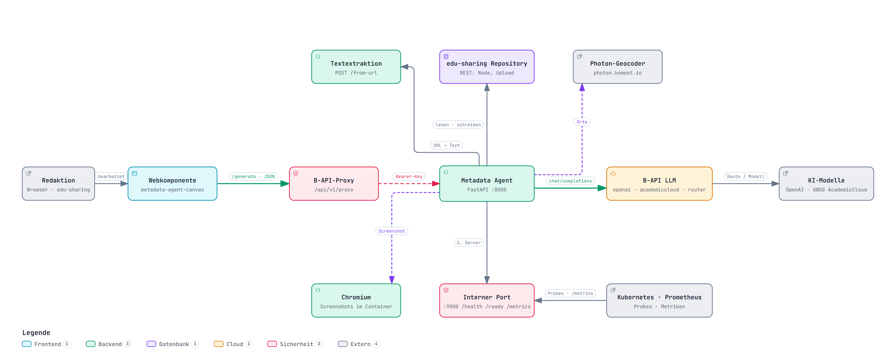
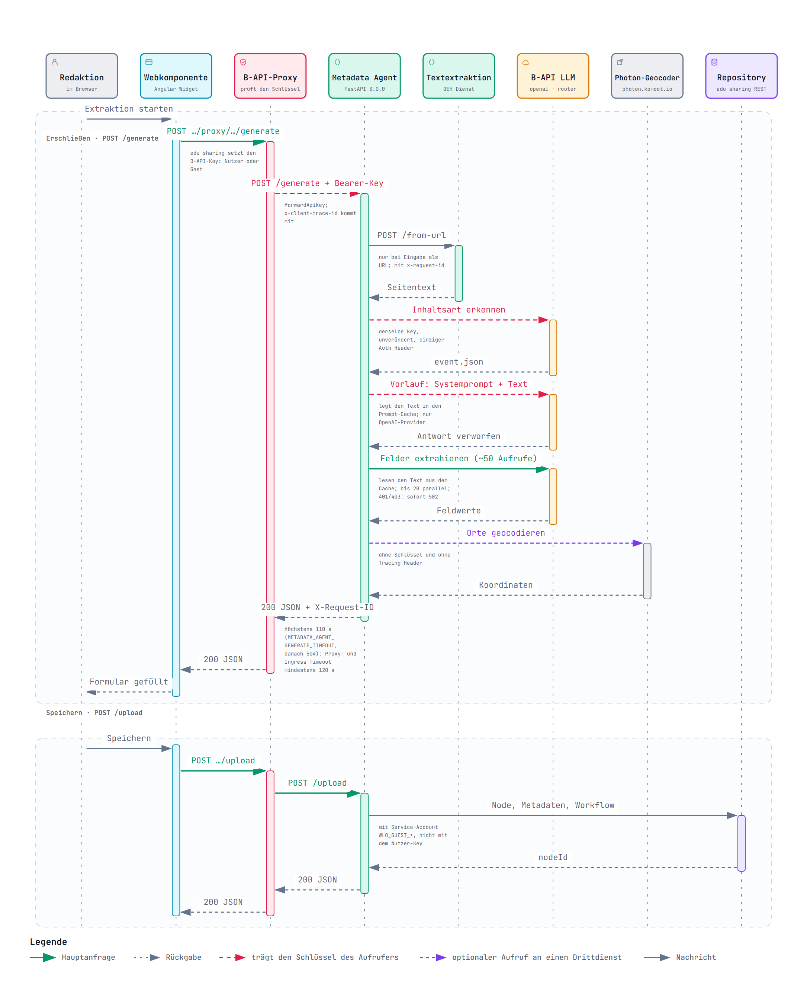

# Steckbrief: Metadata Agent API

Stand 16.10.2026, Version 2.1.0. Status-Werte wie in der Vorlage: **ungeprüft**,
**offen**, **in Arbeit**, **erfüllt**, **nicht anwendbar**. Einzelheiten zu
jedem Punkt stehen in [UEBERGABE.md](../UEBERGABE.md); die Abdeckung der
Anforderungen von Team 6 in [team6-anforderungen.md](team6-anforderungen.md).

| | |
|---|---|
| **Service** | Metadata Agent API – erschließt Bildungsinhalte mit KI (Webkomponente `metadata-agent-canvas` inklusive) |
| **Technischer Owner** | **[eintragen]** |
| **Readiness Status** | **Handlungsbedarf** |
| **Offene Punkte** | 10 |
| **Kritische offene Punkte** | 2 |
| **Jira** | **[Ticket eintragen, z.B. GEN-357 „Planung der Anpassungen für eine saubere Übergabe an die IT“]** |

**Die zwei kritischen Punkte** (ohne sie kann T6 nicht übernehmen):
1. **2.1.0 ist im GitLab-Repo weder committet noch getaggt.** Auf GitHub liegt
   der Stand seit 16.10.2026 (private Repos, siehe Repository-Link); die
   GitLab-CI, die das Image für die eigene Registry baut, braucht aber Commit und
   Git-Tag `v2.1.0` im GitLab-Repo. Dort heißen die letzten Tags `0.0.x`.
2. **Der Weg über den B-API-Proxy ist nicht getestet.** Dafür muss 2.1.0 auf
   Staging laufen und der Dienst in der B-API mit `forwardApiKey` eingetragen
   sein. Prüfablauf: DEPLOYMENT.md, „Nach dem Deployment prüfen“.

## Kurzprofil

| | |
|---|---|
| Zweck | erzeugt aus Text, Webseite oder Repository-Eintrag Metadaten (Titel, Beschreibung, Schlagworte, Bildungsstufe, Inhaltsart …) und schreibt sie ins WLO-Repository |
| Nutzung | Webkomponente in edu-sharing → B-API-Proxy (`forwardApiKey`) → Agent |
| Ports | 8000 öffentlich (API, `/docs`, `/widget/*`); intern optional 9000 (`/health`, `/ready`, `/metrics`) |
| Abhängigkeiten | B-API LLM (OpenAI, AcademicCloud, Router), Textextraktion, edu-sharing Repository (Service-Account), Photon-Geocoder |
| Zustand | zustandslos, keine Datenbank, keine Volumes; ein Worker je Container, skaliert über Replicas |
| Antwortzeit `/generate` | 12–22 s mit `gpt-6-luna`, bis 90 s mit AcademicCloud → Ingress-Timeout mindestens 120 s |
| Kosten je Erschließung | 0,007–0,017 € mit `gpt-6-luna` (Input-Caching aktiv), gebucht auf den Key des Aufrufers |
| Image | `python:3.13-slim`, Multi-Stage, Nutzer `appuser`; Chromium für Screenshots (~400 MB) |

## Architektur

Beide auch interaktiv und als SVG unter [architektur/](architektur/README.md).

## Stammdaten & API

| Punkt | Text oder Link | Status |
|---|---|---|
| Anzeigename und Beschreibung | `Metadata Agent API`; „Erschließt Bildungsinhalte mit KI: Aus einem Text, einer Webseite oder einem Repository-Eintrag erzeugt der Dienst passende Metadaten wie Titel, Beschreibung, Schlagworte, Bildungsstufe und Inhaltsart.“ (`info.summary` der Spec) | erfüllt |
| Repository-Link | GitLab: <https://scm.edu-sharing.com/edu-sharing/projects/wlo/metaservices/metadata-agent>, Webkomponente: <https://scm.edu-sharing.com/edu-sharing/projects/wlo/metaservices/metadata-agent-webcomponent>. GitHub (privat, aktueller Stand 2.1.0, MIT-Lizenz): <https://github.com/janschachtschabel/metadata-agent-10-2026>, <https://github.com/janschachtschabel/metadata-agent-webcomponent-10-2026>. Zugriff für T6 bestätigen | offen |
| OpenAPI Spec | `/openapi.json`, aus dem Code erzeugt (FastAPI); alle 16 Operationen beschrieben; Swagger UI unter `/docs` ohne Dritt-Server | erfüllt |
| Pipeline und Git-Tags | GitLab (`.gitlab-ci.yml`): Branch-Images für `main`/`develop`, Versions-Image je Git-Tag; benötigte CI/CD-Variablen in UEBERGABE §1. GitHub Actions: Tests (1.589 bestanden) und Image-Bau grün, Push nach DockerHub nur mit Secret. **Kritisch:** im GitLab-Repo 2.1.0 noch nicht committet, Tag `v2.1.0` fehlt | offen |
| Endpunkte (öffentliche und Infrastruktur) | Port 8000: API, `/docs`, `/openapi.json`, `/widget/*`. Interner Port (`METADATA_AGENT_INTERNAL_PORT`, z.B. 9000): `/health`, `/ready`, `/metrics`. Nicht in der Spec: `/health`, `/ready`, `/debug/*`; `/debug/*` standardmäßig aus, am Ingress zusätzlich sperren | erfüllt |
| Header | ein: `Authorization: Bearer` (B-API-Proxy, `forwardApiKey`), `x-client-trace-id`/`x-request-id`/`x-b3-*`/`b3`; aus: `X-Request-ID` (UEBERGABE §2) | erfüllt |
| Content-Types | API nur `application/json` (Bilder base64 im JSON). Widget-Dateien: JS, CSS, `woff2`, HTML, JSON – mit Wolli abstimmen | offen |
| Antwortzeiten | `/generate` mit `gpt-6-luna` 12–22 s (gemessen 16.10.2026), mit AcademicCloud bis 90 s → Proxy-/Ingress-Timeout mindestens 120 s; `/extract-field`, `/detect-content-type` wenige Sekunden; Screenshots höchstens 90 s | erfüllt |
| Asynchrone Job-Endpunkte | keine; nötig nur, falls im Proxy keine 120 s möglich sind | offen |

## B-API & Authentifizierung

| Punkt | Text oder Link | Status |
|---|---|---|
| Variante | A: über die B-API geroutet | erfüllt |
| Virtueller Key | wird gebraucht (der Dienst ruft LLMs auf); der weitergereichte Key gilt nur je Anfrage, wird nicht gespeichert oder geloggt (`METADATA_AGENT_B_API_AUTH_MODE`) | erfüllt |
| Berechtigungen des Keys | LLM-Endpunkte der B-API (`openai`, bei Routing `router`); **kein** `LLM_ROUTE_MANAGE` | erfüllt |
| Modell-Routing | Standard `b-api-openai` / `gpt-6-luna`. Optional `b-api-router` mit `provider/modell` oder einer Route, die ein Admin in der B-API anlegt (Muster in ENV-PARAMETER.md). Qwen-Route inhaltlich ausreichend, GWDG-Kontingent (~10 Aufrufe/min) aber zu knapp | erfüllt |
| Eintrag in der B-API mit `forwardApiKey` | Dienst unter `/api/v1/proxy/<dienst>` mit `forwardApiKey` registrieren; danach Konsolentests aus DEPLOYMENT.md. **Kritisch**, siehe oben | offen |
| Ohne B-API: LLM-Zugang per Env | `B_API_KEY` (wie 2.0.x, abwärtskompatibel) oder `OPENAI_API_KEY` mit `METADATA_AGENT_OPENAI_API_BASE` | erfüllt |
| Ohne B-API: Auth für Aufrufer | keine eigene Auth-Schicht; ohne B-API muss ein Proxy den Zugang absichern | nicht anwendbar |

## Monitoring & Logging

| Punkt | Text oder Link | Status |
|---|---|---|
| Prometheus-Endpunkt | `/metrics` nur auf dem internen Port (`prometheus-client`) | erfüllt |
| Applikationsmetriken | `metadata_agent_http_requests_total`/`…_duration_seconds`, `metadata_agent_llm_requests_total`/`…_duration_seconds` (Provider, Ergebnis), `metadata_agent_generations_total` (`success`/`partial`/`failed`) | erfüllt |
| Alarmregeln | vier Regeln als Vorschlag (UEBERGABE §4); in den Helm-Chart übernehmen | in Arbeit |
| Log-Format | stdout; `METADATA_AGENT_LOG_FORMAT=json` mit `trace_id`, sonst Text; `METADATA_AGENT_LOG_LEVEL` | erfüllt |
| Tracing (B3, `x-client-trace-id`) | wird an B-API, Textextraktion und Repository durchgereicht, nie an Fremddienste | erfüllt |

## Build & Image

| Punkt | Text oder Link | Status |
|---|---|---|
| Dockerfile | Multi-Stage, `python:3.13-slim`, Nutzer `appuser`, `.dockerignore`, HEALTHCHECK | erfüllt |
| Image-Größe | nur Laufzeit-Abhängigkeiten; Chromium für Screenshots (~400 MB) macht das Image dennoch groß | erfüllt |
| Daten im Image | nur Schemata (8 MB), Widget (2,5 MB), Swagger UI (1,8 MB); keine Modelle | erfüllt |

## Betrieb

| Punkt | Text oder Link | Status |
|---|---|---|
| Zustand und Skalierung | zustandslos, horizontal skalierbar; ein Worker je Container; GWDG-Limit gilt für alle Pods gemeinsam | erfüllt |
| Architekturübersicht | siehe oben und [architektur/](architektur/README.md) | erfüllt |
| Datenbank | keine (kein SQLite, kein Redis, keine Volumes) | nicht anwendbar |
| Abschaltbare Komponenten | keine; nur der interne Port ist optional | nicht anwendbar |
| Ressourcen-Baseline | Requests 500m / 512Mi, Limits 2 CPU / 2Gi – geschätzt; unter Last messen (`docker stats` während `/generate` mit Screenshot) | offen |
| Große Datenmengen | keine | nicht anwendbar |
| Env-Variablen mit Defaults | [ENV-PARAMETER.md](../ENV-PARAMETER.md), per Test mit dem Code abgeglichen | erfüllt |
| Beispiel-Values-YAML und Secrets | UEBERGABE §6; Secrets: `B_API_KEY`, `OPENAI_API_KEY` (nur ohne B-API), `WLO_GUEST_USERNAME`, `WLO_GUEST_PASSWORD` | erfüllt |
| Dockerfile und docker-compose.yml | im Repo, als Referenz | erfüllt |
| Beispiel-Konfiguration aktuell | `.env.template`, `docker-compose.yml` und Helm-Werte (UEBERGABE §6) am 16.10.2026 gegen den Code geprüft: keine unbekannten oder entfernten Variablen. Compose enthält jetzt auch Auth-Modus, Router und Betriebswerte; die Helm-Werte zeigen Ingress-Annotationen für Timeout und Body-Größe. Einen Helm-Chart baut T6 aus den Beispielwerten | erfüllt |

## Übergabe & Wartung

| Punkt | Text oder Link | Status |
|---|---|---|
| Kosteninformationen | Gemessen 16.10.2026 mit `gpt-6-luna`, je Erschließung: 0,007 € (kurze Seite) bis 0,017 € (lange Seite, 66.000 Zeichen); Input-Caching greift für 66–93 % der Eingabe-Tokens (UEBERGABE §7). Gebucht auf den Key des Aufrufers | erfüllt |
| Abrechnungsweg der B-API | OpenAI verlangt für Datenresidenz-Endpunkte 10 % Aufschlag (Azure EU laut früherer Auswertung 20 %); welchen Weg die B-API nutzt, klären | offen |
| Ansprechperson T4 | **[Name, Kontakt]** | offen |
| Updates (Abhängigkeiten, Patches, Modellwechsel) | **[wer]** stößt an; Modelle wechseln ohne Code-Änderung über Env oder Route | offen |
| Prototyp-Entscheidung | Dienst ist bereits produktiv (2.0.x) | nicht anwendbar |

## Offene Punkte (Kurzliste)

**Kritisch**
1. 2.1.0 im GitLab-Repo committen und als `v2.1.0` taggen (API und Webkomponente), damit die GitLab-CI das Versions-Image baut.
2. Staging-Test über den B-API-Proxy: Dienst mit `forwardApiKey` eintragen, Konsolentests aus DEPLOYMENT.md.

**Offen**
3. Technischer Owner und Ansprechperson T4 eintragen; Jira-Ticket eintragen.
4. Festlegen, wer Updates anstößt (Abhängigkeiten, Patches, Modellwechsel).
5. Repo-Zugriff für T6 bestätigen.
6. Content-Types der Widget-Dateien (JS, CSS, `woff2`, HTML) mit Wolli abstimmen.
7. Entscheiden, ob Async-Jobs nötig sind (nur falls der Proxy keine 120 s erlaubt).
8. RAM und CPU unter Last messen (`docker stats` während `/generate` mit Screenshot).
9. Abrechnungsweg der B-API klären (Aufschlag für Datenresidenz).
10. Alarmregeln aus UEBERGABE §4 in den Helm-Chart übernehmen (in Arbeit).

**Für T6 beim Deployment** (dokumentiert, keine offene Aufgabe von T4)
- Ingress: `proxy-read-timeout` mindestens 120 s und `proxy-body-size` 20 MB (ingress-nginx-Default 1 MB); Beispiel-Annotationen in UEBERGABE §6.
- `/debug/*` am Ingress sperren; den internen Port nicht freigeben.
- Probes auf den internen Port (`/health`, `/ready`), Prometheus auf `/metrics`.
